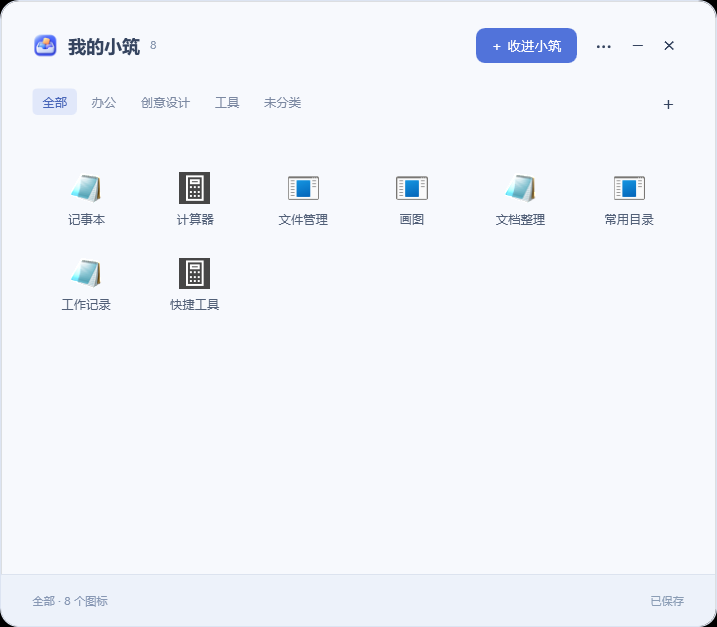

# 桌面小筑 · DesktopNook

一个运行于 Windows 的桌面收纳工具：把自己选择的桌面快捷方式、文件或文件夹收进分类面板，再通过任务栏上的一个入口访问。没有选择收纳的项目继续留在桌面。

**当前源码版本：0.9.1。** 本仓库保存原生 Windows 源码、开发文档及正式发行包，沿用 `desktop-nook-releases` 仓库名称和在线更新地址。

[下载最新正式版](https://github.com/fangmingzhao69-glitch/desktop-nook-releases/releases/latest) · [使用说明](docs/使用说明.md) · [开发与构建](docs/开发与构建.md) · [架构与数据](docs/架构与数据.md) · [反馈问题](https://github.com/fangmingzhao69-glitch/desktop-nook-releases/issues)

## 界面预览



图中使用 0.9.1 的演示数据。顶部切换分类，右上角“收进小筑”添加桌面项目，“···”调整窗口大小或检查更新。

**第一次使用：** [下载安装包](https://github.com/fangmingzhao69-glitch/desktop-nook-releases/releases/latest/download/DesktopNook-Setup.exe) → 安装后固定到任务栏 → 点击“收进小筑”选择项目和分类。

详细图解：[选择收纳项目](docs/使用说明.md#3-选择项目收进小筑) · [按分类查看](docs/使用说明.md#4-按分类查看) · [调整窗口大小](docs/使用说明.md#5-调整窗口大小) · [在线更新](docs/使用说明.md#6-更多操作与在线更新)。

## 下载与运行

支持 Windows 10/11 x64。发行包包含 .NET 桌面运行时，普通用户无需安装 .NET SDK。

| 下载文件 | 用途 |
| --- | --- |
| `DesktopNook-Setup.exe` | 安装版；首次安装或覆盖升级 |
| `DesktopNook-win-x64.exe` | 免安装版；建议放在固定目录后运行 |
| `SHA256SUMS.txt` | 发行文件的 SHA-256 校验值 |

请从 **Releases** 下载安装包。**Code → Download ZIP** 下载的是源码，需要自行构建。

首次打开后，右键任务栏上的“桌面小筑”图标，选择“固定到任务栏”。点击同一个任务栏入口可打开或收起面板。

## 已实现功能

- **手动选择收纳**：拖入桌面项目，或点击“收进小筑”多选。成功后原桌面入口移入托管区；移回桌面可恢复。
- **分类管理**：新建、重命名、删除分类，通过顶部标签筛选；“全部”显示所有收纳项。
- **快捷启动与系统菜单**：单击启动，右键整理、移回桌面或访问 Windows Shell 命令。
- **文件和文件夹**：托管实际内容，收纳期间的修改会随移回操作保留。
- **回收站入口**：支持收纳和移回系统回收站图标，不清空回收站内容。
- **窗口大小**：80%、100%、125%、150% 固定比例；自由拖动、锁定宽高比、尺寸记忆和恢复默认。
- **固定图标大小**：所有窗口比例下，图标和名称保持默认尺寸；窗口宽度改变每行图标数量，图标取图适配屏幕 DPI。
- **启动与关闭偏好**：可选开机自启，以及关闭按钮退出或仅收起到任务栏。
- **在线更新**：启动后后台检查，或从“更多 → 检查在线更新”手动检查；显示当前和目标版本，确认后下载、校验、替换并重启。

## 收纳数据与更新

快捷方式收纳会移动对应 `.lnk` / `.url` 文件，软件安装本体保持原位。普通文件和文件夹收纳则会移动实际内容。请通过“移回桌面”或卸载恢复流程取回内容，不要直接删除数据目录、托管目录或跨卷托管内容。

分类、收纳记录与恢复信息默认保存在 `%LOCALAPPDATA%\DesktopNook`。窗口、自启和关闭偏好由当前 Windows 用户的设置保存。完整备份还需要包含实际托管内容，见[架构与数据](docs/架构与数据.md)。

更新保留分类、收纳内容和设置，通常不需要先卸载。在线下载需要能访问 GitHub，并使用系统网络/代理设置；失败时可继续使用当前版本，或从本地文件更新。

## 源码结构

```text
native/
  DesktopNook.App/      WPF 窗口、Shell 图标/菜单、任务栏定位、更新与原生验证
  DesktopNook.Core/     收纳迁移、配置、恢复清单与文件流保留
  DesktopNook.Tests/    文件系统及故障恢复检查
  scripts/             构建、图标生成、NSIS 安装器、发行脚本
  releases/            版本更新说明
  Directory.Build.props
docs/                   使用、架构与开发文档
```

## 从源码构建

需要 Windows、**.NET 10 SDK** 和 PowerShell 7。构建安装包另需 Unicode NSIS；发布到 GitHub 另需已登录的 GitHub CLI。

```powershell
git clone https://github.com/fangmingzhao69-glitch/desktop-nook-releases.git
cd desktop-nook-releases
pwsh -NoProfile -File native/scripts/Build.ps1
```

脚本生成 ICO、运行核心检查，并输出包含运行时的单文件程序：`native/artifacts/win-x64/DesktopNook.exe`。

只编译开发版本可运行：

```powershell
dotnet build native/DesktopNook.App -c Release
```

完整测试、安装器和发行步骤见[开发与构建](docs/开发与构建.md)。原生 UI 检查会短暂操控鼠标，必须使用专用隔离目录。

## 当前限制与项目状态

- 本地优先，无云端同步或跨设备数据同步。
- 公共桌面或被占用文件受 Windows 权限限制，失败时保留原项目并提示。
- 符号链接、目录联接及未落地的云占位内容暂不作为普通文件夹收纳。
- 图标清晰度受原应用资源限制；已覆盖尺寸/DPI 计算与当前屏幕验证，混合 DPI 多屏的完整组合尚未实机验收。
- GitHub 下载速度受网络影响；公开更新查询无需登录，程序不包含发布账号令牌。
- 当前提交对应 0.9.1 实现。此前发行标签早于源码首次提交，源码请使用本仓库主分支或额外提供的 `DesktopNook-0.9.1-source.zip`；旧标签自动生成的 Source code 压缩包不代表当前源码。

仓库只提交源码、必要的应用图标和文档；构建结果、测试报告、本机分类、文件及恢复备份不纳入 Git。

## 许可证

当前尚未指定源码许可证，仓库中未添加 LICENSE 文件。
