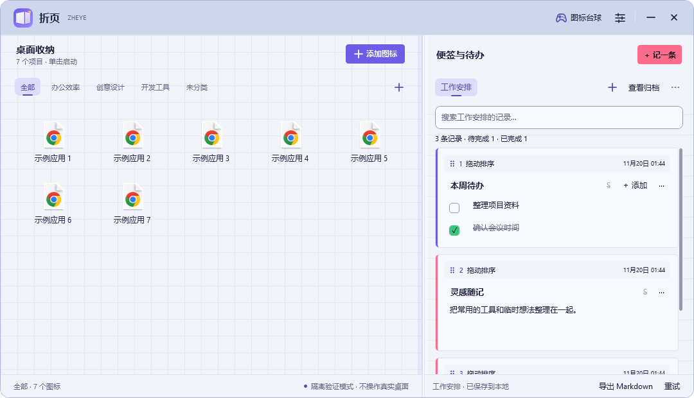

# 折页 / ZHEYE

常用与灵感，折页之间。折页是 Windows 桌面收纳工具。用一个任务栏入口打开收纳面板，左侧整理软件、文件和文件夹，右侧记录便签和待办。

[下载 0.20.1 安装包](https://github.com/fangmingzhao69-glitch/desktop-nook-releases/releases/download/v0.20.1/DesktopNook-Setup.exe) · [最新正式版](https://github.com/fangmingzhao69-glitch/desktop-nook-releases/releases/latest) · [使用说明](docs/使用说明.md)

## 当前功能

| 功能 | 能做什么 |
| --- | --- |
| 桌面收纳 | 批量添加桌面快捷方式、文件和文件夹，也可直接拖入面板。按分类显示，支持拖拽排序、移动分类、右键操作和移回桌面。系统回收站入口可收纳，回收站内容由 Windows 管理。 |
| 便签与待办 | 按分类管理文字和待办，支持搜索、自动保存、重命名和排序。多行文字按原文批量粘贴为多条待办。文字记录和待办均可在标题旁切换所选文字的删除线，完成项自动下移。支持归档、删除和 Markdown 导出。 |
| 面板与任务栏 | 固定到任务栏后单击打开或收起。运行时托盘提供打开、设置和退出入口。支持开机自启、窗口尺寸、左右分栏比例、开合样式、动画开关和关闭行为。顶栏通过设置图标统一打开常规、外观、任务栏外观设置、数据和更新。主题支持浅色、深色及跟随系统。 |
| 任务栏外观 | 支持系统默认、透明、纯色、模糊和亚克力。桌面与六种动态场景可分别配置颜色和细线。可见窗口和最大化场景支持窗口规则。可预览和恢复默认。 |
| 图标台球 | 支持单人练习、本机双人和好友邀请房间。可选中八、斯诺克、九球追分和十五球追分球组，支持球形或原始图标、辅助线、按力度变化的碰撞音效、实录落袋声及成绩记录。 |
| 本地存储和更新 | 收纳内容、便签与设置均保存在本机。支持软件内检查更新、确认后下载安装，以及从本地文件更新。 |

正式版功能以上表为准。图标台球好友联机的验证范围见[联机使用与验收](docs/好友联机使用与验收.md)。

## 下载与安装

支持 Windows x64，需要 .NET 10 Windows Desktop Runtime x64。

| 文件 | 用途 |
| --- | --- |
| `DesktopNook-Setup.exe` | 首次安装或直接覆盖升级。缺少运行时时，安装器会提示补装。 |
| `DesktopNook-win-x64.exe` | 免安装版。请先安装桌面运行时，再放到固定目录运行。 |
| `DesktopNook-v0.20.1-source.zip` | 与本版对应的源码、构建脚本、源依赖和许可证。 |
| `SHA256SUMS.txt` | 所有发行文件的校验值。 |

升级可在折页的「设置 → 关于与更新 → 检查在线更新」操作。完整迁移或备份请复制整个数据目录，可从「设置 → 数据与恢复 → 打开数据目录」进入。

## 任务栏外观

从「设置 → 任务栏外观设置」配置外观。开关和场景集中在上方，下方可调整样式、颜色、不透明度和模糊半径。点击「设为统一外观」可将所选效果用于所有场景。启用「按场景自动切换外观」可在窗口最大化等场景使用单独配置。首次使用 0.17.6 的外观功能时，折页会提示下载并校验约 0.8 MB 的组件，然后在折页自身进程内运行。纯色、透明、取消预览及恢复系统外观已在 Windows 11 26H2 构建 26340.10013 单屏实测。各动态场景的独立实机验证、多屏和实际登录自启仍待覆盖。[0.17.6 发行说明](https://github.com/fangmingzhao69-glitch/desktop-nook-releases/releases/tag/v0.17.6)

## 源码与构建

源码在 `native/`。构建需要 Windows、.NET 10 SDK 和 PowerShell，安装包另外需要 Unicode NSIS 3。开发时用独立 `--sandbox` 数据目录。

[开发与构建](docs/开发与构建.md) · [架构与数据](docs/架构与数据.md) · [项目交接](docs/项目交接.md)

## 许可证

折页单进程合并版按 [GNU GPLv3](LICENSE) 发布。其他第三方代码和素材的版权及许可见 [第三方许可说明](native/ThirdPartyNotices)。
