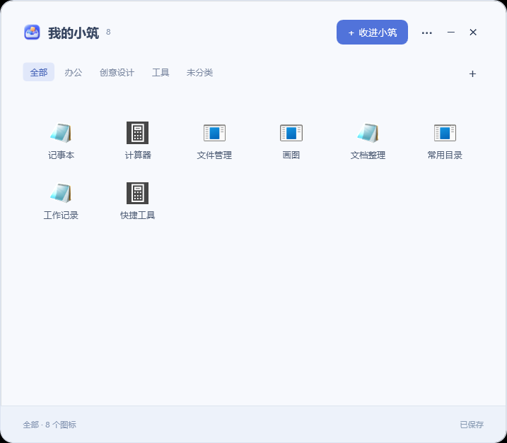
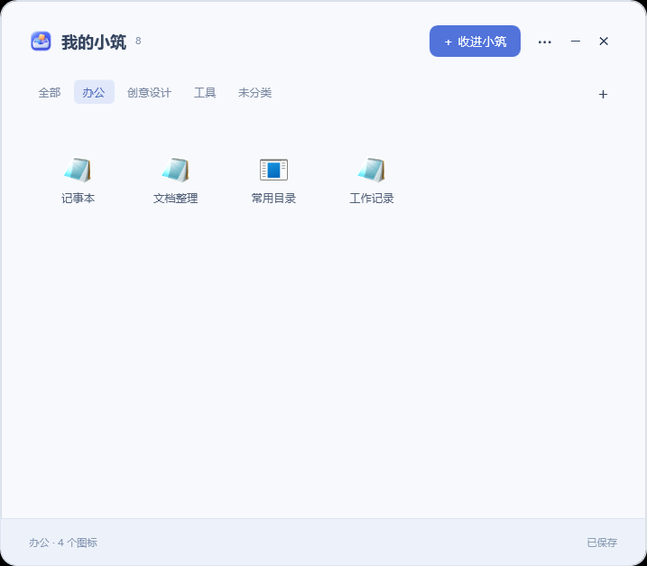
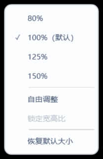
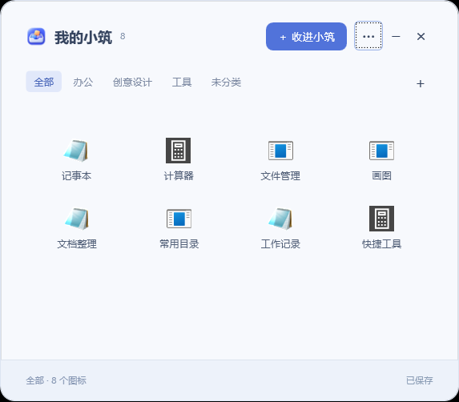
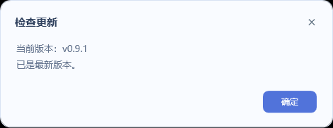

# 使用说明（图文版）

以下截图来自 **桌面小筑 0.9.1** 的隔离演示数据。图中的分类、快捷方式和路径仅用于展示；演示模式会禁用开机自启等系统设置，正式运行时可正常设置。

## 1. 下载、安装与固定入口

1. 打开[最新正式版下载页](https://github.com/fangmingzhao69-glitch/desktop-nook-releases/releases/latest)。
2. 下载 **DesktopNook-Setup.exe**，运行并按提示安装。免安装用户可选择 DesktopNook-win-x64.exe。
3. 打开软件后，右键任务栏上的“桌面小筑”图标，选择“固定到任务栏”。以后点击这个入口即可打开或收起。

普通使用无需下载源代码，也无需额外安装 .NET SDK。**Code → Download ZIP** 是源码下载入口。

## 2. 认识主界面

| 位置 | 怎么用 |
| --- | --- |
| 顶部“全部 / 办公 / 创意设计 / 工具…” | 切换分类；“全部”统一显示所有收纳项目 |
| 分类栏右侧“＋” | 新建分类 |
| 右上角“收进小筑” | 选择要收纳的桌面项目 |
| 右上角“···” | 窗口大小、开机自启、关闭行为、更新等设置 |
| 中间的应用图标 | 单击启动；右键整理或移回桌面 |
| “−”和“×” | 最小化；按关闭偏好收起或结束进程 |
| 底部数量和提示 | 查看当前分类项目数与操作结果 |

再次点击任务栏入口、按 Esc 或点击面板外可收起。需要明确结束程序时，从“···”菜单选择“退出并结束进程”。

## 3. 选择项目收进小筑

点击右上角“收进小筑”，会看到当前桌面上的待收纳项目：

1. 勾选要收纳的项目，可一次选择多个。
2. 在下方“放入分类”中选择目标分类。
3. 点击右下角“收进小筑”完成；点“取消”则不改变桌面。

也可以直接把桌面项目拖到面板或分类标签上。在“全部”下收纳时默认归入“未分类”。**没有选中的项目继续留在桌面。**

软件快捷方式只移动对应 `.lnk` / `.url` 入口，不搬动软件安装本体。普通文件和文件夹则会移动实际内容，收纳期间的修改会在移回时保留。

## 4. 按分类查看

点击分类标签即可筛选。例如选择“办公”后，只显示办公分类中的项目：

- 分类栏右侧“＋”新建分类，分类的右键菜单可进行整理。
- 点击“全部”可重新查看所有收纳项目。
- 单击图标启动；右键可移回桌面或访问 Windows Shell 命令。
- 拖回 Windows 桌面也可恢复。同名目标不会被覆盖，可改名恢复。
- “全部移回桌面”中失败的项目继续保留，供处理占用或冲突后重试。

回收站使用独立的系统入口和可见性设置，移回时还原原设置，不清空回收站内容。

## 5. 调整窗口大小

打开“··· → 窗口大小”：

| 选项 | 效果 |
| --- | --- |
| 80% / 100% / 125% / 150% | 按预设调整窗口宽高，100% 为默认大小 |
| 自由调整 | 拖动四边或四角，独立改变宽和高 |
| 锁定宽高比 | 在自由模式下启用，保持窗口 8:7 形状 |
| 恢复默认大小 | 回到固定 100% 和默认布局 |

**所有模式下，图标和名称大小保持不变。** 窗口变宽增加列数，变窄减少列数；高度决定可见行数，超出时纵向滚动。尺寸会自动记住，重新打开继续使用。

下面是更紧凑的 80% 窗口示例：

需要更大的窗口时可切换 125% 或 150%；[点击查看 150% 窗口原图](images/size-150.png)。图标继续根据屏幕 DPI 请求合适的物理像素。

## 6. 更多操作与在线更新

右上角“···”中集中放置常用设置。更新入口会显示当前版本：

1. 选择“检查在线更新（当前 v版本号）”。
2. 有新版时查看目标版本和更新说明，确认下载。
3. 下载窗口显示当前版本、目标版本和进度，支持取消。
4. 通过大小、SHA-256、产品和版本校验后，程序在原位置更新并重启。

没有新版本时，会直接显示当前版本和“已是最新版本”：

启动后的后台检查只显示发现新版的状态，不自动安装。网络不可用时可重试，或从 Releases 手动下载后选择“从本地文件更新”。

安装版支持覆盖升级，通常不需要先卸载。免安装版建议保持 EXE 的文件名和位置，以维持任务栏和自启入口有效。更新会保留分类、收纳内容与设置。

## 7. 数据、备份与卸载

“··· → 打开数据目录”可查看本机记录，默认路径为 `%LOCALAPPDATA%\DesktopNook`。完整备份需要包含实际托管内容及可能位于原桌面同卷的 `.DesktopNookVault`，见[架构与数据](架构与数据.md)。不要直接删除这些目录。

卸载先尝试恢复已收纳项目；仍有恢复失败的项目时停止卸载并保留程序，请处理冲突或占用后重试。

反馈问题时提供软件版本、Windows 版本、屏幕缩放比例和复现步骤即可；不要公开上传整个数据目录或含个人路径的原始状态文件。
