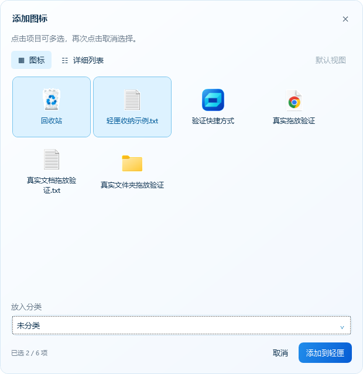
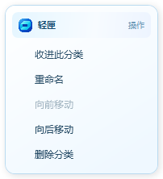
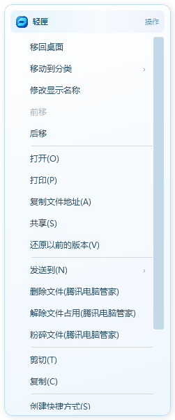
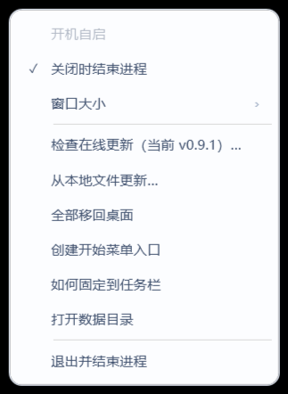

# 使用说明

当前版本：轻匣 0.12.7，Windows x64，需要 .NET 10 桌面运行时。

## 1. 打开与收起

从[正式发行页](https://github.com/fangmingzhao69-glitch/desktop-nook-releases/releases/latest)下载安装包并安装或覆盖升级。缺少运行时时，确认下载必要组件，Windows 管理员授权后自动补装并继续；取消或失败保留原安装。直接运行免安装 EXE 仍需先具备 .NET 10 桌面运行时（x64）。任务栏图标单击打开，再次单击收起；也可用最小化按钮。关闭行为由「··· → 关闭时结束进程」控制。

本文截图使用隔离演示数据。

## 2. 收纳与移回桌面

点击「添加图标」，在图标预览中点击选择桌面项目、选择分类并确认；也可直接将桌面快捷方式、文件或文件夹拖入面板。

点击项目后以蓝色背景和边框高亮，可连续点击多个项目，无需按住 Ctrl；再次点击只取消该项，不影响其他已选项目。键盘空格也可切换当前项目的选择状态。

窗口上方可随时切换「图标」和「详细列表」，多个选择及分类保持。首次默认图标视图；切到喜欢的视图后点「设为默认」，以后打开和更新后继续使用该默认值。只切换视图而不点「设为默认」不会更改下次打开方式。

成功收纳后，桌面原入口不再显示。单击面板图标启动或打开；右键「移回桌面」或拖回桌面，成功后不再显示在收纳区。同名目标不会直接覆盖。回收站只收纳系统入口，不清空内容；公共桌面项目可能受权限限制，失败时保留原内容。

## 3. 分类与排序

顶部标签筛选，「全部」汇总，「＋」新建。右键标签重命名或删除；删除时说明图标接收分类，至少保留一个分类。「未分类」删除后不会自动补回。

分类内直接拖动排序，松手保存；拖到标签移动分类。「全部」按分类顺序汇总。文件和文件夹在收纳期间的编辑会在移回时保留。

## 4. 右键操作

图标右键包含整理操作和当前系统可用的 Shell 命令。超出高度时可滚动，子菜单使用同一风格。

Windows 任务栏系统菜单由系统绘制；轻匣同步图标、名称和应用标识，不替换系统菜单的整体外观。

## 5. 设置与退出

「···」包含开机自启、关闭行为、窗口大小、更新、数据目录及退出。默认六列；窗口变化时调整列数，保持图标尺寸和清晰度。用「退出并结束进程」彻底结束程序。

## 6. 更新与数据

「··· → 检查在线更新」发现新版后，确认下载、校验并原位替换。无需先卸载，沿用分类、收纳内容和设置；也可「从本地文件更新」或正式包覆盖升级。

当前版本等于最新正式版时不显示新版提示；GitHub API 限流/网络异常可能暂时取不到新版，可稍后重试或从发行页获取正式文件。

完整备份需覆盖数据目录内的清单及托管内容，还要考虑原桌面同卷隐藏的 `.DesktopNookVault`。不要自行删除它们，参见[架构与数据](架构与数据.md)。
