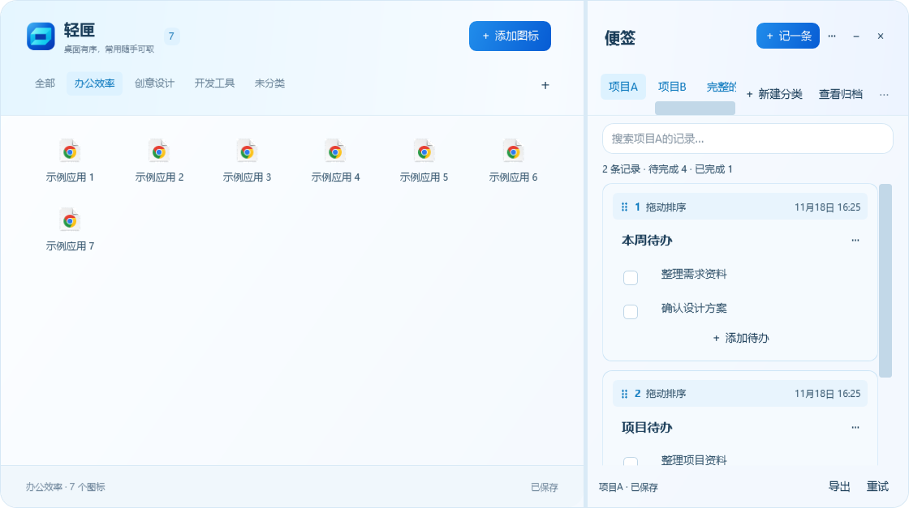

# 轻匣使用说明

适用于轻匣正式版 **0.17.1**。支持 Windows x64，需要 .NET 10 Windows Desktop Runtime x64。[下载正式版](https://github.com/fangmingzhao69-glitch/desktop-nook-releases/releases/latest)

## 打开与收起

安装后可将轻匣固定在 Windows 任务栏。单击该图标打开面板，再次单击收起。也可用面板的最小化按钮。「更多 → 关闭时结束进程」决定关闭按钮是收起面板还是退出。开机自启、窗口大小和动画效果也在「更多」中设置。拖动左右面板间的分隔线可改变宽度，松手后保存。

## 收纳软件、文件和文件夹

1. 点左侧「添加图标」，选择一个或多个桌面项目、指定分类并确认。也可以把桌面项目直接拖入面板。
2. 单击收纳区中的图标可启动软件或打开文件。拖到分类标签可移动分类，在同一分类内拖动可调整顺序。
3. 右键「移回桌面」或直接拖回桌面可还原。目标重名时，轻匣会保留已有文件。回收站收纳的是系统入口，回收站内容仍由 Windows 管理。

顶部「全部」汇总收纳内容。「＋」创建分类，分类标签的右键菜单可重命名、移动和删除。添加窗口支持图标和详细列表两种视图，多选时直接点选所需项目即可。

## 便签、待办与归档

1. 在右侧「新建分类」，点击「记一条」创建待办清单。点击便签标题即可改名，内容自动保存。
2. 用便签右上角「⋯ → 便签类型」在待办清单和多行文字记录之间切换。待办可逐条输入和勾选，文字记录可连续输入多行。
3. 按住分类标签左右拖动可调整分类顺序。按住便签顶部「拖动排序」栏上下移动，松手保存。列表较长时可拖到边缘滚动。
4. 用「查看归档」查看按原分类分组的内容。可单独归档一条便签，也可归档并恢复整个分类。删除便签、细项或分类会直接移除相应内容。
5. 单条便签可从卡片菜单导出，整个分类可从分类菜单导出，右侧底部「导出」可导出全部。文件格式为 UTF-8 Markdown（`.md`）。

## 图标台球

从「更多 → 桌面玩法 → 图标台球」打开。支持单人练习、本机双人和好友邀请，可选中八、斯诺克、九球追分、十五球追分球组。按住左键蓄力，松开击球，空格暂停。好友模式支持邀请和同网房间发现，当前验证覆盖本机双端。

[图标台球使用说明](图标台球使用说明.md) · [好友联机使用与验收](好友联机使用与验收.md)

## 更新与备份

在「更多 → 检查在线更新」中确认后下载新版，也可用「从本地文件更新」或正式安装包覆盖升级。缺少运行时时，安装器会提示补装。免安装 EXE 需提前具备运行时。

请从「更多 → 打开数据目录」定位当前数据。完整备份应包含整个数据目录，其中收纳内容、分类、排序、设置和便签分别保存。[架构与数据](架构与数据.md)

## 任务栏外观

从「更多 → 任务栏外观」打开设置。勾选启用后可选择系统默认、透明、纯色、模糊或亚克力，调整颜色和不透明度。模糊半径适用于现代任务栏。首次使用时，轻匣会提示下载并校验组件，Windows 构建 26340 也可从 0.17.0 发行页下载兼容组件 ZIP 后手动导入。

在「适用场景」选择桌面、有可见窗口、窗口最大化、开始菜单、搜索、任务视图或节能模式。非桌面场景可勾选启用单独外观。「预览」临时显示当前选中场景的样式，12 秒后自动还原。「应用」一次保存全部场景。「细线与窗口规则」包含顶部细线、旧式任务栏的 Aero Peek、窗口规则和忽略窗口。点击「恢复系统外观」可以停用效果，已保存的场景配置留待再次启用。

若已有 TranslucentTB 独立版正在运行，可先导入它的设置文件，再从系统托盘退出独立版。「退出并结束进程」会停止轻匣管理的外观组件，普通收起面板会继续应用已经启用的外观。

若正在使用 0.17.0 预览沙箱版，请从发行页手动安装正式版。旧预览版的数字版本与正式版相同，可能不会提示在线更新。[0.17.0 发行页](https://github.com/fangmingzhao69-glitch/desktop-nook-releases/releases/tag/v0.17.0)
