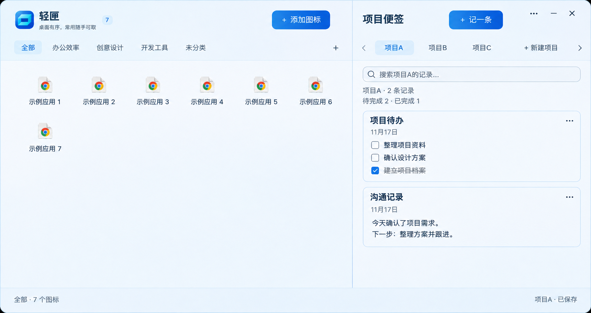

# 轻匣便签模块设计方案 · 右侧项目便签

日期：2026-11-17。状态：首版源码已实现，隔离验收见《项目便签实现与验收》；0.16.0 已正式发布，未主动覆盖本机安装。用户最新要求：便签按项目分类记录，整体 UI 与当前轻匣保持一致，附图仅参考功能。此版以「项目 → 项目内记录」替代此前「工作、生活、随记」的通用分组，以及页面切换、悬浮窗口与卡通主题方案。

## 1. 总体布局

**现有图标收纳在左，便签直接加在右边，左右同时显示，共用一个窗口。**

下图为 AI 生成的设计预览，应用和便签内容均为演示数据；实际实现及 WPF 截图见[实现与验收](项目便签实现与验收.md)。左侧品牌和图标资产实施时继续使用项目原始资源，不能从效果图裁切替换。首版不制作独立悬浮便签。

- 整体沿用轻匣蓝青配色、圆角外框和顶部标题栏，一个任务栏入口，一套最小化/关闭按钮。
- 向右扩展窗口，建议初始尺寸约 1120×627 逻辑像素：左侧尽量保留原约 717 像素的收纳空间，右侧约 400 像素。具体宽度根据屏幕工作区调整，效果图比例为视觉参考。
- 左侧保留软件分类、六列图标、添加图标、拖拽和右键操作，不把现有图标改成左侧纵向列表。
- 右侧使用与左侧相同的浅色面板、深蓝文字和细边框，与左侧之间仅用细分隔线。分隔线可拖动调整宽度，设置保留；左右内容分别滚动。
- 窗口整体展开、收起、移动、缩放及退出。点击便签、搜索、菜单或输入时，不触发主面板失焦收起。
- 收纳分类与便签项目分别切换、分别记忆。切换左侧软件分类不清空或切换右侧正在写的内容；便签项目不自动创建同名收纳分类，也不移动软件图标。

## 2. 保持轻匣现有视觉

参考图只用于提取分类、搜索、新建、文字记录、待办勾选及完成计数功能，分类单位按用户要求改为项目。视觉以当前轻匣界面、App.xaml 资源和界面与交互规范为准。

项目采用与左侧分类一致的横向标签，同一高度对齐，示例为「项目A、项目B、项目C、＋ 新建项目」。选中态沿用浅蓝背景和蓝色文字，不为项目分别设置彩色主题。项目较多时水平滚动，长名称省略并提供完整名称提示；新建项目入口保持可访问。右侧「＋ 记一条」复用当前主按钮样式，搜索、勾选、菜单、焦点与禁用状态复用现有控件资源。新装不预建演示项目，空态引导「先新建一个项目，再开始记录」，未选项目时「记一条」禁用；效果图项目名不写回用户数据。

不引入卡通角色、云朵、花朵、贴纸、插画开关和独立皮肤。便签正文采用原生 WPF 文本，卡片为现有浅色面板加细边框，留白和字号与当前轻匣一致。实施时直接复用原始品牌资源，不能从 AI 效果图裁切界面、文字或图标。

## 3. 右侧内容与操作

从上到下依次为：

1. 与左侧同高的标题区，显示「项目便签」与「＋ 记一条」，右上角为整窗共用的更多/最小化/关闭按钮。
2. 横向项目标签及「＋ 新建项目」入口，与左侧收纳分类对齐。
3. 搜索框，显示「搜索项目A的记录…」，仅搜索当前项目的标题、文字和待办内容，不混入其他项目或回收站。搜索时显示匹配条数，待办统计仍为整个项目，明确标注「项目待办」，避免与筛选结果混淆；首版不设跨项目「全部」页。
4. 当前项目名、记录总数及待完成/已完成数量。记录数按卡片统计，待办数量按清单中的有效条目统计，普通文本不计入任务数量；没有待办项时不显示完成计数。
5. 当前项目的记录卡片流。卡片显示标题、日期、正文或待办项，点击内容直接编辑。卡片较多时仅此区域滚动，顶部工具栏保留。常用卡片在项目内优先排列，其余默认按创建顺序排列，编辑时不跳位。
6. 底部共享状态栏。左端显示图标数量，右端显示「项目A · 已保存」等保存状态，沿用现有浅色背景与细分隔线。

「＋ 新建项目」只创建分类容器，输入项目名称后选中该项目，显示空态「这个项目还没有记录，点击『记一条』开始」。项目名去除首尾空白且不能为空；活动项目内重名时提示使用其他名称，不按名字合并数据。项目标签菜单支持重命名、调整顺序、归档和删除。归档在提交保存后隐藏项目，记录保留，通过「项目管理 → 已归档」可查看、恢复或导出；归档项目只读，恢复后继续编辑。删除归档项目遵循同样的删除确认规则。

「＋ 记一条」在当前活动项目内提供「文字记录 / 待办清单」两种类型，创建时固定归属该项目。搜索非空时新建记录先清除筛选，保证新卡片可见。文字记录适合需求、沟通、会议、问题与进展，每个项目可记多条，不强制套模板。待办清单每行一个复选框和文字，勾选后变灰并划线，同时更新计数。按 Enter 新增一项，空项退格合并/删除；具体键盘行为实施时验证中文输入法组字，组字确认不得误触新增。首版不混排复杂富文本，不加入 Markdown、附件、提醒和云同步。

卡片更多菜单提供重命名、设为常用、移动到其他项目、导出和移到回收站；移动前提交保存，失败时保留原归属。卡片不设置容易误点的关闭按钮。删除移入便签自己的回收站，保留原项目 ID，支持恢复，永久删除二次确认，不自动清空。删除项目时显示记录数量，并让用户选择把记录移到其他活动项目或随项目一并移入回收站，不能静默丢失内容。整项目删除后支持连同原名称和记录一起恢复；单条恢复遇到原项目已删除时，先选择恢复该项目或改放其他活动项目。恢复后的项目重名时提示改名，不与现有项目合并。

典型流程：新建「客户系统改造」项目 → 记一条「需求沟通」文字记录 → 再记一条「本周待办」清单 → 切到「内部工具」项目记录另一组事项 → 返回前一项目继续编辑。各项目的正文、待办、搜索、滚动位置与当前编辑卡片分别保留。

## 4. 一个整体的行为边界

| 场景 | 行为 |
| --- | --- |
| 点击任务栏轻匣按钮 | 同时展开或收起图标与便签 |
| 点击软件图标 | 保留当前启动及主面板收起逻辑，先提交便签待保存内容 |
| 点击便签输入框 | 焦点进入正文，不触发软件图标的拖动或主面板关闭 |
| 切换左侧收纳分类 | 仅更新左侧，右侧便签持续显示 |
| 切换右侧便签项目 | 先确认输入法组字并提交当前编辑；保存失败时停留原项目并允许重试或导出，成功后只更新右侧 |
| 拖文件到窗口 | 左侧继续接收收纳拖放，右侧明确显示不接收文件；不把附件或文件名意外收纳/插入 |
| 点击窗口外 | 若有输入法组字或保存失败，先妥善结束/提示；正常保存后按原主面板规则收起 |
| 最小化/退出/更新 | 对整个窗口执行，先排空便签保存队列；失败提示处理 |
| 再次打开 | 恢复上次活动项目、项目内当前编辑卡片、搜索、滚动位置和分栏比例，不复位正文；原项目已归档或删除时回到活动项目或新建项目空态 |
| 开机自启 | 保持原后台最小化逻辑，不单独弹出便签 |

本方案的「整体」指窗口、生命周期与使用体验整合，数据层仍需隔离，以便便签保存失败不影响软件收纳索引。任务栏继续保留 DesktopNook.DesktopNook，不能为加入便签重写固定快捷方式。

## 5. 尺寸与可读性

优先扩大整体窗口宽度，不在原 717 像素宽度内硬塞两块内容。以当前显示器工作区限制最大尺寸；屏幕较窄时先减少左侧图标列数，再收紧右侧边距。左右正文保持正常字号，不通过缩小整张界面位图塞入内容。

便签区域建议最小约 300 像素，左侧至少保留可用的三列图标；自由缩放最小宽度与缩放锁定需要据此重新校验。项目过多时横向滚动，不能把分类标签越挤越小。混合 DPI、显示器移除与任务栏附近定位均须验证，窗口不能越过工作区。

## 6. 数据保存与恢复

便签保存在当前 Data/Notes；本机为 E:\yingyon\DesktopNook\Data\Notes。独立记录 ID 与项目 ID 不复用收纳分类 ID；每条记录只属于一个项目，以稳定 projectId 关联，不以可变名称关联。重命名项目不改变记录归属，不向 state.json 或 item-order.json 写正文。

设计初稿建议每条记录一个 JSON 文件及有效备份；首版实现选择有修订号的整库原子快照（notes.json 与 .bak），使项目移动、删除及恢复一次发布完成。逻辑记录，包含格式版本、ID、projectId、类型、标题、文本或待办项、创建/修改时间、常用标记、删除时间与删除批次。项目元数据保存稳定 ID、名称、显示顺序、创建/修改时间、归档和删除状态，不设置独立颜色主题。分栏比例及各项目的滚动、搜索和选择属于界面偏好，不更改正文修改时间。跨项目移动、项目删除和恢复操作使用整库原子替换事务，避免部分写入造成记录失去归属；恢复时先核验项目与记录的关联。

停止输入约 500 ms 自动保存，持续输入最长约 2 秒提交一次。采用统一队列、修订号、临时文件刷盘后发布，旧任务不得覆盖新内容。切换卡片、项目、收起、退出和升级前提交最后输入，输入法组字期间不重建编辑控件。

状态显示保存中/已保存/保存失败；保存失败保留内存草稿，允许重试或导出。损坏单条优先读有效备份并提示，保留坏文件，不覆盖成空内容。断电或强制终止可能丢失尚未落盘的最近输入，不承诺零丢失。

更新备份、安装目录迁移和卸载保留规则必须纳入 Notes；不解除现有文件保护，不将便签正文写日志。所有回归使用独立 sandbox 和演示数据，不拿真实收纳内容验证删除或迁移。

## 7. 实现与验收

实施分为：项目/记录数据层 → 主窗口左右分栏 → 项目切换与文字/待办卡片 → 项目内搜索/常用/归档/回收站 → 更新迁移与动效回归。继续采用当前 WPF 单进程与共享运行时，避免引入 WebView 或额外常驻进程；隐藏后释放可重建列表与搜索结果，保留待保存数据。

原主面板目前有 Viewbox 与固定内容尺寸，需要先调整布局及 WindowSizing、TaskbarPlacement 的尺寸协作，不能仅在原 Viewbox 内增加一列后让全窗口等比缩小。百叶动画沿用一个完整表面，扩宽后仍遵守截图预算；编辑时使快照失效，播放前提交输入，防止旧正文残影。

验收重点：左右同时可用、项目创建/重名/改名/顺序/归档恢复、项目间记录隔离与移动、切换后编辑位置恢复、项目内搜索与待办计数、新建记录可见、空项目与长项目名、中文输入与清单回车、软件拖拽范围、切分类保留便签、保存失败阻止项目切换、异常恢复与项目删除/恢复完整性、窗口整体收起、百叶动效及闲置释放、窄屏/高 DPI、升级保留正文，以及任务栏固定不回归。性能以相同数据量和操作顺序对照测量，不预先承诺固定内存增量。

## 8. 效果图生成记录

当前有效效果图：images/便签右侧一体式效果图-v4.png。工具：内置 imagegen。编辑目标为 v3 效果图，视觉参考为项目 docs/images/overview.png（现有轻匣）；用户附图仅参考便签功能。未使用 API/CLI。此前 v2、v3 仅作历史设计稿，不作为本版功能组织依据。

核心生成提示：保留 v3 左侧收纳与轻匣现有 UI，右侧改为「项目便签」；项目A/项目B/项目C 横向切换，独立「新建项目」与「记一条」入口；项目内搜索、文字记录、待办及保存状态；禁止卡通、插画和彩色主题。完整提示词见 images/便签效果图-v4-提示词.txt。已目视核验项目入口、两张卡片、两项待办/一项完成、左侧七个图标及计数；效果图不是程序截图或功能验收结果。

验收视觉时以实际应用资源为准。效果图只展示布局意图，实际实施应对比现有 UI 的字号、按钮高度、间距、颜色和窗口控制位置，避免将预览图的生成误差带入程序。
