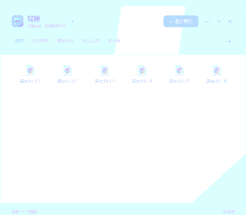
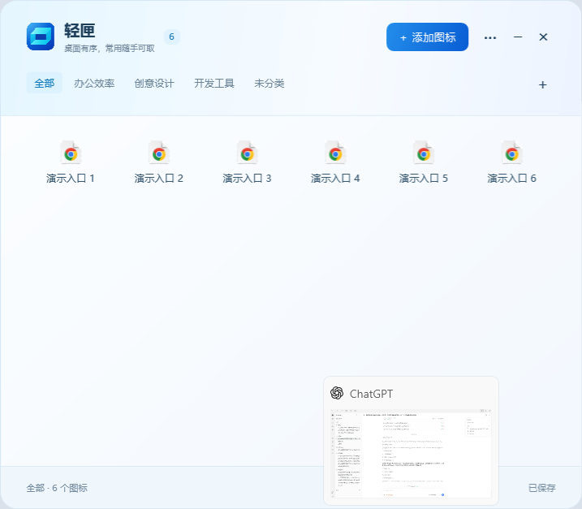

# 轻匣动画实施方案

版本目标：0.12.10（根据 0.12.9 可见性反馈修订）。实施范围为本方案的一期完整内容；二期为后续候选，不列入本次交付。

## 1. 目标与原则

保持蓝青配色、原生 DPI 文字与轻量运行时发布。动画用于表达出现、悬停、按下、选中和内容切换，保持即时输入反馈。业务状态立即提交，动画不能决定分类、排序或收纳结果。

入场采用短时 EaseOut，颜色和微光采用短时线性过渡，不使用弹跳、整屏模糊、图片序列、视频或循环装饰。界面静止时不保留动画计时器。所有动画可中断，关闭、最小化、卸载控件和进入拖拽时归位。

## 2. 一期效果清单

| 场景 | 效果 | 时长 | 边界 |
| --- | --- | --- | --- |
| 主面板首次打开/任务栏恢复 | 内容淡入与 18 逻辑像素上移 | 320 ms | 不动画窗口几何尺寸；定位修正前结束过渡 |
| 收起、失焦、退出、更新维护 | 即时收起/退出，关闭本窗口 DWM 过渡以避免叠加 | 即时 | 取消所有旧入场动画，不追加延迟收起回调 |
| 添加、编辑、确认、更新弹窗 | 内容淡入与 10 逻辑像素上移 | 220 ms | 窗口尺寸保持；添加窗口 88% Owner 边界继续生效 |
| 普通按钮/图标悬停及按下 | 背景颜色过渡 | 140 ms | 不移动点击区域，不缩放文字 |
| 主按钮 | 白色微光透明度变化 | 140 ms | 保留原蓝青渐变，不使用发光阴影 |
| 多选图标/详细列表 | 高亮背景平滑改变 | 160 ms | 选择状态、边框和数量立即更新；不显示勾选框 |
| 分类、图标/列表切换 | 新内容整体轻淡入 | 180 ms | 不保存旧界面截图，不为每个图标排队播放 |
| 应用内菜单打开 | 短淡入 | 160 ms | 不动画菜单文字大小，关闭立即结束 |

二期候选：排序落位移动、图标错峰入场、更复杂的收起路径。本次不实施，避免干扰已稳定的拖拽坐标、排序持久化与任务栏行为。

## 3. 设置与可访问性

“更多 → 动画效果”提供“跟随系统（默认）/开启/关闭”。默认读取 Windows 客户区动画设置；显式关闭后全部直接切换到最终状态。修改设置立即生效，保存到现有 preferences.json，关闭行为、窗口尺寸、添加默认视图与动画设置互相保留。未配置时不新增偏好字段，保持旧配置兼容。

键盘焦点框立即显示，空格多选及 Esc 取消不等待动画。禁用状态保留原样式。系统动画设置改变时重新判断并结束正在运行的过渡。

## 4. 技术实现

新增 UiMotion 统一管理入场及反馈。使用 WPF 动画时钟、Opacity、SolidColorBrush.Color 与 TranslateTransform；不新增第三方包。位置微调使用 RenderTransform，不修改 Width/Height/Margin，不改变布局和 DPI 文本尺寸。

动画以目标对象和属性为键，新的动画替换旧动画并从当前值继续。结束、取消或控件卸载时清除时钟；反馈状态用弱键关联，静止时活动时钟数为零，不通过全局强引用保存已关闭窗口。

主面板保持现有 WindowState 语义：最小化时同步取消入场；恢复时启动新的揭示；旧动画回调只归位视觉属性，不写 WindowState。任务栏定位仍由原逻辑管理，Win32 定位实际改变窗口位置前结束入场；相同位置的重复定位不取消揭示，避免位移叠加。

开始点击或键盘操作时结束相关祖先入场；拖拽开始和拖入命中计算前，结束面板/图标区域的过渡。分类与视图先完成现有状态变更，再执行单一内容区域淡入。排序、收纳、恢复和更新逻辑不以动画完成作为成功条件。

参考：
- https://learn.microsoft.com/en-us/dotnet/desktop/wpf/graphics-multimedia/transforms-overview
- https://learn.microsoft.com/en-us/dotnet/api/system.windows.systemparameters.clientareaanimation?view=windowsdesktop-10.0

## 5. 验证与验收

1. 开启、关闭和跟随系统三种模式正确，偏好跨其他设置写入与升级保留。
2. 入场中重复打开/收起，不产生延迟最小化、透明窗口或残留位移；最终状态服从最后一次操作。
3. 多选、单项取消、默认视图、分类切换即时正确；颜色在时限后归位。
4. 拖入、拖出、排序、Esc 取消、菜单、更新提示、窗口尺寸完整回归；顺序与真实内容不因动画改变。
5. 正常结束、显式停止、关闭弹窗和关闭动画开关后，活动时钟归零。100 次往返压力检查无时钟累积。
6. 比较相同数据和流程的动画开启/关闭采样：记录工作集、专用提交、CPU 与操作耗时。目标为空闲 CPU 不增加、无持续内存增长；短时峰值据实记录，不承诺零额外内存。
7. 验证完成后提交推送源码，从该提交构建正式包，草稿上传并核对哈希后公开，再同盘备份升级本机并核对即时元数据与排序。

## 6. 实施与实测结果

一期已实现。完整原生检查 57 项通过，其中动画专项 17 项；真实拖动检查 12 项通过。升级验证保留动画关闭设置、添加默认视图、关闭偏好和三个分类的自定义排序。开启/关闭各 100 次的动画替换与取消后活动时钟为 0，两种模式的 500 ms 空闲 CPU 采样均为 0；未强制 GC。

最终阶段构建（807,029 字节），使用相同 56 项隔离数据、两个独立进程，在 WaitForInputIdle 后 5/10/15 秒采样，最后一条如下：

| 模式 | 工作集 MiB | 专用提交 MiB |
| --- | ---: | ---: |
| 开启 | 205.55 | 140.87 |
| 关闭 | 206.06 | 128.09 |

本轮专用提交差约 12.78 MiB，工作集相近。早期阶段采样的差值约 3 MiB，最终按本表披露，不当作固定开销。进程采样受到 Shell、显卡驱动缓存和自然 GC 影响，短测不能证明所有机器都具有同样开销或长期内存完全不增长。100 轮混合界面压力阶段包含窗口切换和资源释放，其前后内存值不用于估算动画净占用；循环耗时也受计时精度影响，不等同于打开速度。

未使用截图缓存、循环动画、常驻帧回调或第三方动效库。主程序仍小于 1 MiB。资源紧张时可直接关闭动画；默认跟随 Windows，普通功能和排序保持即时执行。详细证据见验证结果中的动画检查、动画压力采样、动画进程对比和轻量版升级检查。
## 7. 0.12.10 可见性修正与屏幕验收

用户反馈开启后几乎看不出效果。实际路径探针启用正常任务栏定位（不使用会绕过 Place 的 KeepOpenForVerification），三次恢复均记录到 0.12.9 过渡在播放，本次没有复现定位提前取消。因此不将问题归咎于开关失效，也不宣称已确认 Windows 遮盖了旧动画；确认的问题是旧参数过轻（主面板 45% 起始不透明度、6 像素、180 ms），旧验收只证明时钟及状态正确，不能证明观感足够明显。

0.12.10 主面板改为透明到完整显示、18 逻辑像素、320 ms；弹窗 10/220，视图切换 180，菜单 160，多选 160，按钮 140 ms。为防止系统窗口过渡和内容过渡叠加，仅对本软件窗口设置 DWMWA_TRANSITIONS_FORCEDISABLED，不修改 Windows 全局动画设置；动画关闭仍直接显示最终状态。

新增 --motion-visibility-self-test，仅在 --sandbox 下执行。测试不绕过真实定位路径，显示中性测试背景遮住其他桌面内容，用 BitBlt 采实际屏幕帧，记录透明度、位移、时钟、状态和停止调用栈；三次开启循环各至少采到三张中间状态，关闭循环必须完全不透明且位移为零。屏幕帧可用 Make-MotionPreview.cjs（Node 内置模块，无应用依赖）编码成 APNG/GIF。预览是隔离演示，GIF 循环仅供查看效果，软件本身不循环播放装饰动画。

## 8. 0.12.11 用户选定的百叶方案

主面板展开、收起均使用五段横向百叶翻转，时长各 500 ms；展开下到上、收起上到下。每段 360 ms、段间 35 ms；翻转同时交替横移 20 逻辑像素并变化透明度。连续切换从当前画面反向，避免闪回起点；中途反向的剩余过程重新使用 500 ms。窗口收起完成才最小化，因此收起阶段能够实际显示。

实现使用 WPF 自带 3D 平面和一份共享的临时截图，不添加库。截图原始像素预算约 8 MiB，默认窗口实测 1,798,236 字节；预算不包含 WPF/GPU 副本。结束、取消、关闭动画和外部强制最小化均清理引用。没有空闲动画计时器或持续帧回调。

最终隔离回归为核心 44 项、完整界面 65 项（动画 25 项）、真实拖动 12 项通过。升级检查保留三个分类的自定义排序、关闭偏好、默认添加视图和动画关闭设置。100 次收起、反向、取消后活动时钟和截图引用为零，开启/关闭的 500 ms 空闲 CPU 采样均为 0；未强制 GC。压力流程同时含窗口状态切换，不将进程提交量差值当作动画净开销或长期内存保证。

真实屏幕采集同时记录打开和收起的中间角度及资源释放；见验证结果/百叶动画可见性检查.json。图示为测试数据的屏幕帧，采集本身有耗时，不用于测量帧率。

