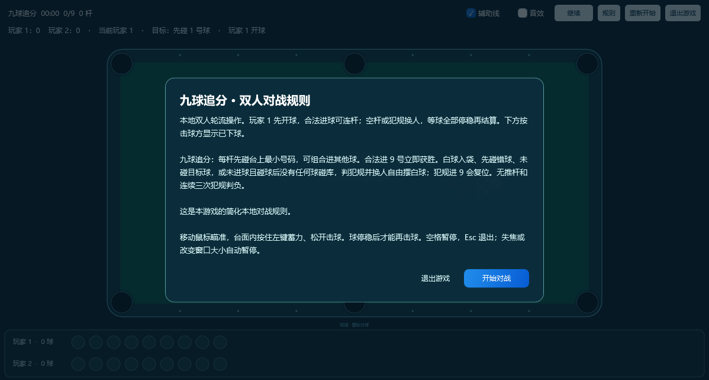
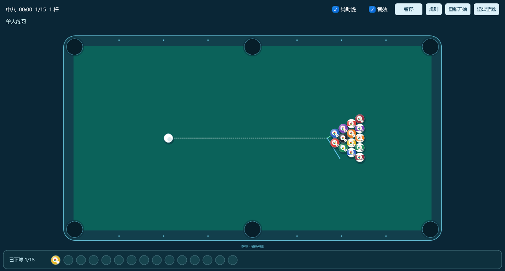
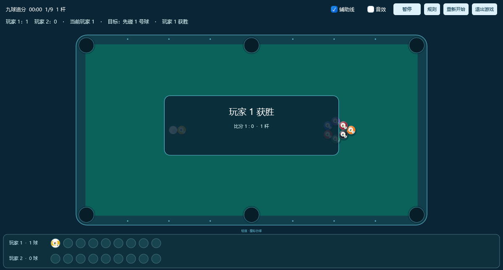

# 球盘、音效与双人模式（0.14.0）

新增球盘、开局规则、力度音效和同机双人，窗口默认改为屏幕约 40% 面积。入口仍为「更多 → 桌面玩法 → 图标台球」，在设置窗选择单人练习或本地双人对战。

## 窗口与操作

初始宽、高均乘 √0.4（约 63.25%），面积约为屏幕的 40%，中心保持一致；不把宽高均设为 40% 而得到 16% 面积。保留正常拖动、缩放、失焦暂停和按需临时进程。

开局说明覆盖游戏画面，点击蓝色开始按钮后才能击球。说明期间暂停且不计时；提供退出按钮，键盘 Tab 在说明卡内循环。「规则」可以随时重新打开，返回时按此前状态恢复。

底部球盘按进球顺序显示目标球，保留圆形图标；白球不进球盘。双人球盘按实际击球方分两排，显示双方入袋记录。复位球移出球盘，避免同一颗球重复展示；球盘不等同于计分表，犯规进袋仍可能按本局规则留在盘中。

## 双人规则

双人指同一台电脑轮流操作，玩家 1 开球，无网络或 AI 对手。球停稳后结算，合法得分可连杆，空杆或犯规换人。游戏启动时完整显示对应规则及简化范围。

| 球组 | 本游戏的双人处理 |
| --- | --- |
| 中八 | 首个合法进球分配全色 / 花色；先清自己组，再击打黑 8。提前进 8 或进 8 同时犯规判负，开球同样处理。先碰错组、无接触、白球入袋、无进球且接触后未碰库为犯规，对方自由摆白球。无指定袋及开球特殊重摆。分数栏为各自组已入袋数量。 |
| 九球追分 | 必须先碰台上最小号，可组合进球；合法进 9 获胜，犯规进 9 安全复位。无接触、先碰错球、白球入袋、无进球且接触后未碰库为犯规，对方自由摆白球。无推杆和连续三次犯规判负；分数栏统计合法入袋数量。 |
| 十五球追分 | 必须先碰最小号，合法进球按球号得分，先达 61 分获胜。犯规本杆目标球复位，不计分，对方自由摆白球。清台同分为平局。 |
| 斯诺克 | 红彩交替，红 1 分、彩 2～7 分；交替阶段彩球复位，最后一红后再打一彩，再按黄到黑清彩。错球、无接触、白球入袋或进错球给对方 4～7 分并换人，误进彩球复位；白球落袋安全复位。无自由球、重打及裁判复位，清台同分按平局处理。 |

这是简化本地对战，完整规则文字以程序开局卡片为准。球值、红彩和基本犯规参考 [WCBS](https://wcbs.sport/sports/how-to-play-snooker/) 与 [WPBSA](https://www.wpbsa.com/rules/)；没有声称覆盖全部正式赛事的开球、指定袋、裁判及重打条款。单人仍为任意目标的清台练习。

## 音效及资源

由纯 C# 生成短 PCM，包含球杆击球、球碰撞、碰库和入袋。球杆声音在约 82 ms 出杆准备结束、白球真正获得速度时触发，取消蓄力不播放。球杆力量控制振幅和时长，球间及碰库声音使用实际碰撞强度；不修改系统或其他应用的音量。

游戏内通过 WinMM waveOut 输出，一个设备句柄、最多三段短缓冲，碰撞声音限频；仅在有待释放缓冲时运行清理计时器。播放完成先 unprepare 再释放，暂停 / 静音 reset，本局关闭释放句柄。依照微软 [waveOutWrite](https://learn.microsoft.com/en-us/windows/win32/api/mmeapi/nf-mmeapi-waveoutwrite) 与 [waveOutReset](https://learn.microsoft.com/en-us/windows/win32/api/mmeapi/nf-mmeapi-waveoutreset) 的缓冲生命周期处理。没有常驻音频进程、麦克风采集、音频下载或磁盘音效缓存。设备实际不可用时保留游戏并提示音效状态。

## 数据与验证

设置新增 Players（1 / 2）、Sound，旧设置默认单人、音效开启，来源、球组和辅助线保留。完成成绩新增玩家数、胜者及双方分数，由父进程核验会话、规则、人数、分数和轮次后原子写入；双人局不覆盖单人最佳，旧成绩按单人读取。

纯核心 36 项通过，覆盖球盘顺序及白球排除、音效触发及强弱 RMS、中八分组 / 黑球、九球组合 / 犯规复位、十五球追分、斯诺克交替 / 罚分 / 清彩及重开。收纳核心 53 项通过。游戏集成 43 项通过，覆盖说明阻止提前开始、40% 尺寸、声音设置互不覆盖、真实设备提交与缓冲释放、双人胜负保存、单人最佳隔离、30 次启停和维护 / 异常退出；游戏前后主收纳数据及合成文件摘要一致。

本机声音设备提交 1 段测试 PCM 成功、无需回退，播放后待释放缓冲为 0。纯音频测试验证强击 RMS 大于弱击两倍，输出未削顶；不是主观音质或所有声卡的听感保证。

21 个合成图标、40% 窗口三局样本平均约 60 FPS，P95 34.6 ms；游戏私有工作集约 83.5 MiB，父进程约 58.8 MiB，合计约 142.3 MiB。P95 ≤33 ms 的旧目标未稳定达到，不声称全程锁帧。最小化暂停且无帧订阅；没有强制 GC 或裁剪工作集。

正式发行与本机应用结果在完成发布后补录。只用独立沙箱验证游戏，不移动真实桌面或收纳文件来测试对战。

