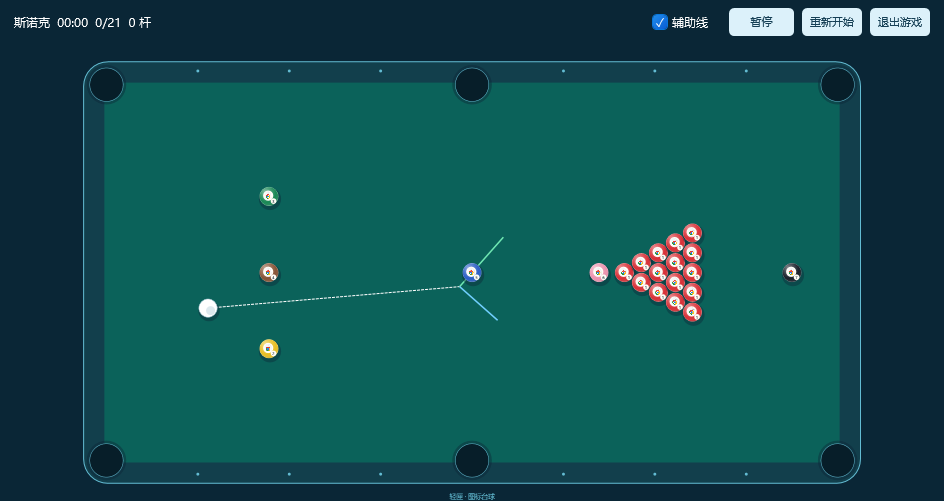
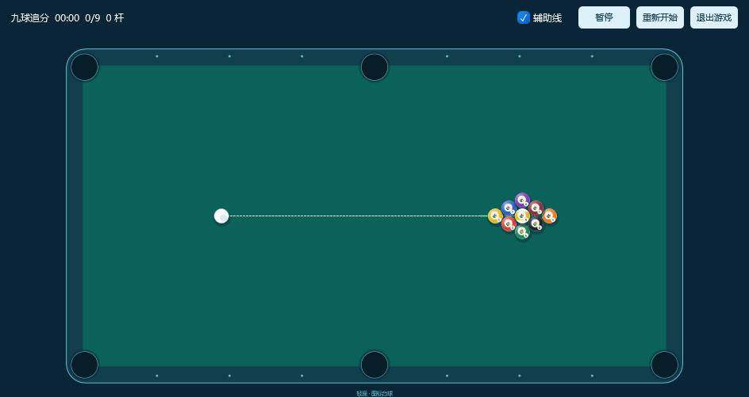
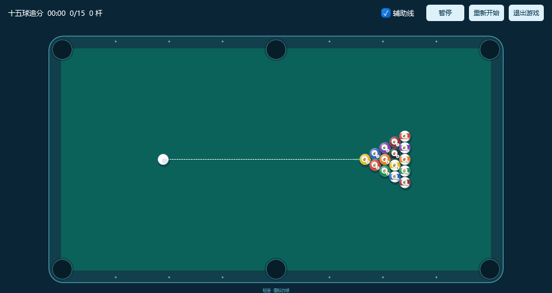

# 台球球组与窗口调整（0.13.1）

按用户四项要求，并确认两种追分都需要，提供以下固定球组。选择后同时确定球数、配色、编号和开局摆法。

| 选项 | 目标球 | 加上白球后的总数 | 球组 |
| --- | ---: | ---: | --- |
| 中八 | 15 | 16 | 1～7 全色、8 号黑球、9～15 花色；黑球居中，后角分属两组 |
| 斯诺克 | 21 | 22 | 15 红＋黄、绿、棕、蓝、粉、黑；红球三角阵，彩球定位 |
| 九球追分 | 9 | 10 | 1～9 号；菱形摆球，1 号在前、9 号居中 |
| 十五球追分 | 15 | 16 | 1～15 号；编号三角球阵 |

配置球组的基础参考：[WPA 8-ball / 9-ball 球数及摆球](https://www.wpapool.com/wp-content/uploads/2026/01/2026.01.02-WPA-Rules.pdf)、[WPBSA 斯诺克球组与定位](https://www.wpbsa.com/wp-content/uploads/2198_WPBSA-Rulebook-2024-25.pdf)。追分两项按用户选择提供对应数量的练习球组。

当前仍为单人清台练习，本次配置不宣称包含完整双人比赛判罚、斯诺克红彩交替复位或追分计分系统。设置窗已明确说明练习玩法。

## 外观及窗口

每颗图标的外轮廓、球面、中央图标小标及编号全部限制在圆形内。用规则的球色及全色 / 花色呈现球组，鼠标停留可辨认原图标；不将方形图标直接当成球。

首次打开宽、高各取所在屏幕的一半，面积为四分之一，中心与该屏幕中心重合。以 1920×1080 逻辑像素屏幕为例，窗口为 960×540，左上角 480、270；支持负坐标屏幕。窄窗口将操作栏分为两行，用户仍可调整大小，调整后暂停。

移除游戏底部整条信息区，因此不再显示右下角许可按钮及左下角窗口尺寸 / DPI 提示。原 MIT 版权和完整许可仍嵌入程序，迁到主软件「更多 → 桌面玩法 → 开源许可」查看。

## 保存与兼容

`settings.json` 新增 Rule，Count 由球组计算，不再由用户任意指定。旧版只含 Count 的设置默认中八，来源和辅助线值保留。游戏启动消息同时核验球组与数量，游戏完成成绩按会话球组核验。

`scores.json` 保留已有 Recent 和 Best，新增按规则保存的最佳记录；不同球组不混排，较早最佳不随最近 100 局滚出。旧局标记为 legacy 保留，不冒充新规则成绩。所有写入仍只在父进程的当前 Data/Games/IconBilliards 内进行。

## 隔离验收

- 53 项收纳核心、19 项纯物理 / 球组检查通过；四种数量、配色、黑球 / 九球居中、斯诺克 15 红 6 彩、无初始重叠均验证。
- 16 项集中的原生鼠标检查通过，实际按住蓄力、松开击球；另一轮 34 项 IPC 集成检查独立验证规则、旧设置 / 成绩兼容、圆形像素边界、960×540 居中、四种实际游戏窗口、30 次启停、暂停 / 最小化及维护 / 异常退出。两种入口明确区分原生鼠标与 IPC 驱动，不将后者描述为真实鼠标。
- 原有 70 项原生界面、12 项真实拖动及 0.13.0 → 0.13.1 旧版更新回归通过，三个分类排序、偏好与正文保持。初次鼠标检查因并行桌面操作干扰失败；经用户提供集中测试时段重测通过，未将失败结果覆盖为通过。
- 21 个合成来源、四分之一屏幕窗口三局采样：游戏私有工作集约 79.5 MiB，专用提交约 127.3 MiB；主进程约 60.0 MiB，合计约 139.5 MiB。帧均值约 16.65 ms / 60 FPS，P95 31.8 ms。最小化时暂停且无帧订阅；本机样本，不代表所有图标和电脑的固定上限。
- 所有场景使用沙箱与合成 URL，未隐藏真实 Explorer 或改变真实文件。完整记录见验证结果中「台球球组」系列 JSON。

正式发行与本机应用结果以项目交接和本轮实机核验记录为准。
