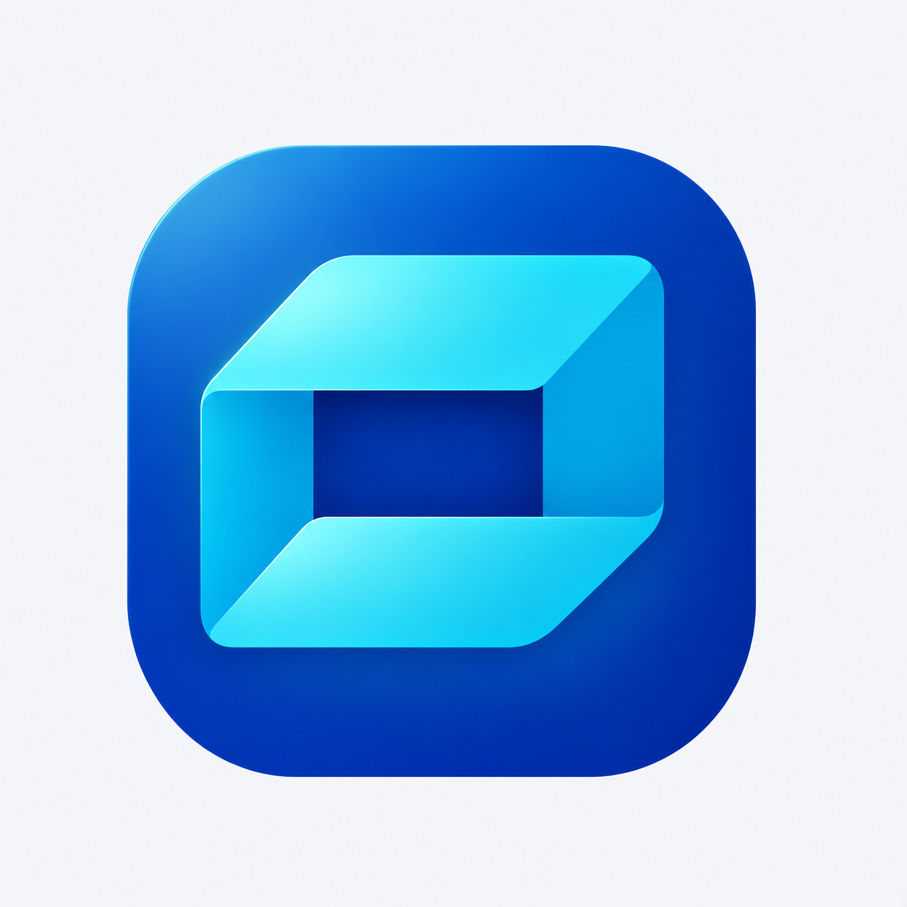

# A2 折角收纳光感精修 v0.3

用户要求继续优化[光感试稿 v0.2](A2折角收纳光感试稿-v0.2.md)。本轮保留选定图形与蓝青配色，收敛左上亮区，整理折边反射和明暗层次。



蓝底左上方的泛白亮区减弱，光感更集中于上缘与折面；顶部、左右侧面、下折面的亮度关系重新平衡，中央深蓝开口保持清楚。整体属于保形光照细修，未重新设计图形或追加装饰。

当前为浅色背景候选图，未制作透明生产资源或 ICO，未进行实际任务栏、DPI 或几何逐点验收，不宣称像素级完全保形。未修改程序名称、图标、版本或用户数据，旧稿保留作比较。

## 生成方式与完整提示词

内置 imagegen，唯一编辑输入为 `docs/images/folded-box-light-preview-v02.png`。

```text
Use case: precise-object-edit.
Asset: restrained finishing pass of the selected A2 blue/cyan folded-container app icon.
Input image 1 is the sole exact edit target. Preserve the icon's silhouette and geometry, rounded-square shape, fold orientation, plane thickness, central rectangular negative space, layout, scale and blue/cyan palette. Keep the same near-white background. This is a careful refinement of the selected lit version, not a redesign.
Refine the lighting and plane relationships:
- Reduce the broad pale/whitish haze on the blue base's upper-left quadrant by about one third. Keep a gentle upper-left blue light, with a clean controlled azure-to-royal-blue gradient and a smooth deep lower-right.
- Make the thin pale-cyan highlights at the upper-left exterior rim and inner folded edge more controlled and tapered, fading naturally at their ends. No continuous glowing white outline.
- Top folded plane remains luminous ice-cyan, with an elegant broad subtle highlight near upper left and richer cyan toward the right, not a blown-out white patch.
- Left vertical fold uses a clear slightly deeper blue-cyan plane; right vertical plane stays a little deeper than the lit top. Preserve the crisp fold junctions, with a fine restrained reflected edge where appropriate.
- Lower/front fold gets one subtle broad reflected-light sweep aligned with its surface, slightly brighter near its left inner crease and calmer toward its outer right tip. No extra stripes or bevel geometry.
- The dark blue central opening stays legible and crisp, with a tiny quiet recess shade under the top inner edge. Blue base immediately surrounding mark gets a very restrained cyan bounce reflection, no hazy aura.
Use calm broad perfectly smooth color planes, clean optically smooth edges, modest illustrated depth and precise rounded corners. The result should retain the requested sense of light but feel more balanced and deliberate, not washed out, neon or plasticky.
Avoid shape changes, added lid, changed aperture, thick bevels, glass or frost effects, material grain, glare blobs, sparkle, stars, light rays, lens flares, smoke, background shadows, added text, borders, tiles, additional icons or product mockup.
Same single full uncropped icon centered square canvas, same generous margins and neutral light backdrop as input.
```
