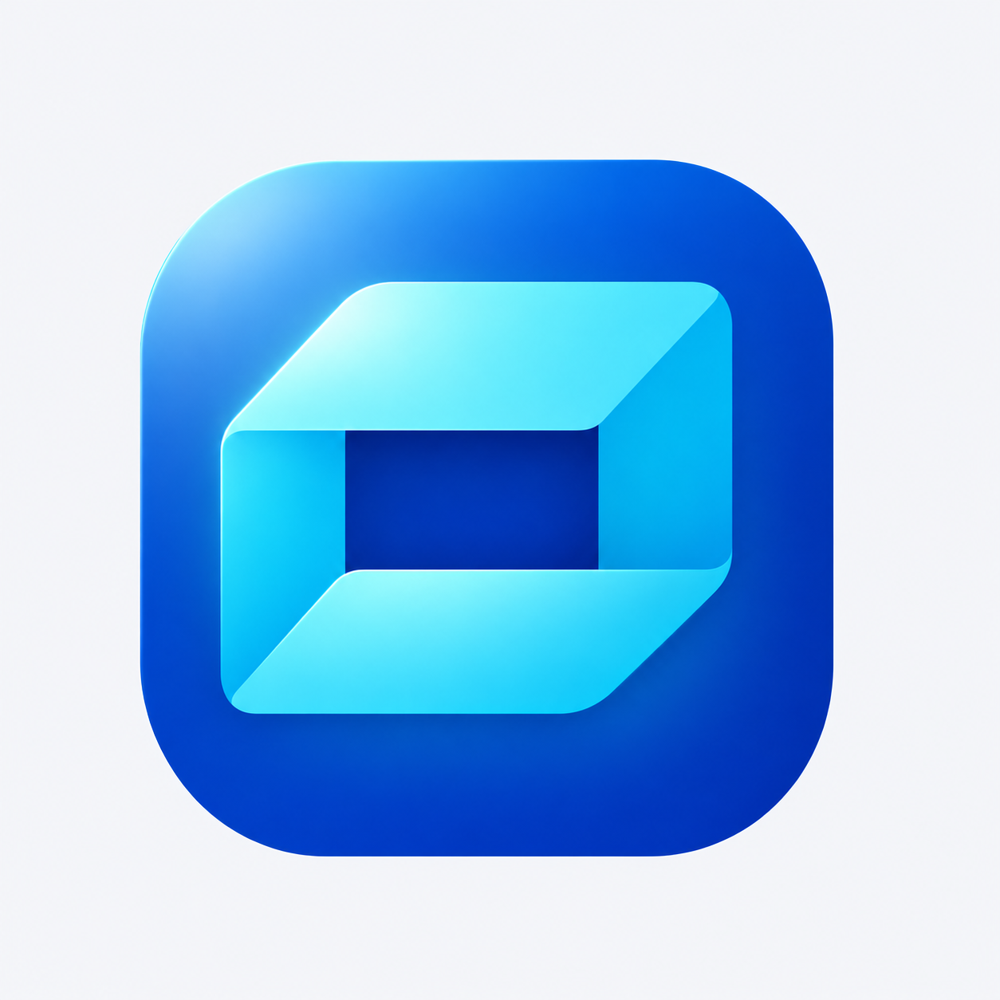

# A2 折角收纳图标光感试稿 v0.2

用户要求在[配色微调版](A2折角收纳配色微调-v0.1.md)基础上“加一些光感试试”。本轮沿用蓝青色折角图标，仅尝试光照、边缘高光与折面反光。



光源从左上方照入，蓝底左上角形成柔和亮区，顶部冰青折面提亮，左侧折边与下折面添加细小反光，中央深蓝开口保持清楚。造型、朝向、圆角和主要比例延续上一版，未重新设计图形。

当前为浅色背景光感试稿，用户尚未确认光照强度。生成式编辑不等于几何逐点或像素级完全不变，未制作透明生产资源或 ICO，未进行真实任务栏、DPI 或图形近似性验收。不替换程序图标、改名、构建发布或变更用户数据；无光感版保留用于对比。

## 生成方式与完整提示词

内置 imagegen，参考图光照编辑。唯一输入：`docs/images/folded-box-color-preview-v01.png`。

```text
Use case: lighting-weather.
Asset: a subtle LIGHTING pass on the user's selected A2 folded-box app-icon preview.
Input image 1 is the exact edit target. Change ONLY illumination and reflected light; preserve the selected icon's geometry, fold directions, dimensions, corners, cyan mark thickness, central dark rectangular opening, blue/cyan palette, position, scale, and plain light background. No redesign or added elements.
Add a refined restrained sense of light:
- One broad soft cool key light from upper left. The top cyan folded plane becomes gently luminous ice-cyan near its upper-left portion, easing smoothly into existing cyan toward right.
- A very slim clean pale-cyan reflected edge follows selected upper/left fold edges, then fades naturally. No white stripe outlining every plane.
- Lower/front folded cyan plane gets a quiet broad reflected glow from the top, enough to separate its light face from the blue base. Right cyan side plane remains a little deeper for clear three-dimensional fold reading.
- Blue rounded-square base gets a soft blue-white sheen near upper-left and a very delicate cool rim on the upper/left curve; keep the base smooth and refined, no thick beveled border.
- A restrained cyan bounce-light halo immediately behind the inner mark may fall onto the blue base, contained inside the blue rounded square and very low intensity.
- Central opening remains deep blue, dark and crisp. Preserve strong contrast and recognizable open folded-box silhouette.
Overall: subtle premium luminous app-icon lighting, clear polished gradients, controlled highlights and soft reflected color. Keep broad quiet surfaces and the original simple geometric product-icon rendering.
Avoid strong neon emission, blown-out white patches, sparkle, stars, lens flares, beams, particles, streaks, glass, frosting, texture grain, plastic inflation, metallic bevels, extra shadows outside icon or changing the central opening. Do not add a lid or change shape into a letter.
Composition: exactly the same one complete blue rounded-square icon centered on the same nearly-white square background with same margins. No title, text, labels, border, app screenshot or extra icons.
```
