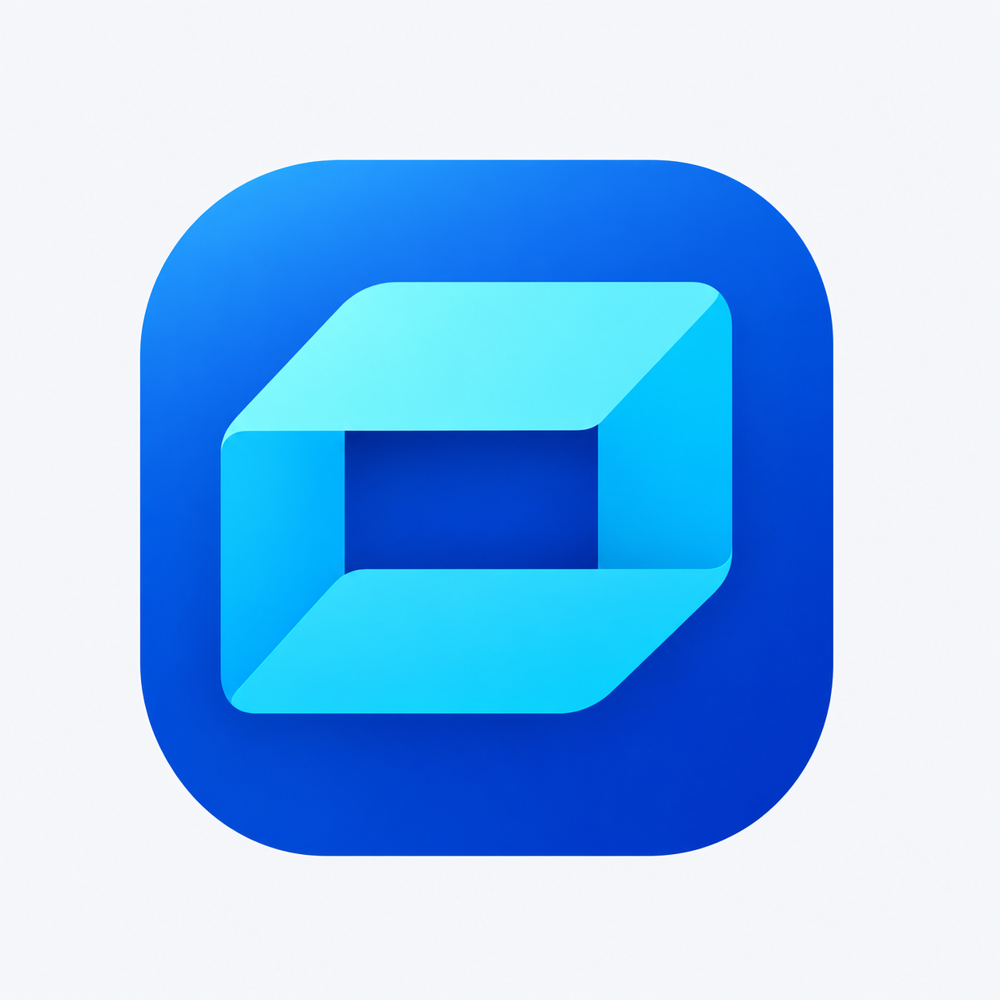

# A2 折角收纳图标配色微调 v0.1

用户提供旧方案截图并明确表示“算了还是先用这个吧，颜色稍微调整下”。本轮以该 A2 折角收纳图标为当前选择，停止推进青提角色方向。截图中的“轻匣”是历史方案文字，不据此推断用户已确定软件改名；本轮仅调整图标配色。

## 原始依据

已找到并归档[原始高分辨率方案板](../images/folded-box-original-board.png)，对应顶部中间的 A2 图标。用户附件 `codex-clipboard-2172c099-c3f9-49d2-a3c6-e4036772bf04.png` 用于确认选择。图标保留蓝色圆角方底、青色折角容器及中央深蓝开口。

## 配色预览



蓝色底略收敛电光感，顶部青色亮面偏柔和冰青，侧面与下折面保持蓝青层次。没有改成水果色、动物或新的抽象形象。

[透明单图](../images/folded-box-color-v01.png)另行保存，外部透明区域仍有生成式边缘残留，暂不作为直接投入正式程序的生产资源。浅色预览用于观察整体配色，为再次生成的清洁背景展示，非确定性像素合成。

生成过程为高保真位图参考编辑，并非原始可编辑矢量逐点替色，轮廓可能存在细微差异。未完成真实任务栏、不同 DPI、ICO 或图形近似性验收，未替换程序资源、构建新版或改动用户数据。

## 生成方式与完整提示词

内置 imagegen，共两个顺序编辑任务。

### 颜色微调与独立图标

输入一：本轮归档的原始高分辨率方案板。输入二：用户的 A2 截图，只选顶部中间 A2，不复制其他方案、文字或任务栏预览。

```text
Use case: precise-object-edit.
Asset: the user's SELECTED A2 folded-box software icon, subtle COLOR adjustment only, isolated clean icon.
Input image 1 is the high-resolution original design board. The edit target is ONLY the TOP-CENTER icon labeled A2: blue rounded-square base containing the cyan folded open box / ribbon-like container. Input image 2 is the user's crop confirming that exact A2 selection. Exclude every other icon, all text, thumbnail strips, panel dividers and board background.
Preserve the A2 geometry with exceptionally high fidelity: identical rounded-square proportions/corner softness, identical margins between base and inner mark, the same isometric folded top cyan plane, slim vertical left fold, right side plane, broad folded lower plane, and the same dark rectangular central opening. Keep the exact fold orientation, corner cuts, thickness and negative space. Do NOT redesign, rotate, add a lid, add objects or change to an S/letter logo.
User request: keep this icon and only slightly adjust the colors.
Make one restrained fresh blue/cyan refinement: rounded-square background a slightly less electric refined azure-to-royal-blue gradient, brighter toward upper-left and deeper at lower-right; keep it clearly BLUE, no purple/green/orange palette shift. Folded mark top plane soft luminous ice-cyan (around #74E4EF), left plane medium clear blue-cyan, right plane clean cyan-blue, lower plane slightly richer aqua-blue. Central opening stays deep cool blue with strong contrast. Reduce oversaturated fluorescent cyan a little without making pale, gray or dull. Retain original simple polished flat-gradient rendering and quiet illustrated depth.
Crisp smooth icon edges, clean broad planes and tiny restrained gradients. No texture or grain, glass effects, material frosting, plastic clay, gloss flares, shiny bevel borders, glow, lighting rays, extra shadows outside the icon or decorative marks. No lines/letters on the mark.
Composition: one single square icon centered with 8 percent empty margins on a square transparent canvas. True transparent area OUTSIDE the rounded blue square, while blue square and folded mark remain opaque. No white background, border, title, label, font, taskbar, mockup, comparison panel or watermark. Deliver a clean high-resolution isolated faithful recolor of A2.
```

### 浅色背景预览

输入：本轮生成的透明配色图。

```text
Use case: compositing.
Input image 1 is the new color-adjusted A2 folded-box icon. Preserve the icon's exact geometry, proportions and blue/cyan color palette. Do NOT redesign or recolor it again.
Create a clean neutral presentation of this same single icon on a plain warm-white/light-gray (#F7F8FA) background. Remove the stray blue speckles and irregular pixels outside its exact smooth rounded-square silhouette. The intended icon is a blue rounded square with its complete cyan isometric folded-box mark and dark-blue central opening; all background artifacts are excluded. Edges crisp and smooth, broad gradients clean, no texture.
Single icon centered square canvas, icon about 75 percent of canvas width, generous equal empty margins all around. Flat presentation, no cast shadow, 3D pedestal, frame, card, shine, extra lighting, labels, title, letters, taskbar, mockup or decorative objects. Keep the selected A2 icon intact, with only a clean simple neutral preview background.
```
