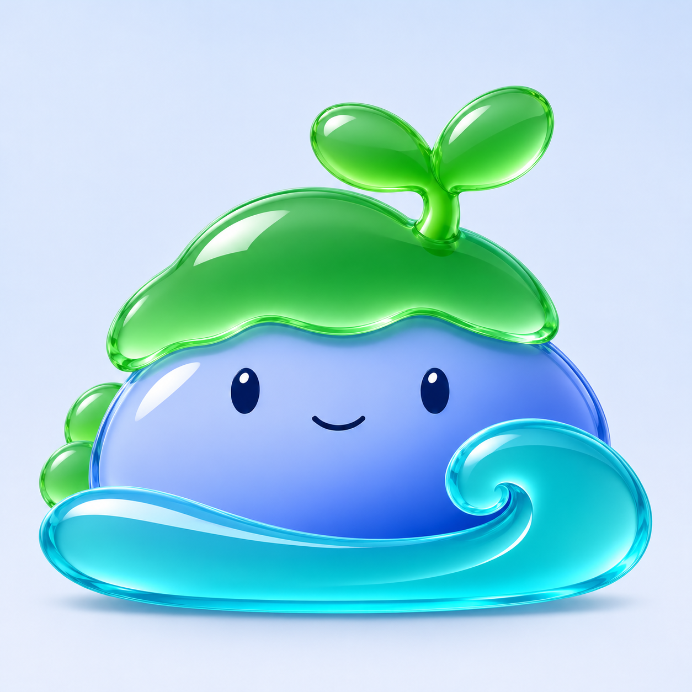

# 北沚光洁玻璃方向 v0.16

用户明确要求“不要加磨砂这种，换个方向优化”。停止沿用 v0.15 的磨砂、颗粒与柔雾表面；本轮尝试光洁清透的彩色玻璃。用户尚未确认这个新方向。



以[层次优化 v0.14](北沚玻璃层次优化-v0.14.md)作为造型参照，保留饱满身形、大幼芽、卷浪和表情，通过光滑反射、清透边缘与折射区分绿色苔帽、蓝色石身和青蓝卷浪。相比上一轮，表面更光洁，色彩更鲜明。

生成方式：内置 imagegen 参考图风格编辑，浅色背景预览。当前不是透明图标资源，未进行真实任务栏尺寸、DPI 或 ICO 验收。旧稿保留作历史对照，不替换程序图标或变更用户数据。

## 完整提示词

输入：`docs/images/beizhi-glass-preview-v14.png`，仅取角色造型与布局。

```text
Use case: style-transfer.
Asset: new polished clear-glass direction for the 北沚 software mascot.
Input image 1 supplies ONLY the authoritative character identity, shapes, composition and expression: rounded low blue-violet island body, full scalloped green cap, large two-leaf sprout, two small oval navy eyes, small smile, broad aqua crescent with a large right curl. Preserve these silhouette proportions, facial placement and generous margins.
User correction: explicitly REJECTED frosted or matte rendering. Move to optically polished, completely smooth colored glass and clean graphic reflections. This must be visibly different from the current soft milky surface.
Material direction:
- Green cap and large leaves: polished translucent jade-green optical glass, luminous clear edges, rich green internal color in thicker areas, pale clean transmission in thinner areas. Use a small elegant bright reflection shaped by the upper-left studio light. Smooth untextured front surface.
- Main body: polished blue/periwinkle colored glass with a clear curved rim, soft but clean blue gradient through its solid readable core, a controlled deep-blue lower-right region. A single simple clear reflection near upper left establishes gloss. Keep the face completely readable; eyes and smile opaque navy with crisp tiny highlights.
- Foreground wave: crystal-clear turquoise/aqua glass, graceful smooth spiral and round crest. Show believable thickness via clean refraction along inner and lower edges. A single tapering white-blue reflection follows the curve, not many nested stripes.
Render as a refined 2.5D app mascot: precise silhouette, modest depth, disciplined bright highlights and broad quiet colored planes. Clean optical separation between green cap, blue body and aqua wave. Gentle contact shadow at overlaps, no heavy dark cartoon outline.
No frosted glass, no matte surface, no satin finish, no sandblasting, no micrograin, no speckle, no translucent cloudy milky veil. No grain or roughness, no jelly/slime, no balloon or inflatable toy finish, no harsh chrome, no gemstones, no glitter, no neon halo. No noisy realistic texture or exaggerated lens distortion.
Background: very simple near-white studio backdrop with a faint cool-blue falloff. Small soft grounding shadow. One full complete centered mascot, square canvas, about 10 percent outer margin. No words, labels, app tile, frame, prop, extra plant, scene, separate objects, arms or legs. Keep the original friendly calm personality and the full sprout and wave sizes.
```
