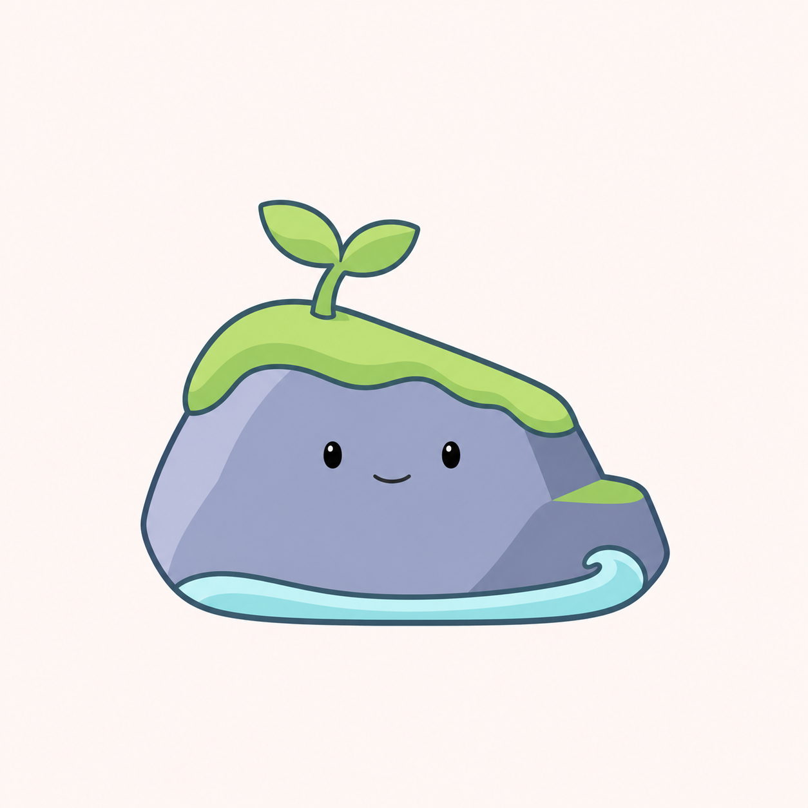

# 北沚岩洲轮廓调整 v0.19

用户要求在[清爽插画新轮廓 v0.18](北沚清爽插画新轮廓-v0.18.md)后再改。本轮保持清爽插画方向，重画石身与配套水纹，不视为用户已选择前一轮 C。

## D：高低岩台



采用圆角转折的岩体与右侧低岩台，苔帽跟随顶部坡度，水纹缩为底部浅弧与小卷浪。石身更突出。

## E：斜肩石形


右高左低的斜肩石形，苔帽集中在右上方，左侧小浪收拢到底部，整体更简洁。

两版均保留幼芽、单一面部和岩洲主题，采用描边、柔和色块和简化明暗。当前线条和局部阴影仍待选型后继续统一，未完成任务栏或 DPI 验收。两版为浅色背景候选稿，不是透明生产图标。旧稿继续保留，未定名、不替换程序资源或变更用户数据。

## 生成模式与完整提示词

内置 imagegen，两份独立生成请求。输入为 `docs/images/beizhi-illustration-c-v18.png`，仅作题材与插画风格参照，允许重新设计轮廓。

### 方案 D

```text
Use case: stylized-concept. Asset: new shape redesign for 北沚, an illustrated software-family mascot.
Input image 1 is a style/subject reference ONLY. The user asks to change the designs again, not just recolor or polish the reference. Keep clean opaque illustration, delicate slate-blue contour, simple soft color blocks, minimal cel shading, calm friendly small oval eyes and a tiny smile. Core motif: a little rock-islet with green moss, one two-leaf sprout and simple aqua water. Change the silhouette substantially.
Design quality: a memorable compact character silhouette, moss that belongs to the rock rather than a mushroom hat or human haircut, a clear readable rock form, water as a restrained supporting element. Dusty periwinkle/slate rock, fresh restrained leaf green, pale turquoise water, warm off-white background. Only two or three broad shaded planes. Clean 2D hand-drawn mascot, not glass or rendered materials.
No arms, legs, clothing, animal ears, blush, scenery, texture, glass, transparency, frost, glossy highlights, 3D toy, neon, detailed cracks, scattered plants or decorative sparkle. No generic round blob in a huge wave-ring.
One complete standalone character on square off-white canvas, balanced center with generous margins. No text, title, tile, frame, other characters or props.
Specific new structure D: a squat softly angular island rock with a broad gently slanted top plateau, a high rounded left shoulder and lower RIGHT side stepping down once into a small rock ledge. Give the outer silhouette six broad rounded directional changes, not an oval. Width slightly greater than full height including sprout, comfortably compact. A single low moss blanket follows the slanted plateau and tucks neatly around its left edge; use a shallow uneven organic edge, not large hanging hair lobes. Small but clear two-leaf sprout rises near left-of-center with a short stem. Friendly face in the large exposed front rock plane, eyes relatively small and gently spaced. A thin open aqua pool crescent sits at the base, with one tiny curl at the low right ledge; water occupies less than one-sixth of visual area. Small pale lit rock plane on left, muted darker side face on right. Stable, charming and clearly a small island.
```

### 方案 E

```text
Use case: stylized-concept. Asset: new shape redesign for 北沚, an illustrated software-family mascot.
Input image 1 is a style/subject reference ONLY. The user asks to change the designs again, not just recolor or polish the reference. Keep clean opaque illustration, delicate slate-blue contour, simple soft color blocks, minimal cel shading, calm friendly small oval eyes and a tiny smile. Core motif: a little rock-islet with green moss, one two-leaf sprout and simple aqua water. Change the silhouette substantially.
Design quality: a memorable compact character silhouette, moss that belongs to the rock rather than a mushroom hat or human haircut, a clear readable rock form, water as a restrained supporting element. Dusty periwinkle/slate rock, fresh restrained leaf green, pale turquoise water, warm off-white background. Only two or three broad shaded planes. Clean 2D hand-drawn mascot, not glass or rendered materials.
No arms, legs, clothing, animal ears, blush, scenery, texture, glass, transparency, frost, glossy highlights, 3D toy, neon, detailed cracks, scattered plants or decorative sparkle. No generic round blob in a huge wave-ring.
One complete standalone character on square off-white canvas, balanced center with generous margins. No text, title, tile, frame, other characters or props.
Specific new structure E: a softly triangular rounded pebble-islet, one high curved shoulder on the RIGHT tapering toward a low LEFT rock nose, a broad stable rounded base. NOT a symmetrical egg or dome. Tilt the front rock face slightly left; single tiny friendly face centered in the front plane, larger open forehead. A small irregular moss patch sits diagonally across the upper-right shoulder, covers only the top quarter and has a tidy natural shallow edge, not a full cap. Two-leaf sprout grows from that patch and leans inward toward center. Aqua water is redesigned as a short elegant SIDE wave sweeping behind the lower-left shoulder and ending under the front base, a modest upward curled tip only on the LEFT. The rock remains visually dominant, wave less than one-fifth of visual area, no tall right crest and no enclosing oval ring. Calm lively silhouette with simple natural stone planes and light offset rhythm.
```
