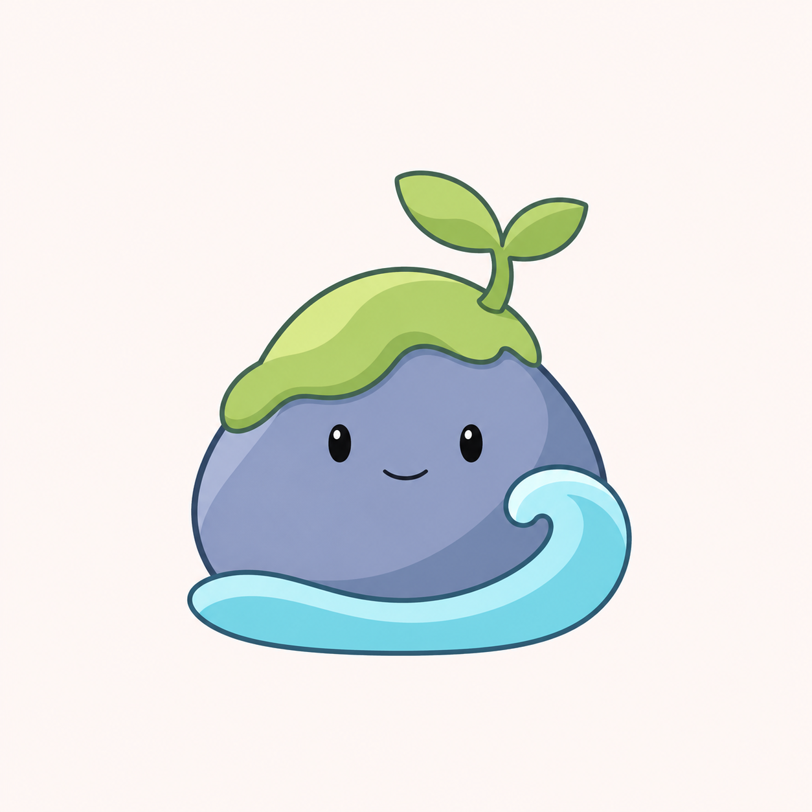

# 北沚清爽插画与新轮廓 v0.18

用户否定上一版后，明确选择“清爽插画、重新调整造型”。本轮返回九角色稿的插画语言，并重新安排石身、苔帽、幼芽与水纹的结构；停止以玻璃材质稿作为当前设计方向。

## A：低矮横向


不对称横向石身，苔帽偏向高肩，水纹压低并以小卷浪收尾，轮廓舒展。

## B：双石错落


主石与较小的肩石形成高低层次，一片苔帽连接两者，左侧小卷浪锚定底部。只有主石具有面部。

## C：卷浪环抱



近圆石身，苔帽偏向顶部一侧，右侧卷浪向主体环抱，整体更紧凑。建议优先观察 C 在方形图标中的比例潜力，这不代表已通过小尺寸验收或用户已选定。

三版采用描边、柔和色块、简化阴影和友好表情，保持岩洲、苔帽、单株幼芽与水纹的题材。生成结果线条仍偏有分量，后续可按选定轮廓统一线宽；不宣称已完成正式源稿。三版均为浅色背景候选图，非透明生产资源，未进行 ICO 或 DPI 验收。未定名，不替换程序图标或修改用户数据。

## 生成模式与提示词

内置 imagegen，三份独立图像生成请求。共用输入为 `docs/images/mascot-cast-detail-v07.png`，仅作为第 6 号题材与整套插画风格的参照，允许重做轮廓。

### 方案 A

```text
Use case: stylized-concept. Asset: redesigned 北沚 (Beizhi) mascot concept for a software family.
Input image 1 is ONLY the illustration STYLE reference and broad subject reference. Use the clean Q-illustration style of character 06, but genuinely redesign its silhouette and arrangement. Do not reproduce the whole nine-character sheet or any other character.
The user explicitly chose fresh clean illustration AND a new character shape. Return to fine blue-gray ink contours, fresh restrained cel-color blocks, minimal two-value soft shading and tiny friendly oval eyes with a small smile. Opaque colors, mostly flat illustration with just slight illustrated depth. Sage/leaf green moss, dusty periwinkle/slate rock, clean pale aqua water. Elegant smooth deliberate curves, coherent construction, readable at small size, calm approachable personality. Clean drawn outlines, not 3D rendering.
Core subject: an original friendly little rock-islet with a moss patch, a single two-leaf sprout and a simple water element. No arms, legs, noses, blush, clothing, realistic vegetation or scenery. Only one face.
Absolutely avoid glass, transparent materials, specular glare, frosting, material grain, chrome, optical rims, neon glow, shiny 3D toys, giant eyes, furry texture, complex facets, busy splash details and huge multi-stripe waves.
Square warm nearly-white plain canvas, one complete isolated character centered with generous 14 percent margins, no text, title, frame, tile, logo or diagram.
Shape direction A: a low wide asymmetric resting islet, a warm pebble-like trapezoid with one broad rounded high shoulder at left and a gently dipping low right shoulder; overall width about 1.35 times height INCLUDING sprout. Green moss forms a gently sloping single soft cap fitted to the left upper shoulder, clearly exposing the rock forehead on the right. Short two-leaf sprout grows from upper-left quarter, leaning slightly toward center. Face centered low and subtly left-looking, very gentle. Water is a simple flattened aqua crescent wrapping the lower edge, terminating in ONE SMALL upward curl at the right, much less dominant than the original reference. Two pale broad stone planes, no polygon facets. Quiet poised silhouette, beautiful negative space. Genuine new shape rather than old round mound.
```

### 方案 B

```text
Use case: stylized-concept. Asset: redesigned 北沚 (Beizhi) mascot concept for a software family.
Input image 1 is ONLY the illustration STYLE reference and broad subject reference. Use the clean Q-illustration style of character 06, but genuinely redesign its silhouette and arrangement. Do not reproduce the whole nine-character sheet or any other character.
The user explicitly chose fresh clean illustration AND a new character shape. Return to fine blue-gray ink contours, fresh restrained cel-color blocks, minimal two-value soft shading and tiny friendly oval eyes with a small smile. Opaque colors, mostly flat illustration with just slight illustrated depth. Sage/leaf green moss, dusty periwinkle/slate rock, clean pale aqua water. Elegant smooth deliberate curves, coherent construction, readable at small size, calm approachable personality. Clean drawn outlines, not 3D rendering.
Core subject: an original friendly little rock-islet with a moss patch, a single two-leaf sprout and a simple water element. No arms, legs, noses, blush, clothing, realistic vegetation or scenery. Only one face.
Absolutely avoid glass, transparent materials, specular glare, frosting, material grain, chrome, optical rims, neon glow, shiny 3D toys, giant eyes, furry texture, complex facets, busy splash details and huge multi-stripe waves.
Square warm nearly-white plain canvas, one complete isolated character centered with generous 14 percent margins, no text, title, frame, tile, logo or diagram.
Shape direction B: an intimate asymmetric grouping of TWO softly rounded stone volumes fused visually into one island character: main upright oval rock on right with the single friendly face, a small low supporting pebble on left without a face. The main rock is a compact rounded soft-square/pear form rather than the reference's broad dome. One sage moss patch bridges the tops as a simple sloping organic contour with only two or three rounded lobes; small two-leaf sprout rises from the seam toward the left. Green covers only the upper quarter, face has breathing room. Low aqua water crescent anchors both stones and has a small open curl at far left, no surrounding high wave. Main rock face on the lower-right large plane, small calm oval eyes. Overall silhouette upright but full, visually balanced and endearing. No stacked tower, sharp rocks, extra stones or scenery.
```

### 方案 C

```text
Use case: stylized-concept. Asset: redesigned 北沚 (Beizhi) mascot concept for a software family.
Input image 1 is ONLY the illustration STYLE reference and broad subject reference. Use the clean Q-illustration style of character 06, but genuinely redesign its silhouette and arrangement. Do not reproduce the whole nine-character sheet or any other character.
The user explicitly chose fresh clean illustration AND a new character shape. Return to fine blue-gray ink contours, fresh restrained cel-color blocks, minimal two-value soft shading and tiny friendly oval eyes with a small smile. Opaque colors, mostly flat illustration with just slight illustrated depth. Sage/leaf green moss, dusty periwinkle/slate rock, clean pale aqua water. Elegant smooth deliberate curves, coherent construction, readable at small size, calm approachable personality. Clean drawn outlines, not 3D rendering.
Core subject: an original friendly little rock-islet with a moss patch, a single two-leaf sprout and a simple water element. No arms, legs, noses, blush, clothing, realistic vegetation or scenery. Only one face.
Absolutely avoid glass, transparent materials, specular glare, frosting, material grain, chrome, optical rims, neon glow, shiny 3D toys, giant eyes, furry texture, complex facets, busy splash details and huge multi-stripe waves.
Square warm nearly-white plain canvas, one complete isolated character centered with generous 14 percent margins, no text, title, frame, tile, logo or diagram.
Shape direction C: a compact nearly round but slightly pear-shaped smooth blue-slate pebble, with a small flat stable base and one gentle upper-left bulge. A broad aqua wave hugs its LOWER-RIGHT side like an open protective bay: starts as a low short crescent under the left base, rises into ONE graceful side curl at right to below eye height, leaving a clean open light gap between the wave tip and stone shoulder. The stone remains the visual main subject. Sage moss is a small elegantly draped off-center top patch, not a whole oversized mushroom cap; exactly one two-leaf sprout tilts slightly left from the top-right. Face centered in exposed blue plane, friendly small eyes and smile. Overall compact circular rhythm, simple readable interlocking silhouettes, no enclosing badge circle, no huge wave platform, no complex foam stripes.
```
