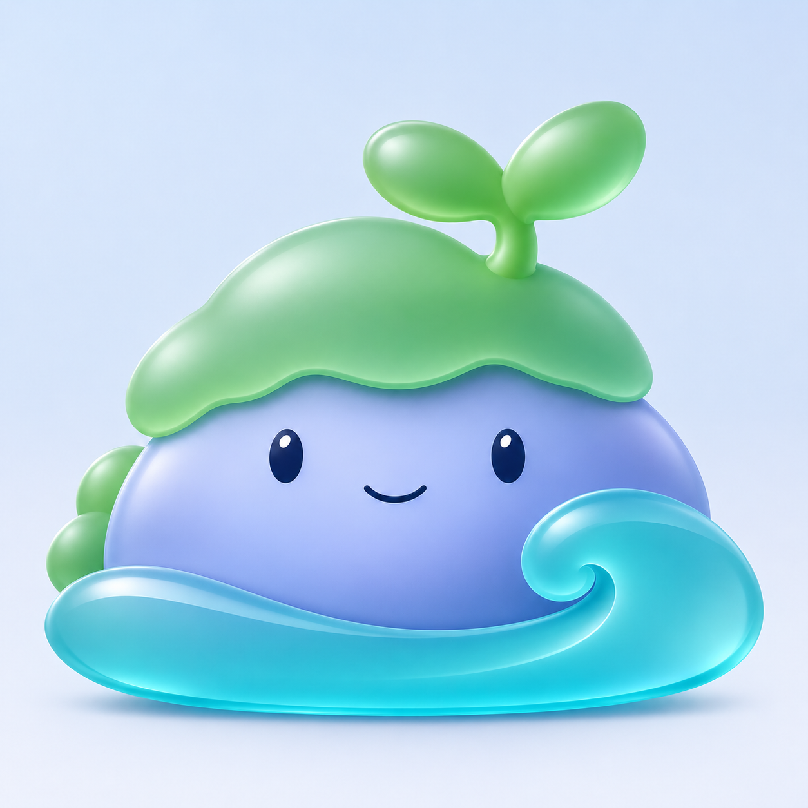

# 北沚玻璃层次优化 v0.14

沿[玻璃材质探索 v0.13](北沚玻璃材质探索-v0.13.md)继续优化。本轮仅更新浅色背景材质预览，保留旧稿及旧透明单图，不将新预览当作透明资产。



收敛连续发光轮廓和大片白色反光，增强绿色苔帽、蓝紫石身、青蓝卷浪之间的色彩与叠层区分；保留饱满身形、大幼芽、完整卷浪和友好神态。苔帽接触阴影与水纹内弧更清楚，背景维持简单浅蓝白色。

生成方式：内置 imagegen 参考图编辑。仍为待评审材质概念，尚未完成正式任务栏尺寸、DPI 或透明资产验收。没有实现程序窗口的真实模糊效果，不修改程序名称、图标或用户数据。

## 完整提示词

输入：`docs/images/beizhi-glass-preview-v13.png`，作为唯一编辑目标。

```text
Use case: precise-object-edit.
Asset: second refinement of the 北沚 frosted-glass mascot material preview.
Input image 1 is the exact edit target. Keep the SAME composition and character identity: full low rounded periwinkle island body, jade moss cap with large two-leaf sprout, friendly small navy eyes and smile, broad turquoise water crescent with a large right curl. Preserve the silhouette proportions, size of leaves, facial arrangement, wave scale and front-view pose.
Primary change: improve material hierarchy and optical clarity while reducing excessive glow and washed-out highlights. Keep the frosted acrylic/glass direction.
1. Remove the continuous neon-like luminous outline around the whole character. Replace it with a thin restrained edge reflection only where the soft upper-left light naturally catches. No bloom, aura or fog around silhouette.
2. Make cap and leaves a slightly richer muted jade-green satin glass, with two broad restrained highlights and a readable cool-green shadow along the underside. Reduce large white glare patches by roughly half. Preserve lush soft lobes and full sprout.
3. Body is softly frosted periwinkle glass with a legible, gently luminous core, a clean smooth front plane and a controlled indigo-blue lower-right shadow. Remove visible grain and cloudy texture; frost should be shown through soft light diffusion, not speckle. Keep eyes and smile opaque navy, clear and small, no extra features.
4. Foreground water is clearer aqua optical glass: graceful single spiral crest, clean inner curve and believable thickness at the rounded rim. One elegant tapered pale reflection follows the crescent and curl. Richer cyan at the lower edge gives a clear silhouette. Do not add waves or sparkle.
5. Give the green cap/blue body and body/water overlaps a narrow soft contact shadow and subtle refractive seam, so each shape reads as a separate crafted glass layer, not one blended jelly blob. Keep depth modest and balanced.
Background: preserve a quiet pale blue-white studio backdrop but tone down the broad colorful haze. Background should be simple enough to judge silhouette and materials. Very small soft grounding shadow directly under the wave; no separate pedestal.
Style: polished restrained glass-icon product rendering, calm, friendly and clean. Avoid thick black cartoon outlines, overinflated toy surfaces, glitter, realistic stone/moss/water textures, additional details or decorations.
Square output, one complete uncropped mascot, generous outer margin. No words, logos, tiles, frames, comparison panels, tools, UI chrome, added limbs or new objects.
```
