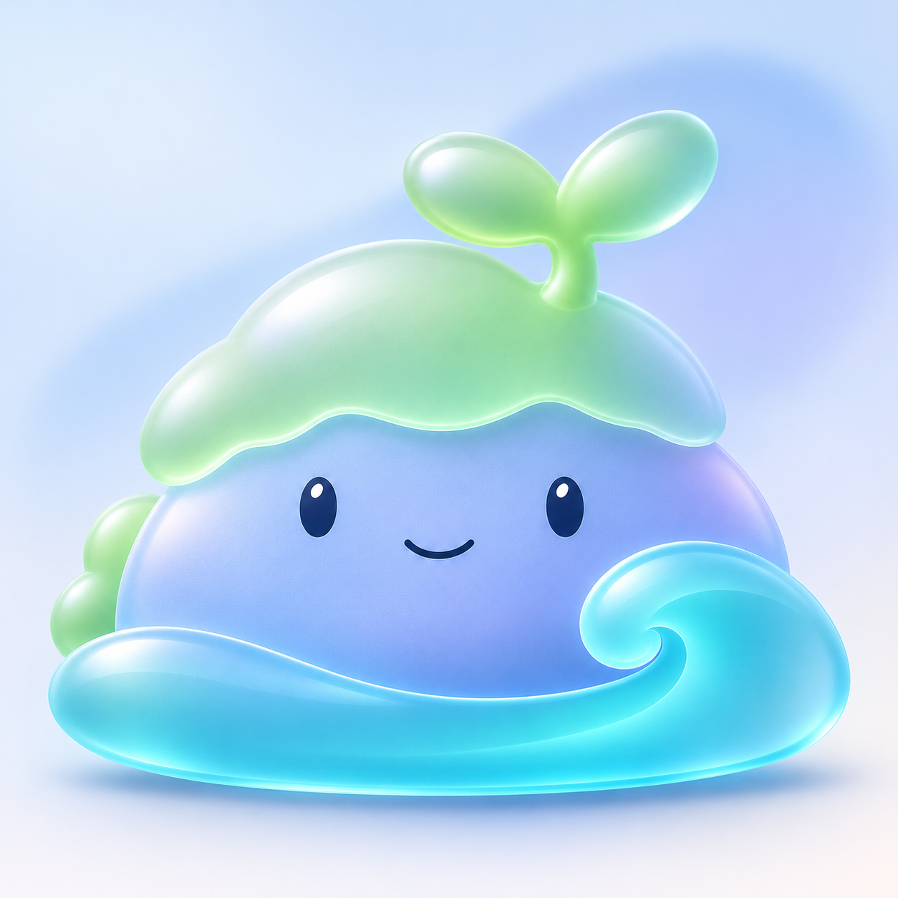
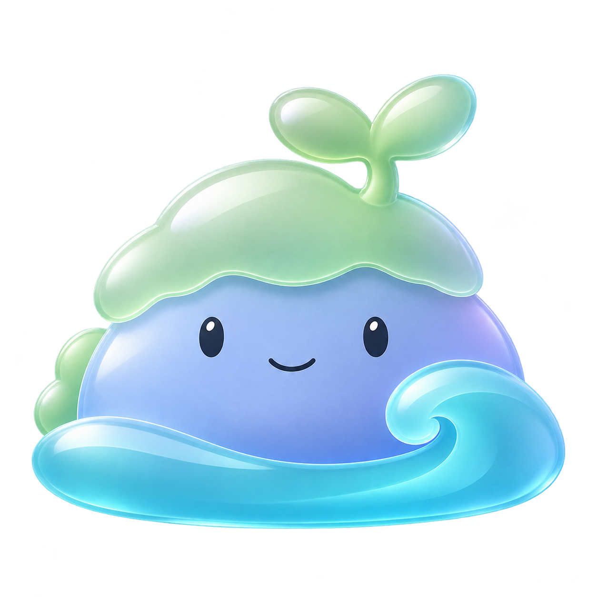

# 北沚玻璃材质探索 v0.13

用户提供新的玻璃视觉参考，要求尝试该风格。本轮以[北沚 v0.12](北沚色彩光影精修-v0.12.md)为角色参照，采用磨砂玻璃、半透明叠层与细边缘光。这是用户新参考驱动的材质探索，暂不视为已确定的新家族规范，原插画稿继续保留。

## 浅色背景材质预览



保留饱满石身、幼芽、卷浪及面部布局，绿帽与幼芽采用浅玉绿磨砂效果，身体采用蓝紫色柔雾效果，水纹采用较清透的青蓝玻璃效果。减弱原来的深色描边，利用边缘光、反射和叠层区分形体。

## 透明单图



透明单图用于后续排版试放。边缘仍可见生成式裁切残留，正式资源阶段需要处理和验收，不能直接作为已完成的任务栏图标。浅色预览为生成式重绘，并非把透明图进行确定性像素合成。

本轮仅为位图材质概念，没有实现程序窗口的真实背景模糊或 Acrylic/Mica 效果。未定名，未替换程序图标，未修改用户数据。

## 生成方式与完整提示词

使用内置 imagegen。首轮为风格迁移，第二轮为浅色环境合成预览。用户参考附件为 `codex-clipboard-27ce9392-640e-46c3-8fb2-ccbe8fd06cf1.png`，只用于材质和光影参考，不复制其品牌、文字或窗口布局。

### 透明单图

输入一：`docs/images/beizhi-character-v12.png`。输入二：用户玻璃风格参考附件。

```text
Use case: style-transfer.
Asset: new glass-material direction for the existing 北沚 software mascot.
Input image 1 is the character edit target: preserve its entire low rounded rock-islet body silhouette, big two-leaf sprout, broad scalloped moss cap, simple friendly face and generous crescent wave with large right spiral. Preserve proportions and facial placement closely.
Input image 2 is ONLY a material/lighting reference: frosted translucent glass, acrylic layers, soft refraction, luminous thin edges, restrained blue/turquoise gradients and delicate studio light. Do not copy its Windows marks, text, rectangles, cards, windows, wallpaper or composition.
Primary request: transform the character into a beautifully designed frosted-glass mascot icon. The body is translucent periwinkle-blue satin glass, softly frosted through its center and clearer at the curved edges. The moss cap and two leaves become pale sage/jade frosted glass, visibly layered just in front of the body with a very slim luminous seam. The foreground water crescent and curling right wave are clearer turquoise/aqua optical glass with a smooth continuous spiral and graceful light passing through its curved rim. Keep rich enough color and a solid legible core so this still reads as a friendly mascot, not a ghostly glass outline.
Replace the current ink cartoon contours with slim tinted glass edges and controlled refractive rims. Give surfaces elegant broad reflections and restrained light diffusion like the supplied acrylic reference. Add a very subtle cool-lilac reflection on one side, not rainbow iridescence. Clear physical layer separation between green cap, blue body and turquoise wave. Keep the eyes and smile opaque dark navy, small and precise, with tiny restrained catchlights. No realistic moss, rocks or water textures.
Lighting: large soft key light from upper left, one pale cool rim on upper right, gentle depth and believable thickness at edges. Calm clean premium desktop-icon aesthetic. Moderate 3D volume, keep original illustrated front-view identity; no extreme perspective or toy-like inflating of shapes.
Composition: a single complete standalone character, centered square canvas, 10 percent generous margins, true transparent background, no text, no tiles, no frame, no scenery, no detached shadows. Preserve all core shape sizes; do not shrink the sprout, wave or body. Do not add arms, legs, decorations, tools, new plants or external objects. Avoid thick dark outlines, chrome metal, gemstones, excessive sparkles, harsh glow, messy reflections, watery slime, transparent eyes or face distortion.
```

### 材质预览

输入一：本轮透明玻璃单图。输入二：同一用户风格参考附件。

```text
Use case: compositing.
Asset: clean material presentation of the 北沚 frosted-glass mascot.
Input image 1 is the exact glass mascot to preserve: full rounded periwinkle face, large jade two-leaf sprout and moss cap, full aqua water crescent and right curling crest. Input image 2 supplies only the frosted acrylic glass lighting aesthetic, not logos, text, layout or UI.
Place one complete polished instance of image 1 on a quiet pale cool-blue to warm-white studio background, with one very broad softly blurred blue-lilac light shape far behind it, understated enough to show glass translucency without clutter. Square composition, centered mascot, generous 14 percent breathing room. No tile or container.
Retain image 1's identity, proportions, tiny navy eyes and smile, pose and colors. Improve edge quality for this presentation: smooth optical contour, remove stray white flecks and detached alpha fringes. Keep glass-body core readable and softly frosted; show gentle diffused background light through its colored edges. Slim luminous seams mark the moss/body and wave/body overlaps. Sage glass cap and leaves, satin periwinkle body, clearer turquoise optical-glass wave. Large soft upper-left key, delicate broad reflections, restrained thin rim highlights, small soft contact shadow directly beneath. Render as a premium frosted-glass software mascot study, calm and friendly, not a toy or realistic landscape.
No lettering, Windows logos, watermarks, other objects, frame, UI windows, cards, badges, inset examples, rays, sparkles or busy scenery. Do not modify silhouette or add new elements.
```
