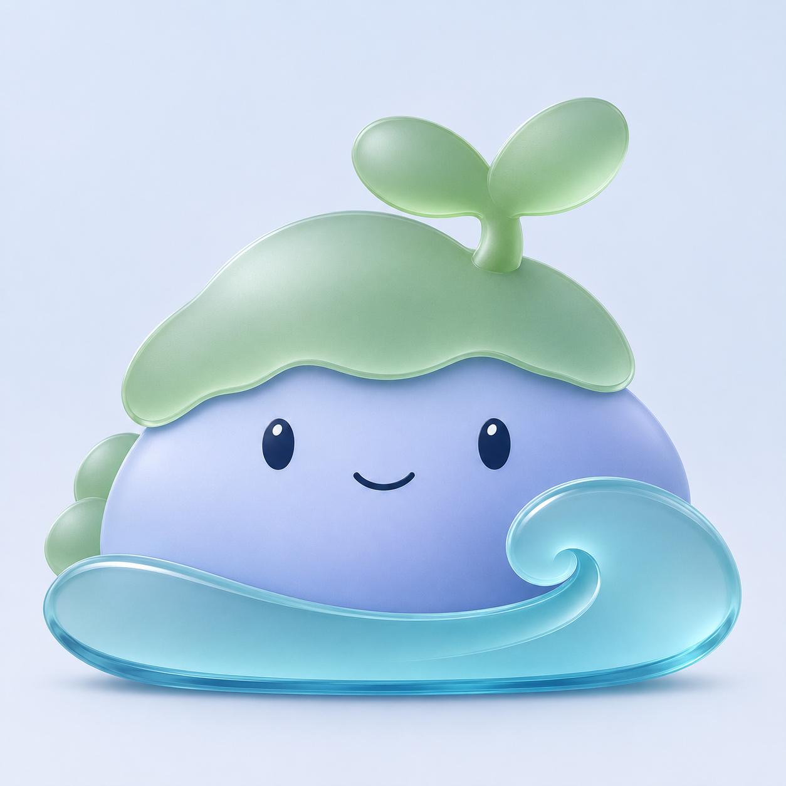

# 北沚磨砂与清透材质优化 v0.15

继续沿[玻璃层次优化 v0.14](北沚玻璃层次优化-v0.14.md)精修，保持身形、大幼芽、卷浪和表情。



本轮降低绿色苔帽的亮面塑料感，采用更柔和的鼠尾草绿磨砂效果；水纹减少大块白色反射，增加清透边缘与折射层次。石身保持蓝紫柔雾效果，使苔帽、石身、水纹的材质差别更明确。生成结果仍有细颗粒磨砂纹理，未达到提示词所要求的完全平滑表面，暂作候选观察。

本轮仅更新浅色背景材质预览，旧稿保留。使用内置 imagegen 参考图编辑，不将预览当作透明图标；未进行实际任务栏、DPI 或 ICO 验收，不变更程序和用户数据。

## 完整提示词

输入：`docs/images/beizhi-glass-preview-v14.png`，作为唯一编辑目标。

```text
Use case: precise-object-edit.
Asset: material refinement of the attached 北沚 glass mascot concept.
Input image 1 is the sole edit target. Preserve its front-view silhouette and proportions EXACTLY: full low rounded blue-violet stone-island face, broad green scalloped moss cap, large two-leaf sprout, small oval navy eyes and tiny curved smile, full low turquoise water crescent with a large right spiral. Preserve all object scale ratios, placement, expression and the generous frame. Change the material rendering only.
Design aim: crafted frosted optical glass with a calm tactile satin front, more precise layered acrylic edges, less inflated resin-toy appearance. Keep the mascot soft and friendly.
Green cap and sprout: use muted fresh sage/jade instead of bright candy green. Broad softly frosted front planes, delicate light diffusion, restrained smooth highlight toward upper left, a thin clearer glass bevel tracing selected edges. Reduce spherical shiny hot spots. Keep full lobes and large leaves, no leaf veins.
Blue body: pale periwinkle frosted-glass front, slightly deeper cool blue-violet on lower right. Quiet smooth satin face with two broad coherent light values. No mottled airbrush patches. Eyes and mouth are opaque navy inlay, tiny crisp highlights and no swollen glossy bevel.
Water: clearer aqua optical glass, visibly different from the frosted body. A continuous elegant spiral, transparent inner depth, thin clean pale reflection along the upper crest, a subtle darker blue refraction at the lower thickness. Remove the broad opaque white streak across the left water surface. Show the glass edge thickness with one coherent rim and restrained internal color rather than glow, extra stripes or bright neon.
Layering: slender cool contact shadows at cap/body and body/water junctions. Clean tangent-free edges; no heavy black contours, no bright outline encircling every shape. Keep material depth modest so surfaces feel finely crafted rather than balloon inflated. No bloom or outer aura.
Presentation: same single complete character in square composition on a very quiet cool-white/light-gray background with a faint pale-blue falloff, a small soft grounding shadow only. More neutral background than reference, enough contrast to read the glass. No scene or extra objects. No text, title, logos, borders, app tiles, comparison panels, limbs, props or decorations. No photorealistic rock/moss/water textures, grain, sparkles or prismatic rainbow. Keep the original character identity unchanged.
```
