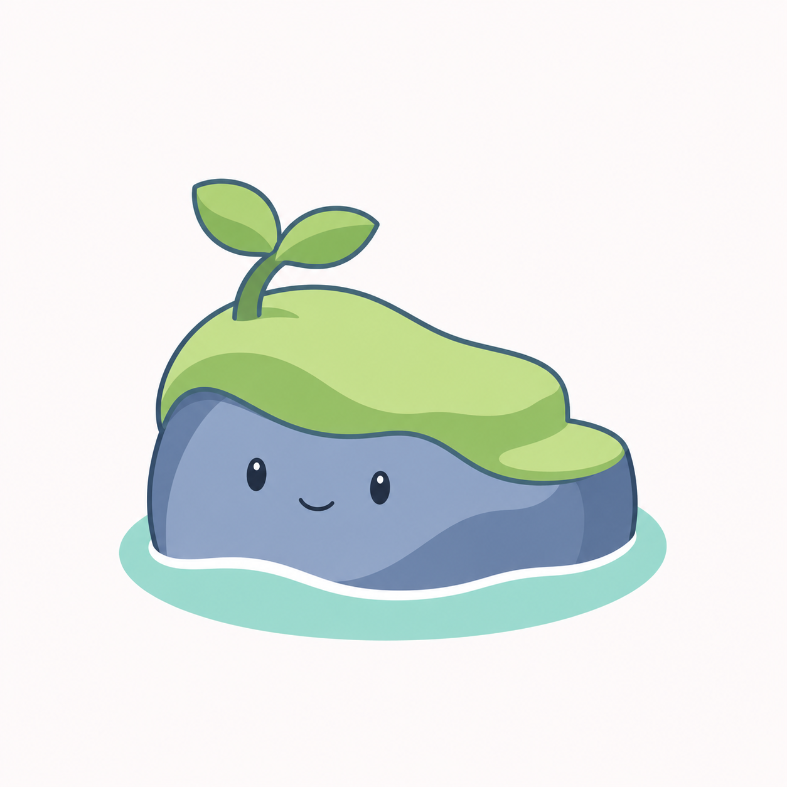
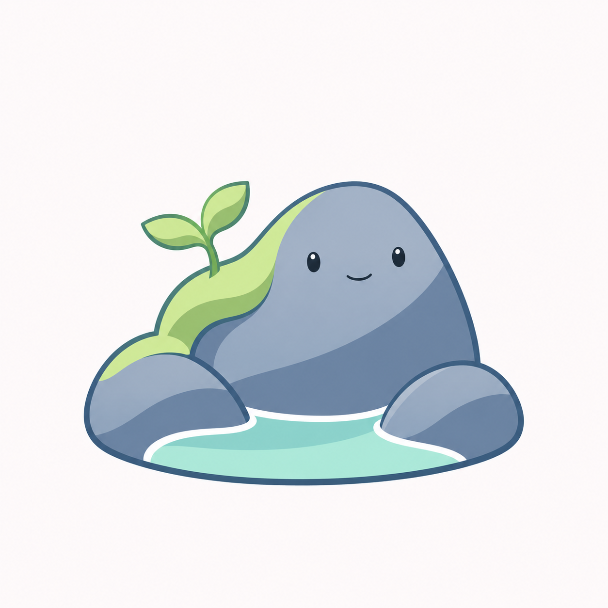

# 北沚草坡小岛与礁石小湾 v0.20

用户在[岩洲轮廓 v0.19](北沚岩洲轮廓调整-v0.19.md)后要求再换。本轮继续清爽插画方向，将草坡、石身与水面重新组合，增加两种结构候选。

## F：草坡小岛



顶部草坡呈现俯视平面，前方短岩壁带面部，右侧草地台阶形成起伏，浅绿水面与白色岸线围绕底部。采用轻微三分之四视角，增加小岛感。

## G：礁石小湾



主石与两侧低礁石围出浅湾，草坡集中于左侧肩部，幼芽从其间生长。主石带唯一面部，水面处于前方湾内，取消高卷浪。

两版均为浅色背景插画候选，使用描边、柔和色块和简化阴影。F 的幼芽仍较明显，G 的岩石形状仍偏圆润，后续应根据用户选择继续调整，不将提示词当作完全实现的验收结果。未制作透明图标、ICO 或进行真实任务栏尺寸、DPI 验收；未定名，不替换程序图标或修改用户数据。

## 生成模式与完整提示词

内置 imagegen，两个独立生成请求。输入 `docs/images/mascot-cast-detail-v07.png`，仅参考插画风格及岩洲题材，允许重做形体。

### 方案 F

```text
Use case: stylized-concept. Asset: 北沚 illustrated mascot, genuinely new design concepts.
Input image 1 supplies ONLY the fresh illustrated character-family art direction. Do not copy the silhouette or mushroom-like moss cap of number 06. The user wants a new shape in clean illustration.
Draw a charming original island mascot using elegant fine blue-gray contours, restrained fresh opaque colors, smooth confident shapes, two broad cel-shading tones and minimal detail. Slight illustrated dimension, no render materials. Expressive very small dark oval eyes and a tiny natural smile, one face only. Clear silhouette and attractive proportions, friendly and quiet, designed as a software icon. Palette: soft jade green, muted ocean blue/slate, pale mint-aqua water and warm ivory. Colors feel fresh rather than muddy gray or neon.
Square nearly-white plain background, one complete centered design occupying about 70 percent of canvas, generous breathing room, no text, border, tile or presentation grid.
Avoid glass, frost, plastic shine, big specular highlights, 3D toys, textures, thick sticker borders, elaborate scenery, buildings, trees, extra mascots, clothing, arms and legs. No huge sprout dominating the shape, no giant curled wave surrounding a round head. This is a new island design, not another stone wearing hair or a hat.
Concept F, grassy little island: a compact rounded asymmetric tabletop island seen in a gentle three-quarter top view. The top is a low continuous pale-jade grassy slope, clearly a land surface with visible upper plane, not a cap dangling on a head. Outline shaped like a soft irregular bean, higher at back left, with a short smooth blue-slate cliff face underneath and one small rounded step at right. A small TWO-LEAF seedling emerges from back-left turf and leans inward. Tiny eyes and smile live on the exposed front cliff face. Base water is a shallow mint oval tucked partly behind the rock with one clean white shoreline arc at front; NO spiral crest. Emphasize a pleasing compact island silhouette, a small sunny grassy top and a friendly short rock face; only three clear large color regions. Slightly taller than wide including the small sprout, never a wide landscape panorama.
```

### 方案 G

```text
Use case: stylized-concept. Asset: 北沚 illustrated mascot, genuinely new design concepts.
Input image 1 supplies ONLY the fresh illustrated character-family art direction. Do not copy the silhouette or mushroom-like moss cap of number 06. The user wants a new shape in clean illustration.
Draw a charming original island mascot using elegant fine blue-gray contours, restrained fresh opaque colors, smooth confident shapes, two broad cel-shading tones and minimal detail. Slight illustrated dimension, no render materials. Expressive very small dark oval eyes and a tiny natural smile, one face only. Clear silhouette and attractive proportions, friendly and quiet, designed as a software icon. Palette: soft jade green, muted ocean blue/slate, pale mint-aqua water and warm ivory. Colors feel fresh rather than muddy gray or neon.
Square nearly-white plain background, one complete centered design occupying about 70 percent of canvas, generous breathing room, no text, border, tile or presentation grid.
Avoid glass, frost, plastic shine, big specular highlights, 3D toys, textures, thick sticker borders, elaborate scenery, buildings, trees, extra mascots, clothing, arms and legs. No huge sprout dominating the shape, no giant curled wave surrounding a round head. This is a new island design, not another stone wearing hair or a hat.
Concept G, reef cove: a cozy asymmetric cluster of THREE smooth blue-gray sea pebbles forming a single compact little island, central main pebble upright and rounded with a gentle flat shoulder, a smaller lower stone on each side. Main pebble is NOT a symmetrical egg or domed head. Put the only tiny friendly face high on the central rock. Pale jade moss is a SMALL side patch fitted to the upper LEFT shoulder and connects naturally into the left supporting stone, not an overhanging cap; one small two-leaf seedling grows diagonally from that sheltered seam. Pale aqua water fills a simple open crescent cove between the low stones across the foreground, with one soft white shoreline contour, NO curling spiral. Composition feels like a tiny protected bay, central rock face remains visible, no large platform. Keep three stones visually fused into one compact mascot silhouette and a calm upward rhythm, no extra scattered pebbles or busy decorative plants.
```
