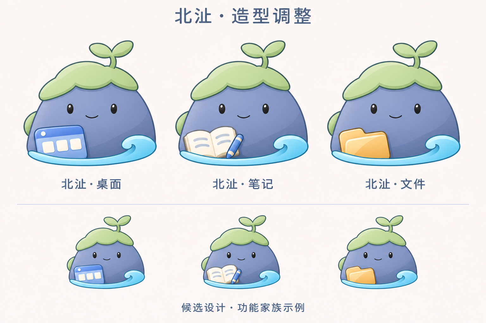

# 北沚造型调整 v0.9

继续调整[北沚 v0.8](北沚重点精修-v0.8.md)，保留岩洲、苔帽、两叶幼芽和卷浪的角色结构。旧稿保留用于对比。

本轮缩小幼芽，收紧苔帽并简化侧边苔块，减薄底部水纹和右侧卷浪，微调眼距与五官比例，简化石身明暗，让造型更紧凑。独立稿仍为透明背景 PNG。

桌面、笔记、文件示例同步采用新的角色造型，道具集中在左下方，保留脸部与右侧卷浪。家族稿为生成式重绘，尚不是同一可编辑对象的精确复用；缩略图仅供概念观察，尚未进行真实任务栏或不同 DPI 验收。

本轮使用内置 imagegen 参考图编辑，先生成独立角色，再将其和上一轮家族稿作为参照绘制功能示例。[完整提示词](北沚调整提示词-v0.9.md)随稿保存。名称和最终角色仍待定，本轮不替换程序图标或修改用户数据。
