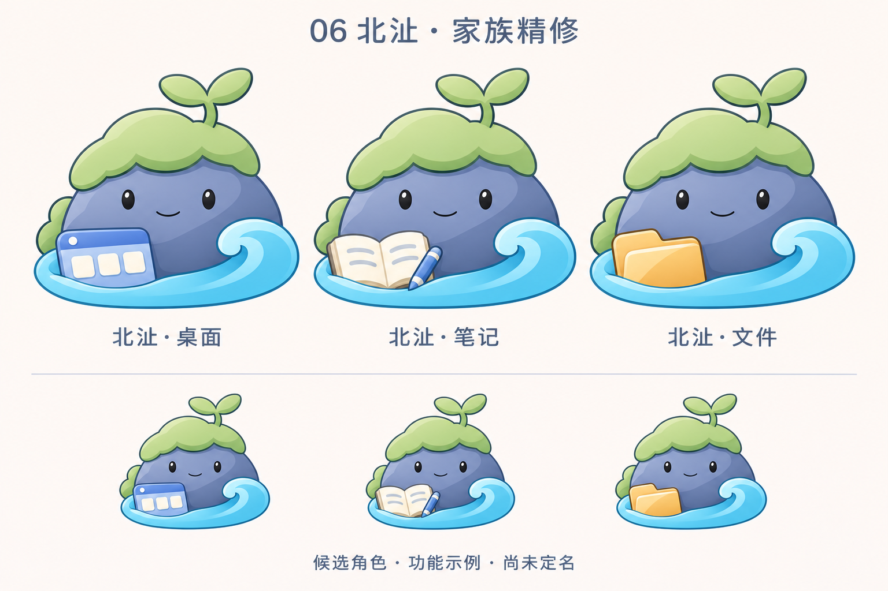

# 06 北沚重点精修 v0.8

用户要求继续精修，重点增加 6 号。本轮沿用[九角色 v0.7](角色造型精修-v0.7.md)里的北沚造型，增加单独角色大图及功能家族示例。其他候选继续保留，尚未确认母品牌或最终角色。

## 独立角色

保留岩洲、苔帽、两叶幼芽和底部水纹。绿色调整为更柔和的鼠尾草绿，简化石身切面，整理苔帽与石身的重叠边缘，底部水纹采用一条完整前景弧线和右侧卷浪。独立稿为透明背景 PNG，便于后续排版与背景观察。

## 功能家族

新增“北沚·桌面、北沚·笔记、北沚·文件”三个功能示例，以窗口面板、笔记与笔、文件夹区分功能。道具靠在前景水纹内侧，不增加手脚，保留面部、幼芽和右侧卷浪。

下方缩略图仅用于概念对照，尚未完成真实任务栏尺寸、DPI、深浅背景验收或 ICO 制作。家族实例为生成式重绘，不代表共用同一可编辑母版；正式资源制作应复用角色对象。北沚为名称意象的原创角色表达，不作为古籍原形复原声明。

生成方式：内置 imagegen，先参考九角色稿编辑独立角色，再引用独立角色绘制家族稿。[完整提示词](北沚精修提示词-v0.8.md)随图归档。仅更新设计资料，不改程序名称、图标、版本及用户数据。
