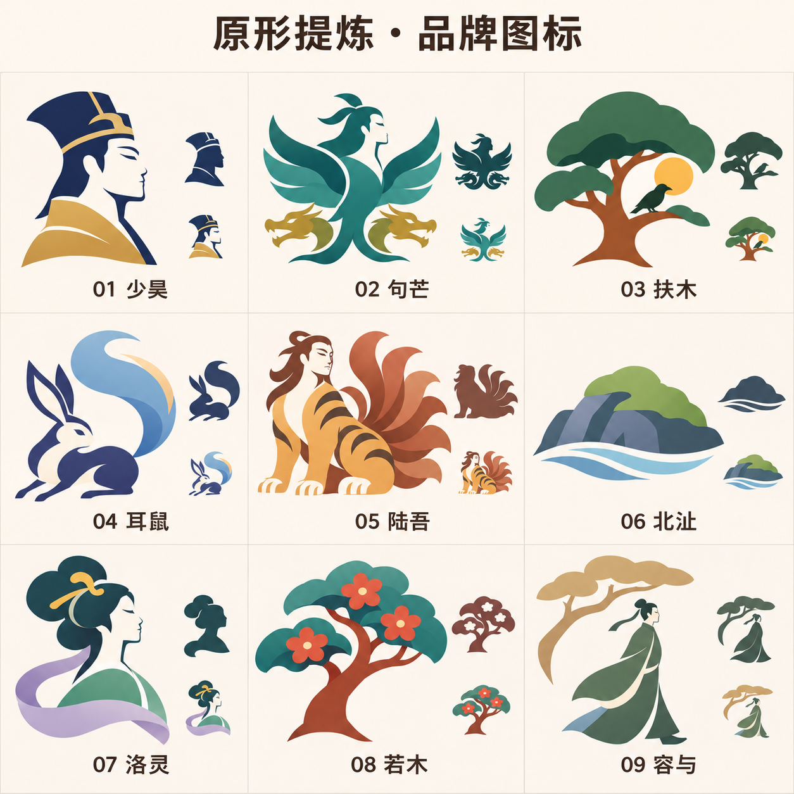

# 原形提炼与图标设计研究 v0.3

日期：2026-11-07。状态：方向稿，待用户评审。九个名字分别是母品牌候选，不是九款已开发软件。

## 需求与此前问题

用户选定的九个候选：少昊、句芒、扶木、耳鼠、陆吾、北沚、洛灵、若木、容与。用户要求尽量贴近原本形象，并参考成熟的软件图标设计思路。

此前两种表现均被否定：过度几何化后失去原形；保留过多衣冠、毛发、枝叶、河岸后，成为插画而不是图标。本轮重新生成，尝试在轮廓层面保留可认的主体与关键特征。

## 参考研究与设计推导

| 参考 | 参考资料中可见的处理 | 本项目的推导 |
| --- | --- | --- |
| Firefox 官方 Photon 产品标识案例 | 保留熟悉的狐狸与球体元素，以更简练的形状和鲜明色彩更新标识 | 保留能认出的原形特征，精简附属细节；不复制包围球体的构图或品牌轮廓 |
| Thunderbird 官方 2023 标志 | 将鸟与信封组织成紧凑的具象标识 | 用姿态与层叠建立整体性，避免将一幅场景塞进方框；不复制其鸟抱信封造型 |
| Windows 应用图标规范 | 单一主要意象、清晰轮廓、适量细节，按尺寸检查可读性 | 先检查主体和负形，再设计颜色；小尺寸需独立重绘和验证 |

以上推导是本项目的设计判断，不代表第三方认可或参与设计。

参考原页：[Firefox Photon](https://firefoxux.github.io/photon/visuals/product-identity-assets.html)、[Thunderbird 官方说明](https://blog.thunderbird.net/2023/05/introducing-the-brand-new-thunderbird-logo/)、[Windows 图标设计规范](https://learn.microsoft.com/en-us/windows/apps/design/iconography/app-icon-design)。第三方原图仅供本机研究，没有作为本项目标志或生成输入发布。

## 本轮方案

| 候选 | 需要保留的识别点 | 图形处理 |
| --- | --- | --- |
| 少昊 | 冠服人物的身份 | 帽冠、人物侧面、衣领三层；参考后世人物表现，不称唯一原貌 |
| 句芒 | 人面鸟身、乘两龙 | 人面与宽翼形成主体，两龙成为支撑轮廓，减少羽毛线条 |
| 扶木 | 神木、日与乌的意象 | 树冠、树干、太阳、乌鸟形成有层级的组合，取消叶脉和地面场景 |
| 耳鼠 | 兔首长耳、麋身、以尾飞 | 长耳、身姿与上扬的大尾巴作为识别点，取消毛发和写实肌理 |
| 陆吾 | 人面虎身、九尾 | 人面、虎纹、尾部扇形形成整体，取消衣纹与写实毛发 |
| 北沚 | 水中小洲 | 洲石、草冠、两条水线，取消完整河岸风景 |
| 洛灵 | 神女、云髻、轻裾 | 侧面、发髻、袖与披帛作为大色块，取消花饰和珠饰细纹 |
| 若木 | 赤树、青叶、赤花 | 树干与树冠作为主体，少量红花区分于扶木 |
| 容与 | 林间徐行的动作与状态 | 文士姿态与一段树荫，取消写实地面与河岸；它不是固定神兽 |

古籍描述作为特征依据，姿态、设色和衣冠属于设计表达。少昊可参照[故宫所藏后世少皞像](https://digitalarchive.npm.gov.tw/Collection/Detail/15624?dep=P)；陆吾、句芒、若木等依原文形貌取特征。容与和北沚用场景含义表达，不虚构其为神兽。

## 评审与下一步

- 已查看本轮成图，方向改变体现为轮廓和大色块的简化，保留了主体辨识点；用户尚未认可任何一款。
- 相比前稿，树木仍有生态品牌感，人物仍有服饰文化感，是否适合本项目要由后续选择和原生效果共同判断。
- 陆吾的九尾等数量性细节，须在最终可编辑绘制中逐条校正；生成图不作为数量准确性的最终验收。
- 单色和缩小图是生成示意，尚未证明 16/20/24/32 像素下可用；不能据此声称完成任务栏清晰度验收。
- 选定后制作单枚可编辑源稿，简化过密负形，分别绘制小尺寸，验证深浅背景和 DPI；随后才扩展当前桌面产品与其他功能图标。
- 本轮只提交设计资料，不更名、不替换程序图标、不生成软件更新，不触碰用户数据。

生成方式：内置 image_gen；[原始提示词](原典图标提示词-v0.3.md)随稿归档。
