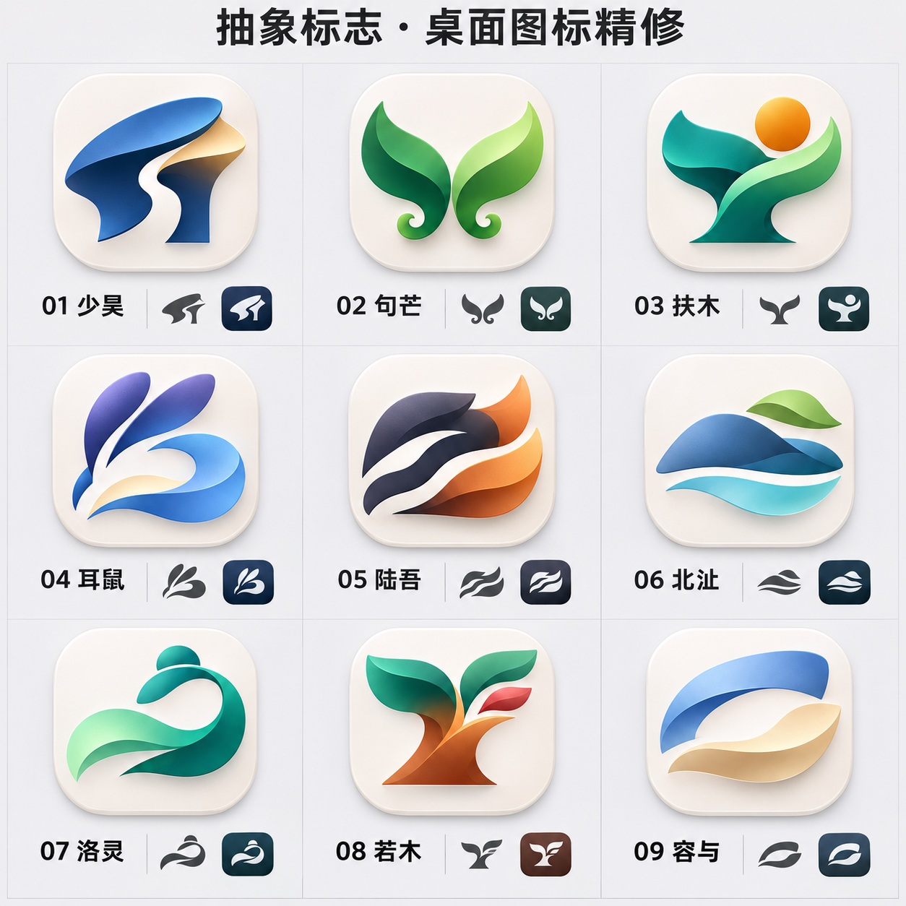

# 优秀案例研究与产品图标 v0.4

日期：2026-11-07。状态：待用户评审，九个名称均为候选母品牌，未定名、未替换软件图标。

## 本轮目标

用户要求在保持抽象的基础上，参考优秀案例继续美化。此前轮次已尝试原形插画、形体提炼、抽象标志和渐变。本轮重点是把品牌标志落实到桌面产品图标的构图与质感，而非再给图形堆叠渐变或重画神话场景。

## 案例与应用

| 官方参考 | 参考资料中的处理 | 本项目的应用判断 |
| --- | --- | --- |
| [Sketch 2020 图标改版](https://www.sketch.com/blog/how-we-redesigned-the-sketch-icon-for-big-sur/) | 保留钻石核心，反复比较前景和背景；重新绘制并调整颜色、对比与阴影 | 背景从简，主体占据稳定面积；明确前后层次，让载体衬托而非抢夺主体 |
| [1Password 2023 品牌更新](https://1password.com/blog/1password-brand-refresh) | 区分公司品牌标志与既有产品图标，并以钥匙孔作为核心符号 | 保留简洁的无底标志，同时尝试更有材质层次的应用图标；两者不同用途、同一识别骨架 |
| [Raycast 官方品牌素材](https://www.raycast.com/press) | 提供浅深背景标志及独立产品图标 | 配套看无底标志、浅色产品图标和深色示意；不复制其斜纹符号、文字或霓虹边框 |

以上是本项目的设计推导，不表示参考品牌要求或认可本项目采用这种底板，也不表示 Windows 强制应用图标具有背景板。官方参考原图只保存在本机被忽略的研究目录，未作为本轮生成输入或本项目品牌资产上传。

## 本轮成图

- 每格大图：带轻微质感底板的应用图标方向。
- 每格下方：简化的单色标志和深色环境示意。
- 名称顺序：少昊、句芒、扶木、耳鼠、陆吾、北沚、洛灵、若木、容与。
- 保留抽象标志的基本识别特征，本轮主要调整载体、主体与背景的层次、占比和边缘。

## 设计规则

1. 图形先行：用清楚的轮廓、负形和少量识别特征建立主体；材质不能代替图形设计。
2. 层级清楚：本轮使用低存在感的浅瓷色底板、短接触阴影和主色明暗，避免多层外发光。
3. 比例一致：九种方案采用相近的图形占比、光照方向和留白，便于比较实际造型。
4. 配色克制：保留深色锚点和少量亮色；辅助色应衬托主形，不能让细小切面抢夺视觉焦点。
5. 用途分开：无底标志可用于字标组合和部分界面；应用图标另行处理任务栏与开始菜单等环境。
6. 最终仍需绘制独立的小尺寸资源，不以生成图里的缩略图证明像素级可读性或 DPI 验收。

## 逐款评审

| 候选 | 本轮识别点 | 下一步需要解决 |
| --- | --- | --- |
| 少昊 | 帽冠式宽面和侧面负形，蓝金对比 | 轮廓仍偏横向，需避免与通用鹰形、帽形标志过于接近 |
| 句芒 | 翼/叶式曲线和下端卷钩 | 仍存在普通生态叶片标志的联想，需要继续建立独特比例 |
| 扶木 | 承托式曲线与日轮 | 仍可能被看作人形举手或奖杯，应优先完善树干的非对称结构 |
| 耳鼠 | 长耳与开放的尾部曲线 | 需检查耳尖和内部切面的真实小尺寸可读性，避免仅依赖渐变 |
| 陆吾 | 守护核心、虎纹留白、铜色尾部层叠 | 为抽象多尾意象，不是九尾的写实复原；需检索运输、运动类近似标志 |
| 北沚 | 洲体、草冠与水线 | 还存在山形/户外标志的联想，若选中需进一步压低和圆润洲体 |
| 洛灵 | 发髻提示、丝帛般曲线与大留白 | 需避免形成普通波纹、眼形或浏览器环形，保持女性姿态意象的线索 |
| 若木 | 朱色树干、青叶、花色切面 | 需解决通用植树标志联想，不靠颜色独占识别 |
| 容与 | 两片舒展结构和宽负形 | 需检查折叠丝带类标志近似性，并判断能否表达从容而非仅装饰 |

上述是已查看成图后的设计自评，不代表用户已认可、名称已可注册或图形已通过原创性检索。单色示意中个别细节可能省略，选定方案后须统一修正为同一几何母稿。

## 后续落地

- 选定较有感觉的名称与轮廓后，制作一枚可编辑源稿，实际调整曲率、切面与间距。
- 制作颜色、单色、浅深环境和实际任务栏尺寸版本，检验识别度和对比。
- 基于该母稿扩展桌面、笔记、文件等功能标记，避免重复粘贴完整母标而无法区分用途。
- 当前仅是设计资料更新，不修改正式程序、收纳记录、关闭偏好或更新流程。

生成方式：内置 image_gen；[本轮原始提示词](桌面产品图标提示词-v0.4.md)随稿归档。
