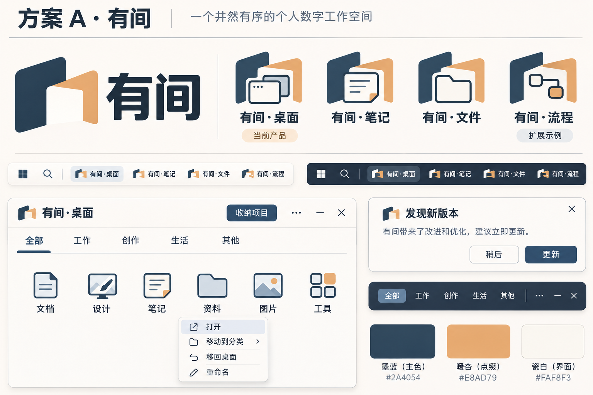
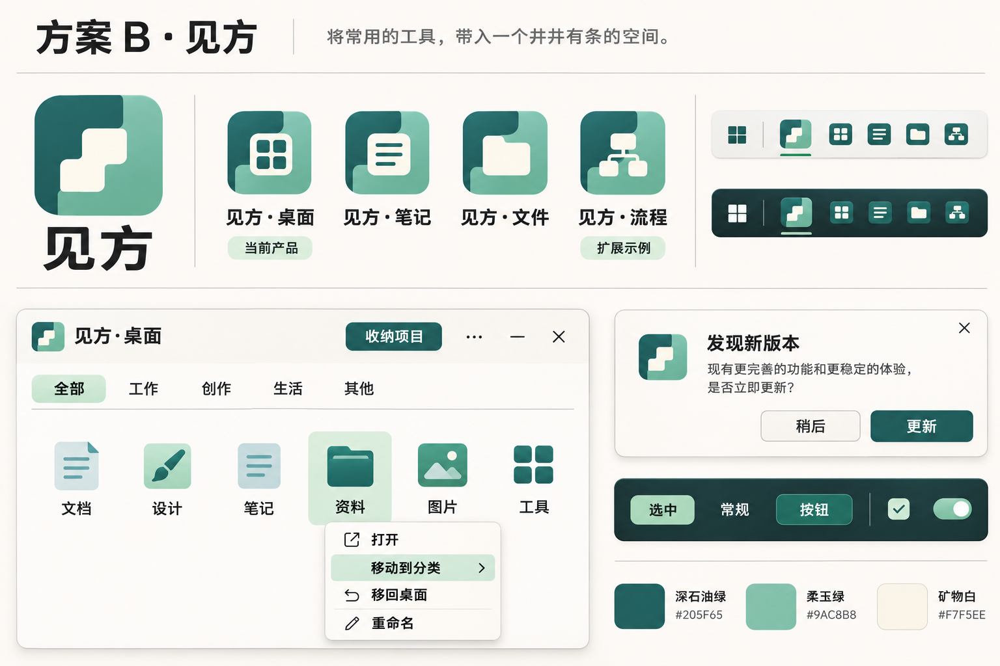
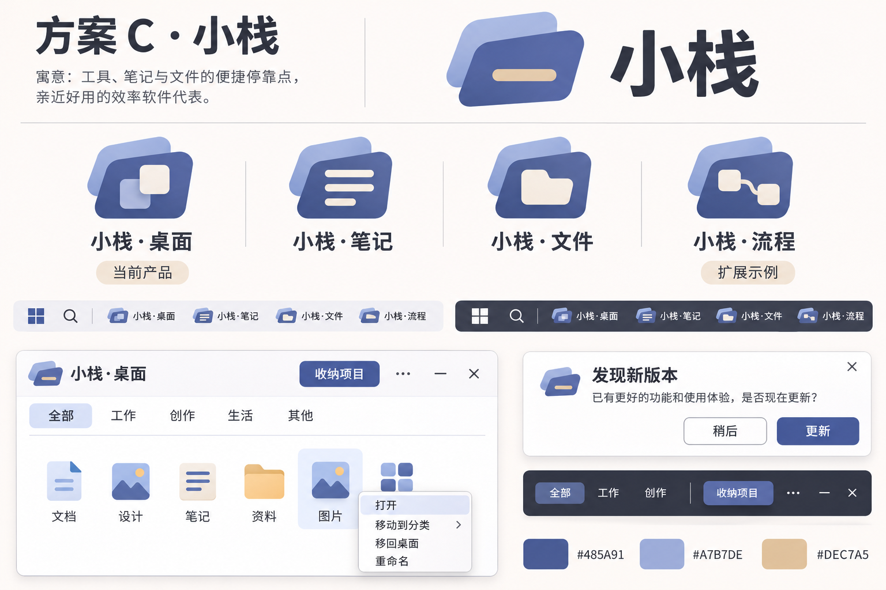

# 母品牌与家族视觉方案 v0.2

日期：2026-11-06。状态：三套待评审方案，不是软件界面的交付验收图。

## 本轮设计边界

- “小筑”仅是用户能接受的语感参照，用户已明确不要直接采用这个名字。母品牌尚未确定。
- 母品牌须为中文，适合两到三个字、自然好叫；兼顾亲切空间感和软件工具感。避免纯文艺命名、生硬技术名词以及刻意拼字。
- 已确认“母品牌＋功能名”，基础交互统一、核心操作按产品功能设计。笔记、文件、流程目前只是家族扩展示例。
- 本轮提供母标、四款产品图标、深浅背景任务栏示意、当前桌面软件界面、右键菜单、更新确认和配色。方案之间采用同类内容，便于比较。
- 历史方向留作参考，本轮不修改正式程序名称、安装包、任务栏入口或用户配置。

## 三套方案对比

| 方案 | 命名与语感 | 图形母体 | 配色与 UI 气质 | 需要权衡 |
| --- | --- | --- | --- | --- |
| A 有间 | “有一个自己的工作空间”，口语自然，空间感明确 | 两片围合出开口空间的宽面；各产品使用相同空间框架加功能符号 | 墨蓝＋暖杏＋瓷白，清楚、温和，有工具感 | 图标缩小时须简化中心符号，避免叠层过多 |
| B 见方 | 常用中文表达，尺寸、秩序与可管理的空间 | 两个互扣模块形成方形轮廓和阶梯留白 | 深青＋柔玉绿＋矿物白，克制、稳定、偏专业 | 方形轮廓较常见，需继续提炼专属比例和留白 |
| C 小栈 | 便捷停靠点，亲近、容易叫，也有软件工具联想 | 两张层叠卡片与一条统一的横向槽口 | 石板靛蓝＋浅矢车菊蓝＋暖砂，轻量、柔和 | 家族底座偏常见，需要在槽口或外轮廓建立记忆点 |

名称均为创意候选，未完成同类产品与商标核查，不能视为可直接注册使用的结论。

## A · 有间

- 产品命名：有间·桌面、有间·笔记、有间·文件、有间·流程。
- 母标解释：留出一个可进入、可安放常用工具的空间。桌面、笔记、文件和流程共用外部框架，内部符号承担用途辨识。
- 品牌主色 `#2A4054`；点缀 `#E8AD79`；浅色界面 `#FAF8F3`。暖杏用于少量识别细节，不承担错误或警告的含义。
- UI：墨蓝主操作，浅蓝灰选中反馈，偏暖背景，菜单尺寸紧凑。更接近本轮希望保留的亲切空间感。

## B · 见方

- 产品命名：见方·桌面、见方·笔记、见方·文件、见方·流程。
- 母标解释：宽面模块拼接成可管理的一个区域，负形成为统一识别特征。各产品共用拼接方式、比例和图形厚度。
- 品牌主色 `#205F65`；辅助 `#9AC8B8`；浅色界面 `#F7F5EE`。辅助绿用于选择态和品牌识别，操作状态另设语义颜色。
- UI：深青主操作、淡绿选择态、温白面板。整体更偏系统化的专业工具。

## C · 小栈

- 产品命名：小栈·桌面、小栈·笔记、小栈·文件、小栈·流程。
- 母标解释：层叠卡片形成共同底座，桌面用重叠卡片、笔记用文本、文件用文档、流程用连接节点区别。不能仅换色。
- 品牌主色 `#485A91`；辅助 `#A7B7DE`；少量暖砂 `#DEC7A5`。背景和正文保持清楚的明暗关系。
- UI：靛蓝主操作与轻量选择态，保留亲切感，同时具有清楚的工具层级。

## 共用的界面与交互参数

以下为落地基线，最终需在原生程序中按屏幕 DPI、文本长度和操作内容验收。

| 项目 | 基线 |
| --- | --- |
| 字体 | Windows 系统 UI 字体与中文回退；正文约 13 DIP，辅助 12 DIP，窗口标题 16 DIP |
| 间距 | 以 4 DIP 为基本步长，常用 8 / 12 / 16 / 24；密集菜单可按内容微调 |
| 圆角 | 控件约 6–8 DIP，菜单约 8 DIP，窗口约 12–14 DIP；相同层级保持一致 |
| 文字渲染 | 当前屏幕 DPI 原生排版、布局取整；文字不跟随整体位图缩放，阴影单独分层 |
| 主面板 | 分类标签、一个连续网格，默认六列；变化的是换行，不是把图标和文字整体缩放 |
| 右键菜单 | 与主面板同一字体和视觉层级；先打开与整理，再移回桌面，危险命令单独区分 |
| 更新确认 | 约 360–390 DIP 宽；说明较长时滚动；提供“稍后 / 更新”，确认后才下载 |
| 下载窗口 | 约 350–370 DIP 宽；进度、当前及目标版本明确；取消不改动当前程序 |
| 重命名 | 输入框明确聚焦；保存才写入，取消或 Esc 保留原值 |
| 用户偏好 | 未勾选也是已保存的有效选择。主窗口关闭行为按用户原偏好保留 |
| 深浅主题 | 共用布局、轮廓、间距和交互含义，分别校验文字、图标与状态的实际对比度 |

## 图标落地要求

- 母标用于品牌介绍或整套工具入口，各软件的窗口、任务栏和安装图标应统一使用自己的产品标记。
- 由选定方案制作可编辑的几何源文件；为 16 / 20 / 24 / 32 等任务栏尺寸检查轮廓、留白和细节，不以大图缩小替代实际检查。
- 收纳区中的第三方软件图标继续使用其真实图标。概念稿中的通用图标只用于演示布局。
- 产品图标在单色、深浅背景下均需能区分。图中任务栏缩略图属于生成示意，尚未完成原生小尺寸和跨 DPI 验收。

## 本轮评审发现与后续修正点

- 概念图部分窗口标题栏用了母标，正式设计需改为与桌面产品图标一致。
- 部分生成图遗漏独立设置示例，或用通用勾选控件展示状态。它们不代表用户当前设置；正式稿须明确绘出“关闭时结束进程”未勾选，并保留真实偏好。
- 扩展示例标签应覆盖笔记、文件、流程三款；概念图中部分仅在流程下标注，正式规范需统一说明。
- 三套均已查看，六列布局和主要菜单、弹窗层级可用于比较。精确字形、间距、控件状态和图标小尺寸清晰度仍需选定后用可编辑稿及原生程序验证。

## 建议选择顺序

先判断哪套母品牌名称与整体气质接近，再固定图标骨架，随后细化字标、配色、控件状态和每一种弹窗。A 更偏亲切空间感，B 更偏稳定专业，C 更偏轻量工具；也可保留某个名字而选择另一套视觉，但需重新建立一套完整的一致规则。

生成方式：内置 image_gen，三次独立生成；[原始提示词](生成提示词-v0.2.md)随方案归档。当前仅提交设计资料，不发布程序新版本。
