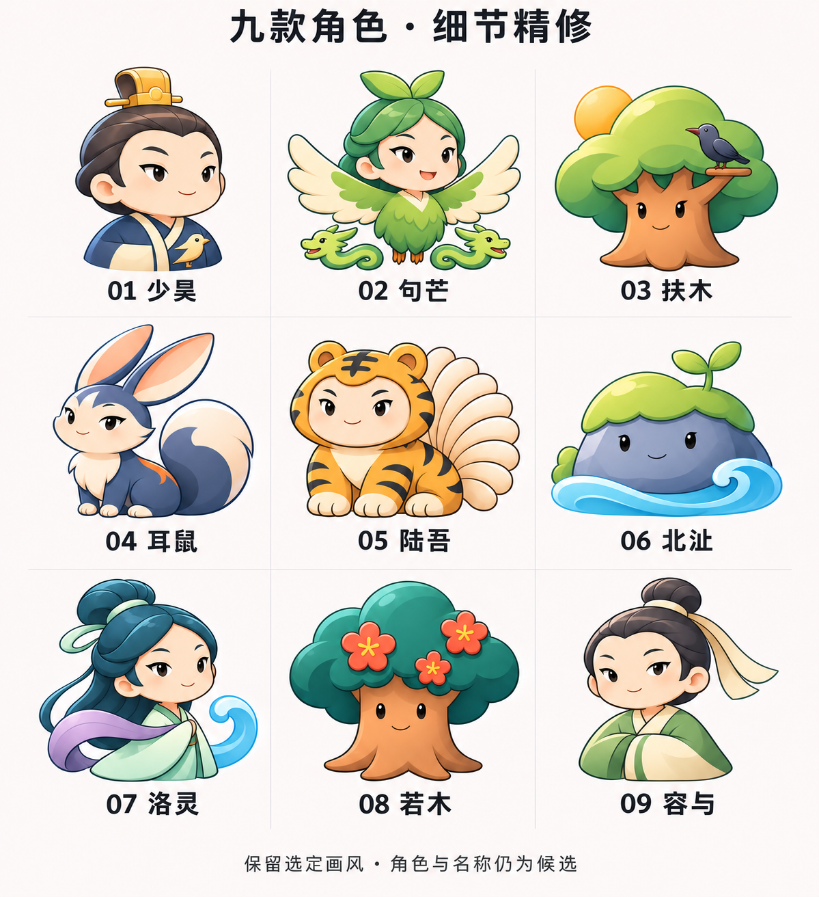
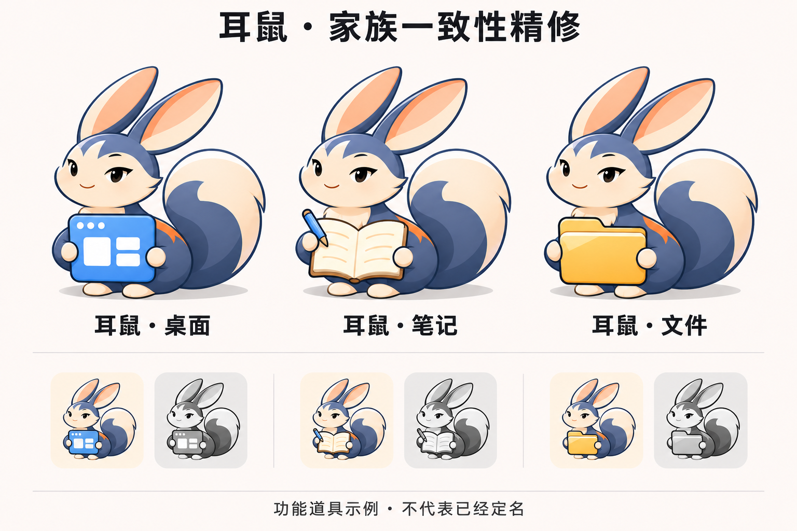

# 选定画风的角色细节精修 v0.6

日期：2026-11-07。依据：用户再次贴出“角色风格·第二轮精修”截图并要求继续精修。

本轮保持 [v0.5 选定风格](选定吉祥物风格-v0.5.md)：细蓝灰描边、柔和色块和轻微立体感，保留候选原有造型、神态与配色。名称、角色和最终图标均未定稿。

## 一、九角色大图

拆掉原板下方家族区，让九个角色各自获得更多观察空间。本轮属于原造型上的细节精修：清理轮廓连接、五官位置和局部阴影，维持统一光照方向，减少零碎细纹与装饰；不是另起一套绘制风格。

| 候选 | 重点保持与检查 |
| --- | --- |
| 少昊 | 小金冠、深色头发、蓝白衣领与鸟形装饰；眼神自然，冠与头部连接清楚 |
| 句芒 | 人面、羽身与双翼、两条龙的意象；翼形平衡，简化层叠羽毛 |
| 扶木 | 桑树式冠形、日与乌、树干脸；面部不被树冠遮住 |
| 耳鼠 | 长耳、蓝白色身形、麋身意象、弯曲大尾；耳部连接、爪形和尾身留白整洁 |
| 陆吾 | 人面虎身与尾扇；虎纹、爪形协调；九尾等数量细节仍需人工源稿核验 |
| 北沚 | 岩洲、苔帽、幼芽和水线；减少岩石细碎切面，保持面部清楚 |
| 洛灵 | 云髻、青白衣、紫色披帛与水纹；发髻、披帛与面部比例自然 |
| 若木 | 赤色树干、青色树冠与三朵示意红花；花形清楚，不添加日乌 |
| 容与 | 发髻、浅青衣、宽袖和舒展神态；衣带与主体保持紧凑 |

人物衣冠、设色和拟人表情均属艺术表达，不能称为原典唯一形象复原。

## 二、家族图标大图

耳鼠仅为方法示例。桌面、笔记、文件三个版本尽量复用相同头型、表情、耳尾比例、配色和照明，仅按道具调整手势：

- 桌面：蓝色窗口卡片，使用简化面板，避免混用第三方品牌图标。
- 笔记：米白笔记本与蓝笔，控制内页线条数量。
- 文件：暖黄色文件夹，保持简单轮廓和清楚的持握关系。

生成大图用于看角色与道具的整体一致性，不是像素一致的正式源稿。正式制作时应复用同一可编辑角色对象，而不是逐次生成近似角色。

下方为彩色与灰度比较，生成结果不是所请求的真正深色背景版本，不能称为已经完成深色环境验证；深色版本留待正式制稿时另行绘制和检查。

## 三、验收边界与后续

- 已查看两张成图，名字顺序与主要角色完整，延续用户指定画风；本轮风格变动有限，重点为细节与分板展示。
- 用户尚未确认本轮精修结果。人物细部、九尾数量、轮廓一致性等仍需进入单枚源稿阶段人工检查。
- 尚未制作透明图标资产、ICO 或真实任务栏分尺寸资源；生成缩图不作为清晰度、跨 DPI 或图形近似性验收证据。
- 当前只更新设计资料和提示词，不更改正式程序名称、图标、配置、分类、文件或更新链路。

生成方式：内置 image_gen；[两份原始提示词](角色细节提示词-v0.6.md)随稿归档。
