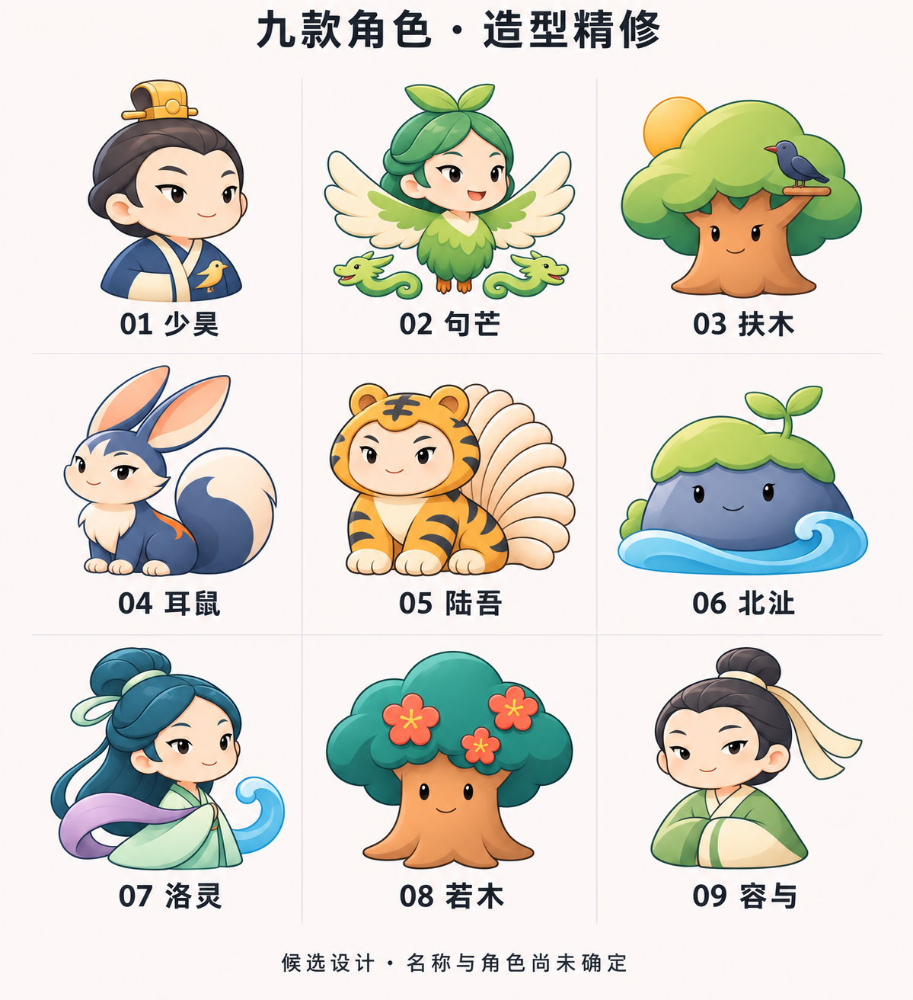
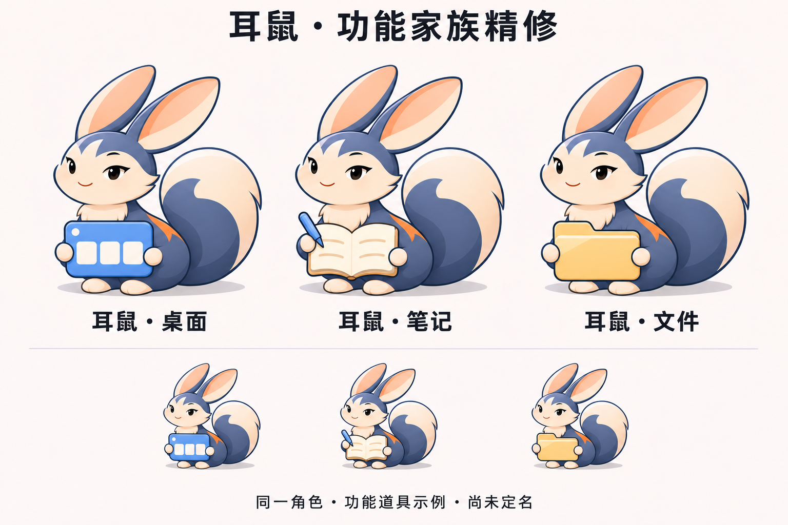

# 角色造型精修 v0.7

继续沿用户选中的清爽 Q 版、细描边、柔和色块和轻微立体感精修，保留九个候选名称、角色概念和配色。上一轮见[角色细节 v0.6](角色细节精修-v0.6.md)。本轮使用内置 imagegen 图像编辑模式，先生成九角色稿，再将新稿作为家族示例的角色参照。

## 九角色稿

整理头发、树冠的碎高光，收紧羽翼、尾扇、衣袖和水纹的内部线条。保持少昊、句芒、扶木、耳鼠、陆吾、北沚、洛灵、若木、容与的原有姿态与识别元素。

## 家族示例

以新九角色稿中的耳鼠为角色依据，继续展示桌面、笔记、文件三种功能。下移道具以露出胸前毛簇，减少面板与笔记的细节，统一三款道具的体量。下方缩略图仅供观察整体效果。

耳鼠仍仅作家族结构示例，没有确定母品牌。本轮图片是位图候选稿，尚未制作 ICO，也未进行真实任务栏尺寸或不同 DPI 验收。家族图中的角色为生成式重绘，并非同一可编辑母版的精确实例；最终落地应复用同一角色母版。陆吾尾部数量与结构仍须在最终可编辑绘制时逐一校验，不能据本稿宣称准确复原。

完整输入角色与提示词见[生成提示词](角色造型提示词-v0.7.md)。本轮仅归档设计，不修改程序名称、图标、版本及用户数据。
