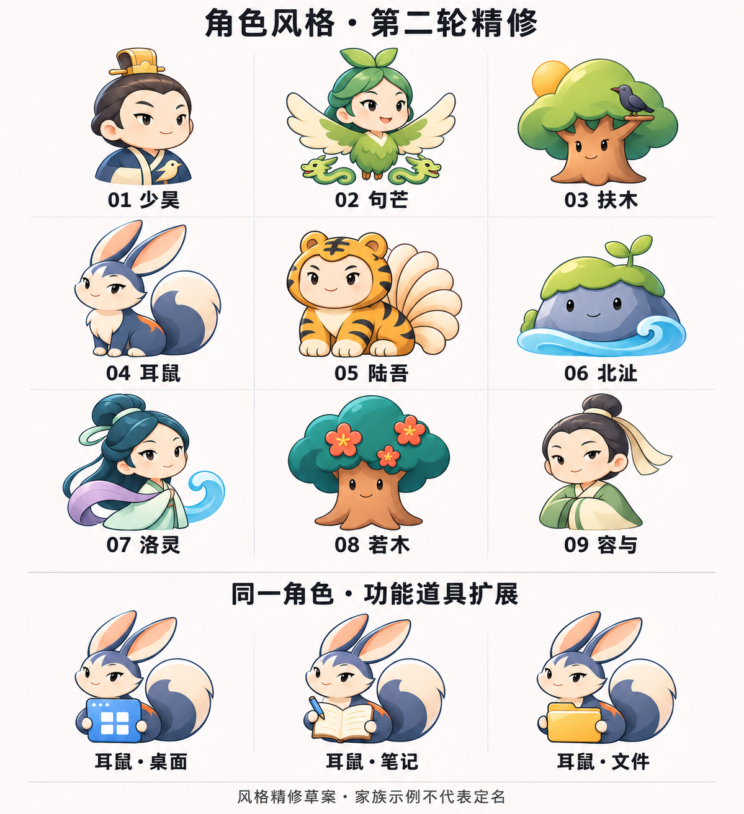

# 选定吉祥物风格 v0.5

日期：2026-11-07。

用户明确选中了此前“九款角色·造型与质感精修”的清爽 Q 版截图，要求沿该风格继续美化。这里确认的是绘制风格，不是母品牌名称或某个角色定稿。

## 风格基准

- 细蓝灰描边，柔和色块，少量阴影和高光；轮廓清楚，保留轻微立体感。
- 保持截图里的小幅眼神和表情、角色比例与主配色，不转为无描边扁平标志、粗线贴纸、深色徽章或写实古风插画。
- 当前九个候选仍为：少昊、句芒、扶木、耳鼠、陆吾、北沚、洛灵、若木、容与。
- 原典特征以可识别为主，服饰、色彩和拟人表情属于艺术表达；最终仍须校正神兽尾数等细节。
- 桌面、笔记、文件等功能版本复用同一角色的头型、眼神、配色、耳/尾轮廓，仅调整道具和必要的手势。耳鼠仅用于演示，不代表已选耳鼠作母品牌。

## 本轮精修



本轮保持原图构成，主要做细节精修，变化幅度有限：清理描边与部分细纹，收拢轮廓，微调局部明暗，保持人物表情与三款耳鼠的家族一致性。不能把本轮表述为重新设计全部造型，也不代表已经完成任务栏小尺寸验收。

下一阶段在用户收敛候选后，单独制作主角色的可编辑稿，明确表情、正侧面、色板和道具规范，再生成透明背景图标与分尺寸资源。未选定前不更改正式软件名称或图标，不操作用户数据。

## 生成方式与原始提示词

本轮使用内置 image_gen 编辑，参考输入为用户指定风格截图与其高分辨率原稿；保持同一方向，不采用上一轮三套对比中的其他风格。

```text
Use case: precise-object-edit / mascot-brand refinement.
Two input images show the SAME selected design: Image 1 is the USER-SELECTED style screenshot, Image 2 is its earlier high-resolution version. The user explicitly chose THIS look. Refine it carefully; preserve its identity, nine character concepts, restrained Q-style faces, thin blue-gray contours, soft cel shading and slight dimension. This is NOT a request to switch to the alternative flat, thick-outline or dark-badge styles.

Deliver ONE new high-resolution clean comparison board with the SAME 3x3 nine-character layout and bottom three-icon 耳鼠 product-family row. Main title exactly “角色风格 · 第二轮精修”. Footer exactly “风格精修草案 · 家族示例不代表定名”. Crisp accurate Chinese labels, fine pale dividers, airy pearl-white background, equal optical size and consistent margins. No frames or app-tile squares around mascots. No English, advertising, watermark or new candidates.

MAKE THE REFINEMENTS VISIBLE BUT KEEP THE SELECTED STYLE:
- More refined and naturally balanced face shapes, cleaner eye placement and consistent eye-line thickness. Keep the source's small expressive almond eyes, not huge anime eyes, not blank dots, not all sleepy faces, not sarcastic angry eyebrows.
- Richer but restrained navy/jade/amber palette with luminous ivory accents. Reduce muddy shadows and excessive bright gloss; one clear cel-shadow region plus a small gentle highlight per main form. Soft tactile illustration, never realistic skin or plastic toys.
- Beautiful smooth silhouette curves, clean thin blue-gray outlines. Fewer tiny folds/feather strokes, clearer internal gaps. Heads/faces stay the focal point, decorations secondary.
- Compact flowing silhouettes suitable for eventual desktop icons. No long stringy ribbons or detailed scenes, no dense jewelry or fur. All nine belong to one coherent illustrator's style, while maintaining individual character.

CHARACTER-SPECIFIC POLISH:
01 少昊: preserve navy/cream shoulder portrait and small gold traditional cap, smooth dark hair. Make expression calm and confident with natural relaxed brows and a little knowing smile. Cap has restrained clean metallic-gold planes, only a small simple bird motif on collar. No extra bird pet or crown sticks added.
02 句芒: keep HUMAN face, bright jade leaf-like hair tuft, green feathered BIRD body, broad cream/jade wings and exactly TWO tiny dragon cues below. Make the face slightly more composed and attentive, tidy wing outlines, minimize feather scallops. No third dragon, no extra detached mini-characters.
03 扶木: retain leafy green mulberry-like canopy, amber sun and dark crow. Improve canopy/trunk proportion: give the trunk face more room and expression, keep three or four broad overlapping leafy masses rather than many small lobes. One simple round sun without radiating spiky rays, one crisp dark crow. Warm woody face, not a broccoli cap on a tiny stick.
04 耳鼠: preserve the selected indigo/ivory mythic animal, long peach-inner ears, slim compact deer-like legs and large elegant ivory-tipped tail. Refine ear curves and head/face/neck proportions, clean balanced eyes with a gently curious gaze; no extra eyelashes or blush. Tail smooth and full with only two broad colour planes, a little closer to body to avoid excessive width. No fur strands or generic bunny baby, do not turn it into abstract geometry. This same character must be copied consistently into all three bottom variants.
05 陆吾: preserve HUMAN-LIKE face in a warm golden tiger guardian body, neat broad stripe patterns, little paws, rounded tiger-tail fan. Make expression steady and friendly, not frowning or childish. Preserve NINE simplified tails as a carefully arranged fan with distinct tips when space allows, no extra tail duplicates or detailed fur. Refine paw symmetry and stripe spacing.
06 北沚: retain rounded blue-slate rock/islet, sage moss cap, one small sprout and a single clear blue water curl. Improve rock contour asymmetry to feel natural and charming, simplify facet shading to two broad soft regions. Eyes clear, gently curious, mouth subtle, no stones or grass clutter around the face. Avoid a purple potato or smiling slime blob.
07 洛灵: preserve elegant pearl/jade shoulder portrait, high dark-teal cloud bun, one lavender floating sleeve/sash, little blue water accent. Delicate natural eyes, composed pleasant face, smooth full hair masses with only one small ornament. Keep sash close to main silhouette, no added flowers, strands, elaborate ribbons or princess gown. Graceful adult-character feel.
08 若木: preserve red-brown trunk face, rich teal canopy, THREE simplified coral-red flowers. Give the face an expressive but calm character; design leaf canopy into a few broad masses with clean silhouette. Flowers simple, no tiny stamens, modest highlights, trunk warm wood not orange plastic. Clearly distinct from 扶木 through colours and red blossoms, no sun or crow.
09 容与: preserve neat topknot, pale-sage/cream shoulder portrait and relaxed full sleeves. Subtle lifted brow and quiet friendly smile, clear eyes, soft natural hairline. Tuck the trailing headband closer, simplify sleeves without losing their rounded flow. No added props, cloud or painted background. Distinct from 少昊: simple hairknot and sage robe, no crown.

BOTTOM FAMILY ROW — exact consistency is critical:
Caption exactly “同一角色 · 功能道具扩展”.
“耳鼠·桌面”: SAME refined 04 character holding one clean blue app-window card, very few white rectangular blocks.
“耳鼠·笔记”: SAME character holding a cream notebook and one small blue pen; only two or three broad page lines.
“耳鼠·文件”: SAME character holding one simple warm-gold folder.
Use identical face, head angle, eye design/expression, ear lengths/angles, tail shape, body proportions, outline, lighting and core colours across all THREE. Change only the hand position needed for the prop and the prop itself. Props at most 25% of visual mass and never hide the face or identifying tail/ears.

Exact main names: “01 少昊”, “02 句芒”, “03 扶木”, “04 耳鼠”, “05 陆吾”, “06 北沚”, “07 洛灵”, “08 若木”, “09 容与”. Do not rename software or introduce new functions. Present an aesthetically improved polished continuation of the USER-SELECTED style with genuinely better drawing, rather than a wholesale redesign or just adding shinier effects.
```
