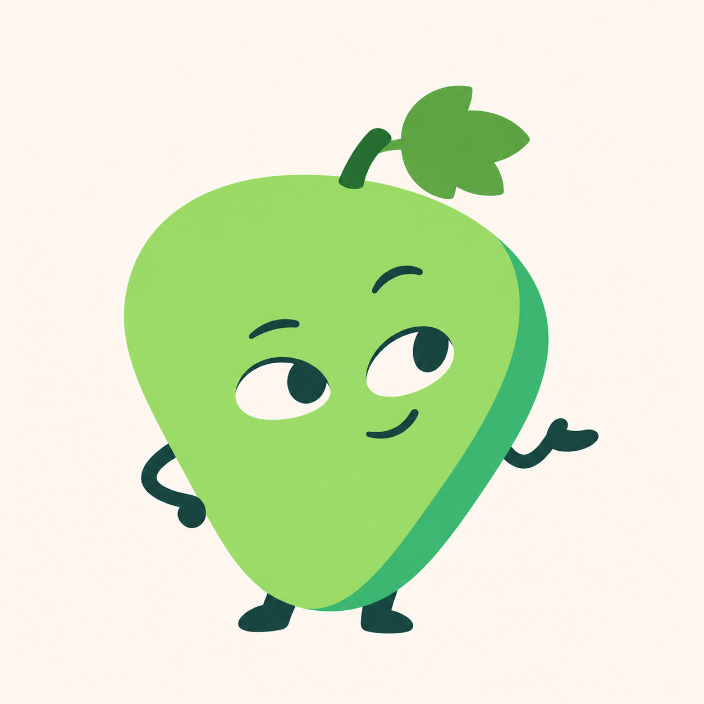

# 青提 C 版精修 v0.15

用户要求“按第三个图精修”，助手展示并明确指向此前三方案中的 C「少描边色块版」后，用户回复“继续”。本轮据此以 C 作为精修依据。此前对三方案的否定不再用来阻止本轮沿 C 工作，但本次成图仍待评审。



保留[原 C 版](../images/qingti-minimal-shape-v09.png)的圆角三角果身、无外描边色块、右侧深绿色面、细手脚与抬手神态。主要是小幅保形细修，整理轮廓、叶梗衔接与五官曲线，配色略向协调的果绿与玉绿调整；不夸大成造型大改。

本轮仅为浅色背景位图候选，未制作应用家族、透明资源或 ICO，未进行真实任务栏和 DPI 验收。不切换到动物、鸟类、叶精灵或粗描边方向，不修改程序名称、图标、版本和用户数据。原 C 稿及其他历史稿继续保留。

## 生成方式与完整提示词

内置 imagegen 参考图编辑，唯一输入为 `docs/images/qingti-minimal-shape-v09.png`，要求保留原 C 的结构与画法。

```text
Use case: identity-preserve.
Asset: precise refinement of selected Qingti concept C, MINIMAL COLOR-SHAPE grape character.
Input image 1 is the ONLY edit target and definitive reference. Preserve its specific selected design very closely: single rounded-triangular grape body, broad soft upper shoulders tapering to a rounded bottom, tilt and stance, NO outer ink stroke around fruit, lighter front plane and darker green plane along the right flank, slender dark-teal attached arms, small feet, left hand resting at side, right hand held in a relaxed outward palm, open ivory almond eyes looking upper-right, raised brows and tiny asymmetric smile. One short angled stem and one small three-lobed grape leaf at upper right. Preserve all main placements, relative sizes and personality.
Polish ONLY drawing precision and subtle color harmony:
1. Smooth the main silhouette into controlled continuous curves, especially the upper-left shoulder, right side-plane boundary and rounded bottom tip. Keep the same rounded triangular silhouette, not a circle, oval, pear, apple or animal.
2. Clean the stem-to-fruit and stem-to-leaf junctions; keep the leaf three-lobed but make pointed tips a little softer and its shape more balanced. Bring the leaf/stem group very slightly closer to fruit, without changing top-side placement or adding leaves. No extra veins or decorative vine.
3. Refine the two small white almond eye silhouettes and dark-teal pupils so the upward-right gaze feels alert, witty and composed. Keep eye size and asymmetric expression almost identical; no giant cartoon eyes or sleepy drooping lids. Shorten the heavier brow curves a little, preserve one higher than the other. Smile stays small.
4. Make the small hands and feet intentional smooth shapes with readable simple thumb/palm, consistent slim arm width and clean joins. Keep original casual gesture and short limb lengths; no bigger gloves or added fingers.
5. Harmonize the fresh light apple/grape green front and slightly cooler jade-green right plane. Reduce the most fluorescent yellow-green cast slightly, but retain the lively original green rather than turning gray, olive or pastel white. Front plane broad, quiet and near-flat with an extremely delicate tonal variation only. Side plane a single clean soft green shape. Opaque color.
Maintain the selected minimalist editorial illustration style with almost no outline. Do NOT introduce black borders around fruit/leaf, glossy highlights, visible texture, grain, frosting, glass, realistic 3D depth, gradients with cloudy streaks, extra accessories, body segments, props, badges, costumes or other characters.
Composition: same single complete uncropped character on warm nearly-white square background with generous breathing room. No words, frame, icon tile, comparison layout or scenery. This is a careful finishing pass on C, not a new art direction.
```
