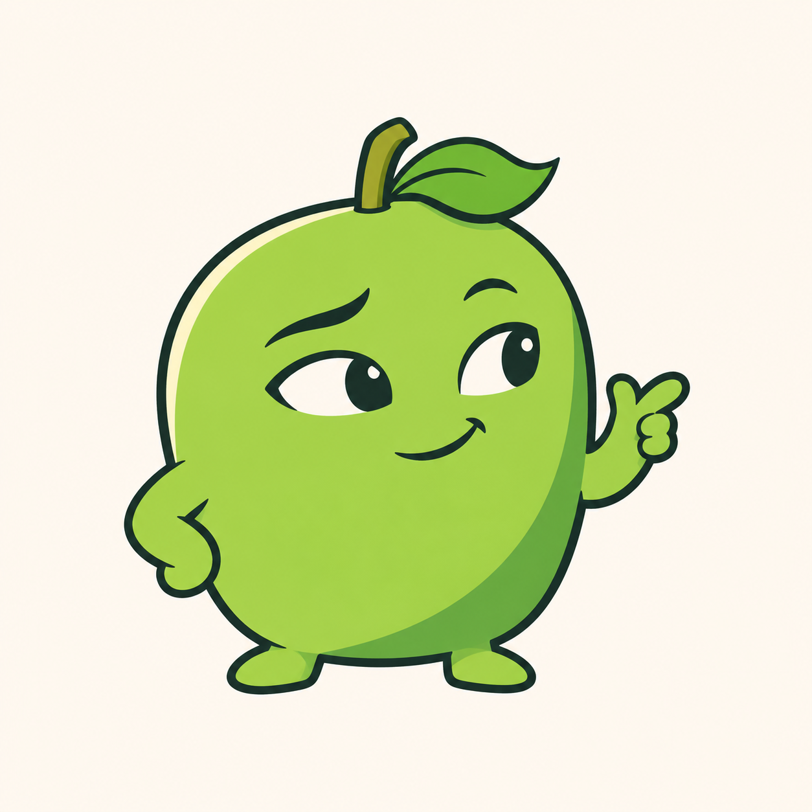
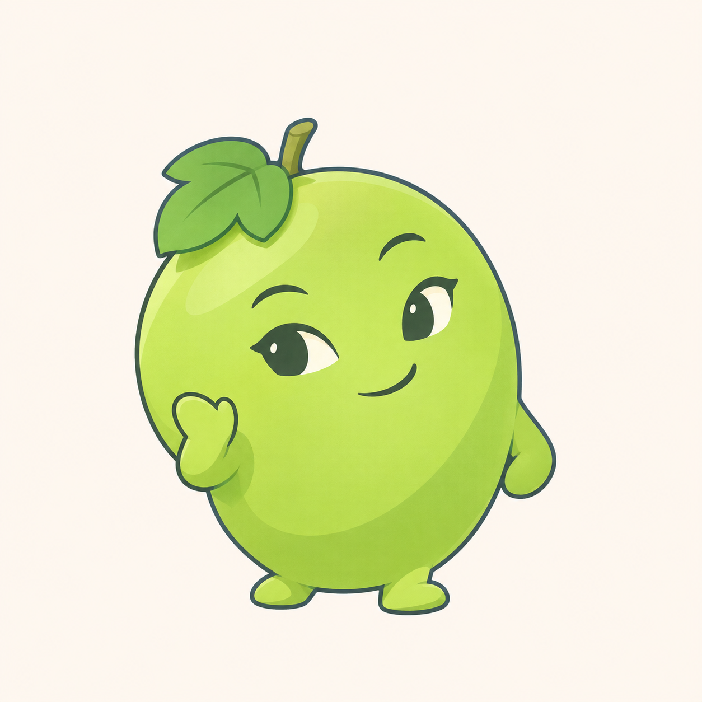
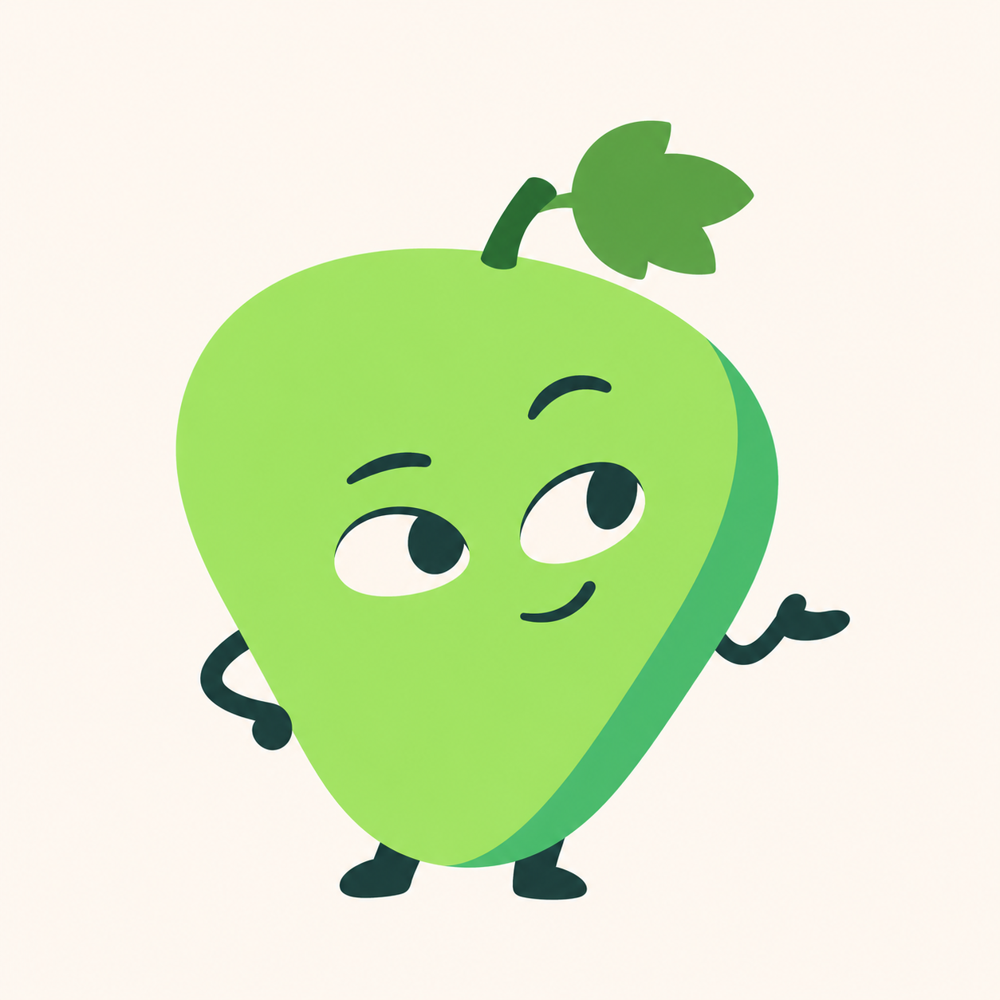

# 青提三种画法探索 v0.9

用户否定 v0.8 后表示没有新的参考图。本轮自主开展三种画法探索，保持已确认的单果完整身体、短小手脚，以及“机灵俏皮＋简洁酷一点”的气质。未要求用户继续找参考，不复用被否定稿作为造型输入。

## A：漫画线条



较明确的轮廓与表情对比，果身偏圆角方形，配小幅手势。成图轮廓仍偏粗，眼睛也比提示词中的小眼更显眼，需继续评审。

## B：柔和插画



细一些的蓝灰描边、柔和色层与抬手动作，轮廓更圆润。与此前插画方向仍有相似之处，差异主要在叶梗位置、动作与配色。

## C：少描边色块



以单一饱满的圆角三角果身和侧面色块建立形体，减少果身外描边，使用深青色短手脚。新轮廓可能与其他水果混淆，仍须结合葡萄特征评审，不把轮廓新颖等同于识别已解决。

三版均为待评审方向稿，不代表用户已选定。当前为浅色背景位图，未制作家族、透明资源或 ICO，未进行实际任务栏尺寸及 DPI 验收，不改动正式程序或用户数据。

## 生成方式与完整提示词

内置 imagegen，三个独立全新生成请求，无参考图输入。未使用代码替代图像绘制。

### 方案 A

```text
Use case: stylized-concept. Asset: original 青提 green-grape software mascot, fresh visual-direction study.
Design from scratch, no existing character reference. User-approved concept: exactly ONE plump green grape is the ENTIRE continuous head/body, with two short directly attached arms and two tiny directly attached feet. No separate head, neck, torso, belly sphere or extra grape circles. A very short grape stem and ONE small simplified grape leaf identify the fruit, both secondary. One whole friendly fruit character, not a human in a costume.
Personality: quick-witted and playful with understated cool. Poised expressive eyes and a little warm humor, never sleepy, sneering, angry, babyish or smug. Characterful compact silhouette with deliberate asymmetry and purposeful body language. Product-family mascot usable later with functional props.
Simple fresh 2D illustration with clean opaque colors, minimal internal detail, dark jade/charcoal facial features. Green should feel crisp and alive, not muddy olive, acid yellow or fluorescent neon. Distinctive facial design, not a stock smiley pasted onto a perfect ellipse.
Avoid glass, frost, realistic fruit pores, material grain, glossy 3D toy, clothing, shoes with laces, gloves with cuffs, sunglasses, hats, badges, props, accessories or surrounding decorations. Keep exactly two short arms, two little feet. Grape remains the dominant single body.
Square warm nearly-white plain background, one complete centered isolated character about 65 percent of canvas height with generous margins. No title, text, labels, frame, app tile, scene, diagram or other characters.
Direction A: confident clean COMIC character design. Slightly squat rounded-square grape with soft asymmetrically rounded corners and a tiny organic taper, not an egg. Crisp slender charcoal-jade ink contour with subtle line-weight variation, three sharply controlled cel-color areas: fresh medium pear green, cool green side shadow, tiny warm ivory edge accent. NO gradients or big white shine. A very small grape leaf folds sideways like a jaunty quiff next to the short bent stem. Small OPEN alert almond eyes with a little ivory white and dark pupils glance to the right; one restrained eyebrow tilted up and a tiny hooked asymmetrical smile convey cleverness. One short mitten arm rests at its lower side, the other is lifted just a little in a compact "got it" gesture with simple thumb and fingers. Tiny feet spread in a casual grounded stance. Adult-friendly witty stationery mascot, excellent curve rhythm, clean original silhouette, confident but kind.
```

### 方案 B

```text
Use case: stylized-concept. Asset: original 青提 green-grape software mascot, fresh visual-direction study.
Design from scratch, no existing character reference. User-approved concept: exactly ONE plump green grape is the ENTIRE continuous head/body, with two short directly attached arms and two tiny directly attached feet. No separate head, neck, torso, belly sphere or extra grape circles. A very short grape stem and ONE small simplified grape leaf identify the fruit, both secondary. One whole friendly fruit character, not a human in a costume.
Personality: quick-witted and playful with understated cool. Poised expressive eyes and a little warm humor, never sleepy, sneering, angry, babyish or smug. Characterful compact silhouette with deliberate asymmetry and purposeful body language. Product-family mascot usable later with functional props.
Simple fresh 2D illustration with clean opaque colors, minimal internal detail, dark jade/charcoal facial features. Green should feel crisp and alive, not muddy olive, acid yellow or fluorescent neon. Distinctive facial design, not a stock smiley pasted onto a perfect ellipse.
Avoid glass, frost, realistic fruit pores, material grain, glossy 3D toy, clothing, shoes with laces, gloves with cuffs, sunglasses, hats, badges, props, accessories or surrounding decorations. Keep exactly two short arms, two little feet. Grape remains the dominant single body.
Square warm nearly-white plain background, one complete centered isolated character about 65 percent of canvas height with generous margins. No title, text, labels, frame, app tile, scene, diagram or other characters.
Direction B: graceful SOFT DRAWN character illustration. A full slightly oblique green grape with high rounded left shoulder and a small flat base, natural controlled contour, not a perfect oval. Delicate blue-gray pencil-like INK line (crisp, no rough paper texture), softly joined broad light-green and jade cel-shadow planes, minimal soft transition for a little illustrated volume. A single small three-lobed grape leaf rests close to top LEFT like a folded botanical tab; stem tiny. Small lively dark eyes with tiny clean ivory crescent whites, a slight eyebrow lift, closed soft one-corner smile. A relaxed subtle forward lean, both short arms visible close to sides, near hand gives a small understated greeting at lower-cheek height. One tiny foot slightly ahead of the other, light and nimble, no large oval shoes. Sophisticated friendly character drawing, tender but not babyish; calm witty expression. Carefully designed soft silhouette and well-joined limbs. No airbrushed cloudy patches.
```

### 方案 C

```text
Use case: stylized-concept. Asset: original 青提 green-grape software mascot, fresh visual-direction study.
Design from scratch, no existing character reference. User-approved concept: exactly ONE plump green grape is the ENTIRE continuous head/body, with two short directly attached arms and two tiny directly attached feet. No separate head, neck, torso, belly sphere or extra grape circles. A very short grape stem and ONE small simplified grape leaf identify the fruit, both secondary. One whole friendly fruit character, not a human in a costume.
Personality: quick-witted and playful with understated cool. Poised expressive eyes and a little warm humor, never sleepy, sneering, angry, babyish or smug. Characterful compact silhouette with deliberate asymmetry and purposeful body language. Product-family mascot usable later with functional props.
Simple fresh 2D illustration with clean opaque colors, minimal internal detail, dark jade/charcoal facial features. Green should feel crisp and alive, not muddy olive, acid yellow or fluorescent neon. Distinctive facial design, not a stock smiley pasted onto a perfect ellipse.
Avoid glass, frost, realistic fruit pores, material grain, glossy 3D toy, clothing, shoes with laces, gloves with cuffs, sunglasses, hats, badges, props, accessories or surrounding decorations. Keep exactly two short arms, two little feet. Grape remains the dominant single body.
Square warm nearly-white plain background, one complete centered isolated character about 65 percent of canvas height with generous margins. No title, text, labels, frame, app tile, scene, diagram or other characters.
Direction C: striking MINIMAL SHAPE character illustration. ONE asymmetric softly triangular grape: broad rounded upper shoulders, tapering gently into a full rounded lower point, plump rather than flat triangle; recognizably a green grape with a tiny short bent stem and small three-lobed leaf angled right. Body is a clean luminous mint-to-apple green flat shape with one deeper teal-green side plane, mostly NO outer stroke on fruit; use selective thin dark lines ONLY for limbs and details where needed. A small off-white almond eye pair with dark pupils placed slightly lower than center, one eyebrow higher, an extremely small mischievous corner-smile. A compact casual hip tilt, one short hand at the side and the other extending in a tiny relaxed outward palm, not a pointing long human arm. Tiny dark teal feet integrated directly at the base. Graphic editorial mascot with bold silhouette, spacious face, economical lines and playful adult-friendly cool. Simple but deliberately composed, not generic geometric circles. No gradients, specular highlights or 3D volume.
```
