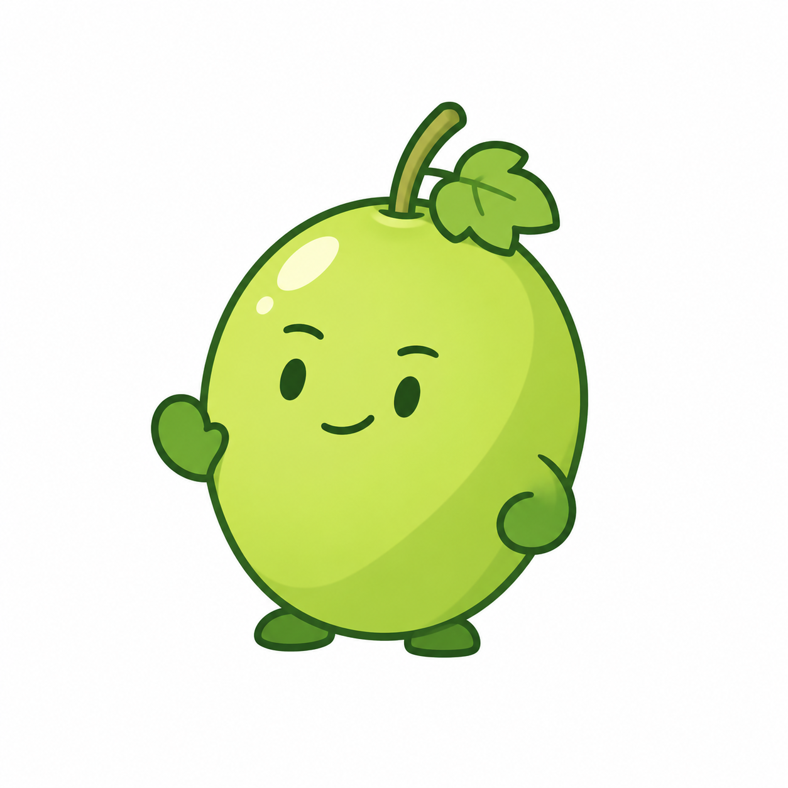

# 青提单果完整角色 v0.5

用户否定大头小身角色后，明确同意以下结构：一颗青提本身就是整个身体，直接长出短小手脚，不再单独分头和身体。本轮按这个确认结构绘制一张主角色稿；结构确认不代表这张具体成图已获确认。



采用一颗连续完整的青提承载面部、手脚和动作，轻微侧身，一手抬起、另一手收于下侧。顶部保留葡萄叶与果梗，继续清爽插画风格。当前顶部果梗仍比较显眼，线条和果身比例可根据后续反馈进一步修整，不宣称完全实现提示词的所有尺寸要求。

本轮未继续制作应用家族。图片为浅色背景位图候选，非透明生产图标，未进行 ICO、DPI 或真实任务栏验收。正式程序名称、图标及用户数据未变更。

## 生成方式与完整提示词

内置 imagegen，以用户此前提供的番茄软件图标截图 `codex-clipboard-5c6aacd9-00ea-4c08-8cb5-4fd071380821.png` 仅作单果完整角色结构参考，不复制品牌形象。

```text
Use case: stylized-concept.
Asset: 青提 full-character mascot, a SINGLE grape that IS the entire body.
Input image 1 is the user's small tomato-software-icon reference, ONLY for the structural idea of a fruit with integrated face and short appendages. Create an original GREEN GRAPE character. Do not copy the tomato face, tomato shape, crown, logos, screenshot background or software marks.
User-confirmed anatomy, highest priority: exactly ONE single full plump green grape constitutes the ENTIRE head AND body together. There is NO separate head, NO neck, NO chest, NO second lower belly sphere, NO torso, NO additional grapes and NO snowman segmentation. The one grape runs continuously from its stem down to its bottom. The face sits directly on this one fruit. Exactly two SHORT arms attach directly to the lower-middle sides of this same grape, two tiny feet attach directly at its base.
Shape: compact full slightly asymmetric oval grape, height only about 1.1 times width. Very subtle natural taper at base and rounded shoulders, not a long cucumber, perfect circular logo, pear with neck or apple cleft. Short slim curved grape stem, one SMALL simplified three-lobed grape leaf tucked beside it, leaf at most 15 percent of fruit area. No oversized foliage, leaf cape or tall stalk.
Pose: slight three-quarter turn toward the viewer's left, whole grape tilted just a little. One tiny rounded mitten hand lifted near its side in a relaxed greeting (short attached arm, no long elbow limb), the other rests comfortably against lower flank. Tiny flat dark-jade feet, one subtly angled forward. Friendly and capable, calm lively body language rather than jumping or running.
Face: two small expressive dark oval eyes, restrained short brows, a small slightly asymmetric warm smile. Facial features occupy a small part of fruit face; no huge baby eyes, eyelashes, blush, nose, teeth or human skin. Keep expression gentle with a little personality.
Style: beautiful fresh clean 2D software-mascot illustration, confident thin dark-jade contour, refined soft cel shading in two broad fruit-green values, a small warm-ivory highlight, slightly deeper green short hands/feet. Natural light yellow-green front, muted jade shadow, no fluorescent neon or dark muddy olive. Opaque clean color, slight illustrated volume, no realistic material. Not a shiny plastic toy or 3D render; no glass, frost, grain, textures, sparkles, action rays or detached emphasis marks.
Composition: ONE complete character, centered square near-white background, generous 15 percent margin, no text, props, tile, border, comparative panels or other objects. Focus on simple coherent single-fruit anatomy and appealing proportions.
```
