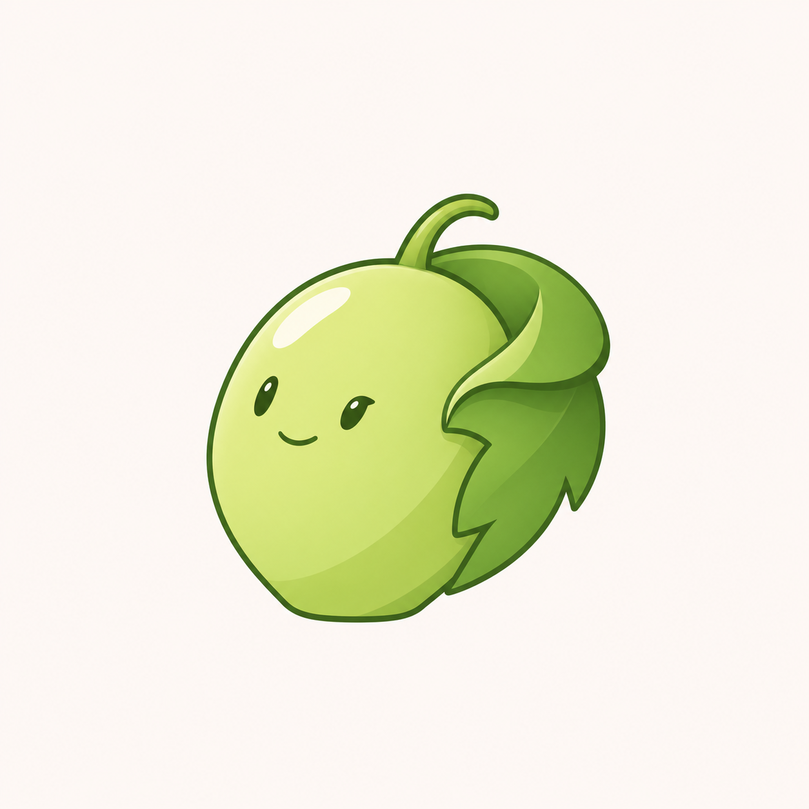

# 青提卷叶角色 v0.3

用户明确指出前两版的问题是“造型普通”。本轮针对角色轮廓重设计，继续青提与清爽插画方向，停止只用圆形果实叠加面部的方法。



采用略侧倾的饱满主果，叶片沿右侧卷折并包住一侧，短弯果梗与侧边叶弧组成不对称轮廓；用简化明暗区分果身与卷叶。当前重点是造型辨识，不将生成结果当作已验证的唯一或原创性商标标志。

单果与卷叶改变了葡萄原形的呈现方式，仍需观察是否容易被误认为其他水果；卷叶比例、眼形与小尺寸可读性均待用户评审。未制作功能家族和透明图标，未进行 ICO、DPI 或任务栏验收，不替换程序名称、图标或修改用户数据。

## 生成方式与完整提示词

内置 imagegen，参考图重设计。输入 `docs/images/qingti-trio-v02.png`，仅取题材与插画完成度，不复用被否定的圆形组合。

```text
Use case: stylized-concept.
Asset: a distinctive original Qingti (青提, green grape) character silhouette for a productivity-software brand.
Input image 1 is the REJECTED generic three-circle grape design. Use only the green-grape subject and clean illustrative finish as a starting reference. The user's specific criticism is "ordinary shape". Do not repeat two or three circular fruits with a little face.
Create ONE memorable compact grape character with an asymmetric three-quarter stance and a coherent botanical silhouette:
- Main fruit is a full plump green grape with a subtle tapered lower end, tilted about 12 degrees left, a high rounded back shoulder and lower forward cheek. It is not a perfect circle, a long cucumber, a pear with a neck, or a human head on a separate body. Fruit is approximately 70 percent of the design.
- ONE small grape leaf is folded and curled so it hugs the RIGHT side of the grape like a natural leaf collar/cape. Its broad upper fold sweeps behind the fruit's shoulder, and two or three simplified lobes taper diagonally along the lower flank. Show one small clean turned-over leaf edge. It is a grape leaf growing naturally from its stem, not a fabricated fabric costume. Leaf mass about 25 percent, do not bury the fruit in foliage. The fruit's left/front face remains fully open.
- A short curved jade vine emerges neatly at the top of the fruit, bends over slightly, then integrates behind the leaf fold. One restrained open side arc on the right supplies a recognizable silhouette accent. No dangling grapes, crowns, oversized leaf cap, long thin twirls or tiny vein networks.
- Give the front of the grape a composed friendly character: small expressive dark oval-to-almond eyes in three-quarter perspective, slightly unequal eye widths from perspective, a very small confident warm smile. Character looks slightly toward left. Personality comes from pose and shape, not big anime eyes or added props.
- The fruit rests on its own gently flattened low base; no long legs, boots, obvious humanoid arms, extra separate hands, accessories or background objects.
Style: sophisticated clean Q-mascot illustration, fine confident dark-jade outline, broad fresh yellow-green fruit plane with one calm leaf-green cel shadow, slightly cooler rich green folded leaf for contrast. Soft ivory highlight along upper-left fruit only. Minimal two-value illustrated shading with gentle transitions; opaque colors, clean edges, a little illustrated depth. Purposeful sculpted contours and well-controlled negative space, not geometric circles pasted together. No thick sticker stroke or clutter.
Composition: one standalone complete character on warm nearly-white square background, centered, generous 15 percent margins, no text or icon tile. No glass, frost, material grain, shiny plastic, 3D toy render, texture, blush, lashes, giant eyes, leaf-hair crown, scenery, clothing, badges or app props. A clean original grape-and-folded-leaf character that could be recognizable by silhouette.
```
