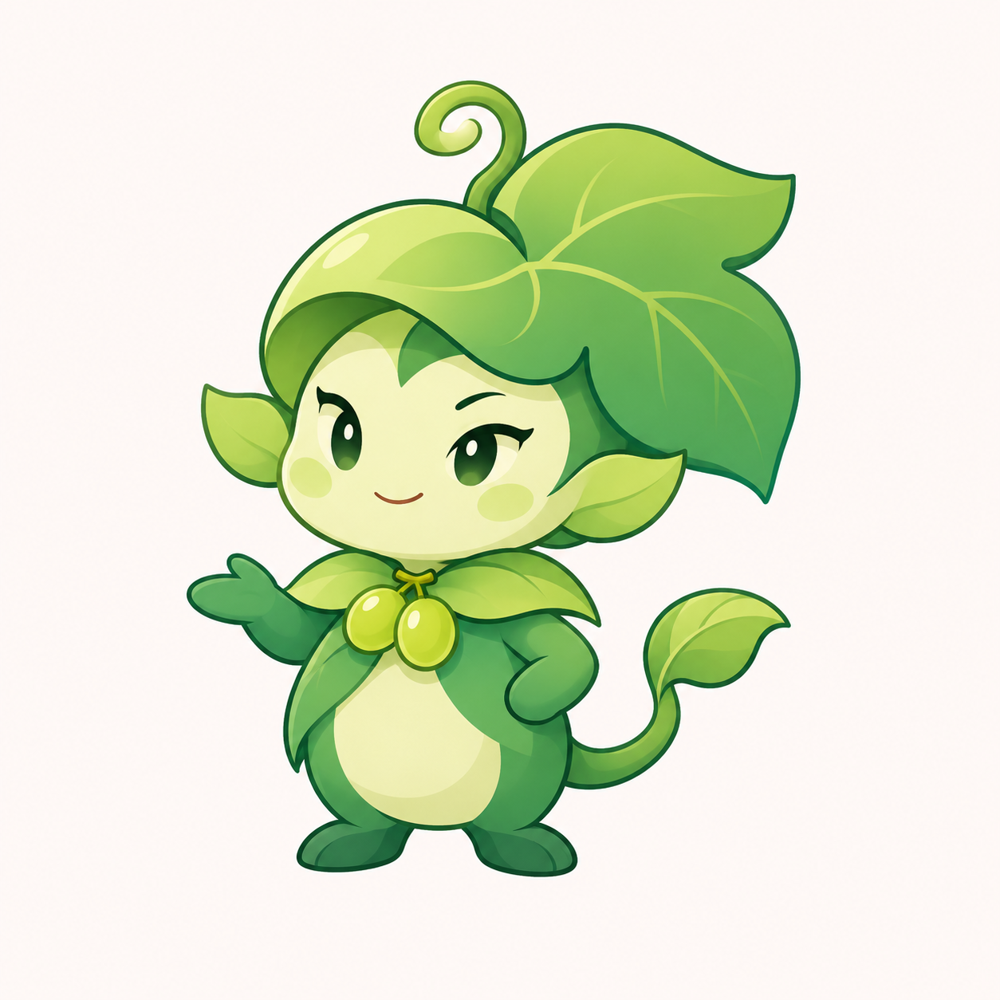

# 青提叶精灵方向 v0.11

在用户否定黑白草图后，提出扩大设计空间：保留青提名称，允许以绿色、葡萄叶与果梗为特征的小精灵，而非限制整颗葡萄作为身体。用户回应“你看着弄”，本轮据此自主尝试新结构。该授权为设计探索，不代表已接受具体成图或授权替换程序资源。



新稿采用侧卷葡萄叶冠、浅绿色面部与腹部、较深玉绿色身形、短小四肢和卷藤叶尾。领部两颗葡萄连接名称意象，角色通过抬手与侧身形成姿态。结构从单果角色放宽为植物小精灵，旧方案继续保留。

当前冠叶偏大、装饰较多，头身与表情仍待用户评审；尚未验证实际图标尺寸下的可读性。不将“原创方向”的创作意图当作商标独创性或近似性验收结果。成图为浅色背景位图候选，未制作功能家族、透明资源或 ICO，未进行 DPI 验收。程序名称、图标、版本与用户数据未变更。

## 生成方式与完整提示词

使用内置 imagegen。输入 `docs/images/mascot-cast-detail-v07.png` 仅参考细线插画与角色绘制完成度，不复用其中具体神话角色。

```text
Use case: stylized-concept.
Asset: original 青提 productivity-tool family mascot, new grape-and-leaf SPRITE direction.
The user delegated art direction after rejecting many literal grapes with faces. We are explicitly FREE to design a small creature rather than force the entire body to be a grape. Keep the Chinese brand concept green grapes. Design a truly new appealing little botanical helper with a distinctive coherent silhouette.
Input image 1 supplies ONLY the clean fine-outline illustrated finish and character-design craftsmanship. Do not copy any specific character, mythology, costume, animal or grid.
Create ONE complete tiny botanical sprite in three-quarter view facing slightly left:
- A softly shaped small creature with a clear compact head and body, no huge detached circular head and tiny snowman belly. Balanced head roughly half total height, short neck integrated into collar, compact torso, exactly two short arms and two small feet.
- Face is pale warm pistachio/ivory-green, softly rounded cheeks and small chin, not a human face or plain fruit ellipse. Small alert dark-jade almond eyes with tiny ivory glints, one subtle eyebrow lifted, a tiny playful closed smile. Clever, composed and helpful, not sneering, sleepy or babyish.
- Headwear is an organic GRAPE-LEAF crest growing naturally around the back of the head, one broad three-lobed grape leaf swept diagonally to one side, gently rolled at its leading edge. Two small rounded leaf-tip side protrusions frame the head; no huge rabbit ears, fur or human hair. Crest produces a memorable jaunty silhouette without dominating face.
- A very short grape stem curl on top is a subtle signature, not a long antenna.
- The body is cool jade-green, a warm pale ivory-green belly patch visually opens the front. Small mitten hands and tiny planted feet are darker jade. No human clothing or armor. The front of its natural leaf collar has TWO small oval light-green grapes attached together, grape fruit clearly legible but a secondary botanical feature, not jewelry.
- A short thick vine tail sweeps behind the right flank in ONE clear compact S curve, ending in a small folded leaf, not a huge squirrel tail, extra limbs or long decorative twirl.
Pose: poised small helper, a slight body lean and confident planted stance, one hand resting near waist and the other a little forward with relaxed open palm, no props. Gentle lively expression, a little attitude, economical gesture.
Style: refined clean 2D mascot illustration, fine slate/jade linework, clear broad soft cel-color masses, tiny tasteful highlights, slight illustrated volume, no airbrush noise or shiny materials. Palette balanced fresh grape green, deeper jade/teal-green shadows and warm ivory-green face/belly so it is not one flat green mass. Small opaque details, carefully drawn joins and elegant contour rhythm. Compact enough for future app-icon adaptation.
One complete standalone character centered on warm nearly-white square canvas, generous margins, no words, labels, border, icon tile, multiple views, additional characters or environment. No glass, frost, plastic toy render, realistic texture, glitter, costumes, hat accessories, human hands, separate tools, flowers or leaves scattered outside silhouette. Original botanical creature, not a copy of any existing game mascot.
```
