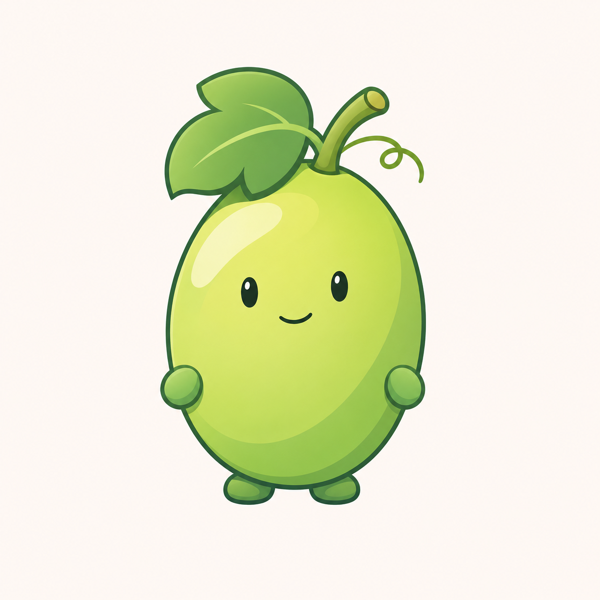
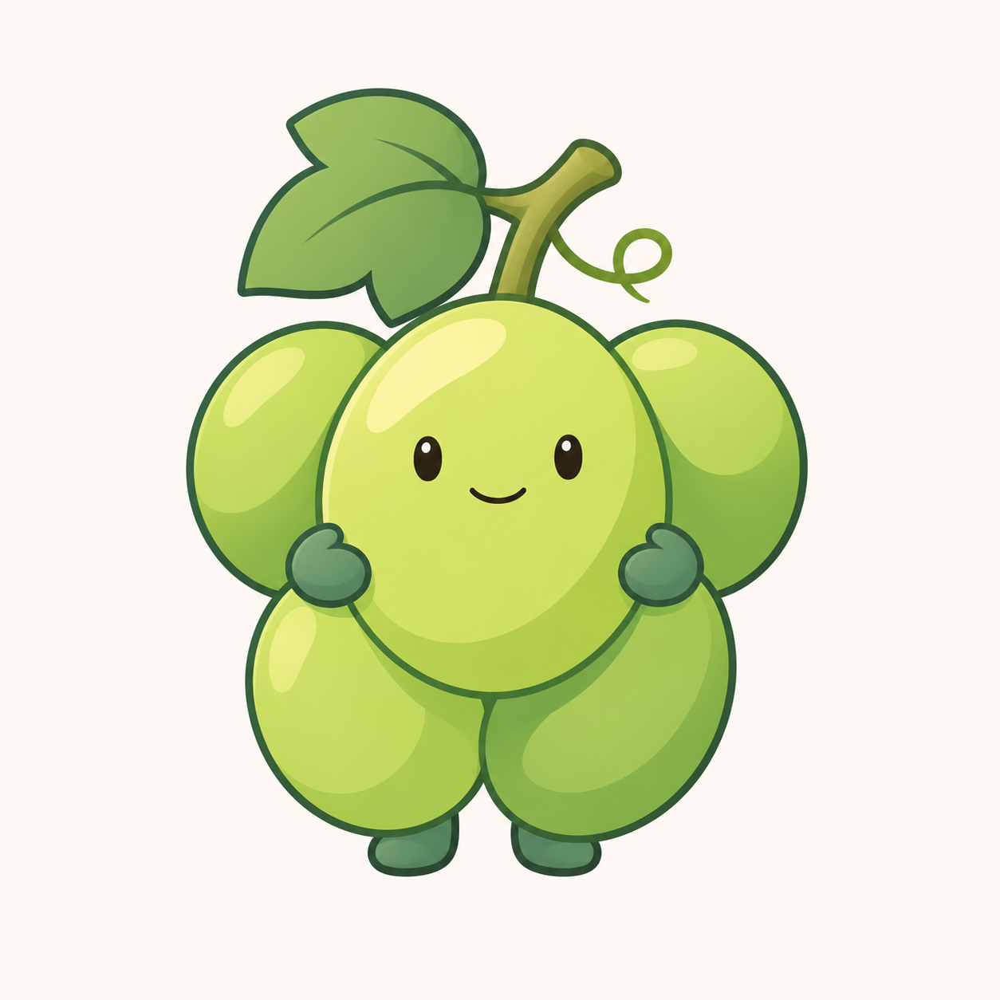
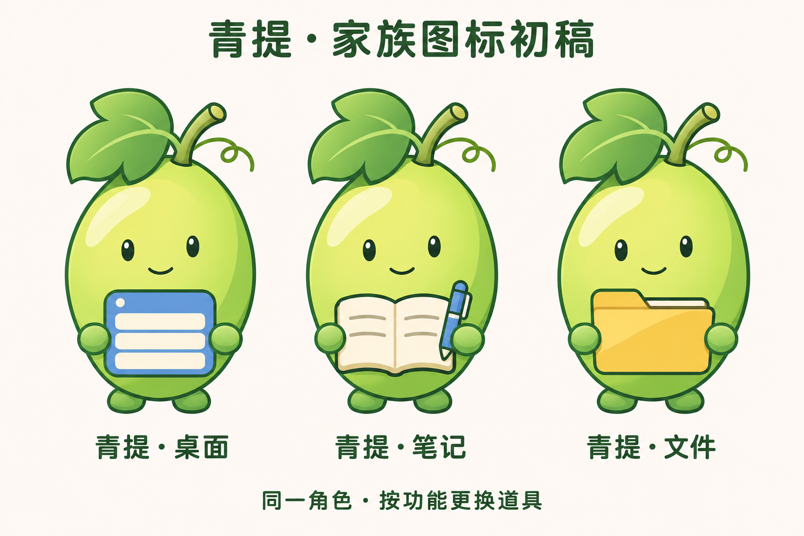

# 青提品牌角色与功能家族 v0.1

用户在水果名探索后明确要求“用青提设计吧”。本轮以青提作为新的设计命名方向，沿用清爽插画与“母品牌·功能名”组织方式。北沚等旧稿保留为历史方案；当前不代表授权直接更改正式程序名称或图标。

## A：单颗角色



单颗椭圆青提，黄绿色果身、较深绿色叶片、短果梗与卷须。小手脚为后续持握功能道具预留动作空间。轮廓简洁，但单果的葡萄识别主要依赖叶、梗和命名，仍需用户评审。

## B：成簇角色



五颗果实组成一簇，仅中央果实带面部。果实组合更直观地表达葡萄，但内部分割较多，后续需要观察小尺寸表现。

## 单颗角色家族示例



暂以单颗版演示青提·桌面、青提·笔记、青提·文件，用蓝色窗口面板、米白笔记与蓝笔、暖黄色文件夹区分功能。家族示例不等于已选定单颗版。

三张图均为浅色背景位图候选，使用内置 imagegen 生成。家族角色为生成式重绘，正式制稿应复用同一可编辑母版；当前不是透明生产图标，未完成 ICO、任务栏或 DPI 验收。未改动程序、版本或用户数据。

## 完整提示词

单颗与成簇使用 `docs/images/mascot-cast-detail-v07.png` 作为插画风格参照，不复用原有神话或岩洲造型。家族稿以本轮单颗青提为角色参照，顺序生成。

### single

```text
Use case: logo-brand. Asset: illustrated brand mascot concept for 青提, a family of Chinese productivity applications.
The user selected the Chinese fruit name 青提, green table grapes. Create a genuinely new fruit mascot. Input image 1 is ONLY a reference for clean illustrative linework, friendly restrained expression, soft cel colors and slight illustrated depth. Do not copy any mythological character, island, stone, sprout or water.
Style: clean polished 2D Q-mascot illustration, fine dark-jade/slate contour with graceful curves, fresh pear-green and soft yellow-green fruit, muted deeper jade shadows, one broad pale warm highlight. Small expressive oval dark eyes and a tiny relaxed smile, no huge anime eyes, no blush or eyelashes. Calm approachable, adult-friendly software-brand character rather than a baby toy. Clear compact silhouette, minimal internal strokes, opaque color with light cel shading.
Recognizable grape cues: slightly elongated green grape shapes, a short curved grape stem, ONE modest three-lobed grape LEAF tucked beside the stem with at most one vein; optional tiny integrated tendril, not two sprout leaves. Leaf secondary in scale, fruit dominant. Avoid apple/tomato anatomy, striped gooseberry, lime segment, seeds or bite marks.
One isolated complete mascot on a warm near-white square canvas, centered with at least 15 percent breathing room, no typography or grid. Not a rounded-square app tile. No glass, transparency, frost, shiny plastic, realistic fruit texture, complex gradients, scenery, extra props, badges or existing logos.
Concept A: ONE slightly asymmetric elongated oval green grape as the main whole body, pleasantly full lower half, compact short curved stem rising toward upper right and leaf sweeping upper left. Fruit height about 1.15 times its width, excluding leaf. A gently offset but balanced face at center. Two tiny simple jade-green rounded mitten hands tucked closely at lower flanks and two tiny unobtrusive feet under the fruit for potential functional prop poses. Keep limbs small and unsegmented, no long arms or legs. Elegant smooth silhouette and restrained personality; no large overhanging hair-cap. Fruit body remains visibly a single green grape.
```

### cluster

```text
Use case: logo-brand. Asset: illustrated brand mascot concept for 青提, a family of Chinese productivity applications.
The user selected the Chinese fruit name 青提, green table grapes. Create a genuinely new fruit mascot. Input image 1 is ONLY a reference for clean illustrative linework, friendly restrained expression, soft cel colors and slight illustrated depth. Do not copy any mythological character, island, stone, sprout or water.
Style: clean polished 2D Q-mascot illustration, fine dark-jade/slate contour with graceful curves, fresh pear-green and soft yellow-green fruit, muted deeper jade shadows, one broad pale warm highlight. Small expressive oval dark eyes and a tiny relaxed smile, no huge anime eyes, no blush or eyelashes. Calm approachable, adult-friendly software-brand character rather than a baby toy. Clear compact silhouette, minimal internal strokes, opaque color with light cel shading.
Recognizable grape cues: slightly elongated green grape shapes, a short curved grape stem, ONE modest three-lobed grape LEAF tucked beside the stem with at most one vein; optional tiny integrated tendril, not two sprout leaves. Leaf secondary in scale, fruit dominant. Avoid apple/tomato anatomy, striped gooseberry, lime segment, seeds or bite marks.
One isolated complete mascot on a warm near-white square canvas, centered with at least 15 percent breathing room, no typography or grid. Not a rounded-square app tile. No glass, transparency, frost, shiny plastic, realistic fruit texture, complex gradients, scenery, extra props, badges or existing logos.
Concept B: a compact asymmetrical BUNCH of exactly FIVE green grapes, a slightly larger central oval grape carries the ONLY face, two smaller berries peek behind at upper left and upper right, two lower oval grapes form the tapered lower silhouette. All berries overlap coherently into one quiet grape-bunch character, avoid many circle seams. Short curved stem above with ONE small three-lobed leaf angled upper left. Vary berry greens subtly for overlap, not five unrelated colors. Two tiny jade mitten hands tucked at sides and two tiny feet at the bottom, no long limbs. Clearly distinct from a single-fruit mascot, memorable softly triangular grape-bunch silhouette, not a broccoli or green cloud. Only one face.
```

### family

```text
Use case: identity-preserve.
Asset: 青提 software-family mascot concept board.
Input image 1 is the definitive SINGLE green-grape character to preserve. Use exactly the same oval fruit silhouette, warm yellow-green palette, jade leaf and stem, short tendril, tiny dark oval eyes and smile, tiny mitten hands and feet across all three instances. Do not turn it into a cluster. Retain clean outlined opaque 2D illustration with restrained soft cel shading, not glass, frost, plastic or photorealistic fruit.
Create three evenly spaced large matched characters left to right, front view, same body proportions and same expression, each holding a small functional object in its tiny hands at lower body level. Objects are about 20 percent of fruit body area, leave the face fully clear. No extra arms, facial changes or floating objects.
Left: a compact cornflower-blue app-window card with one small top dot and three broad ivory panels. Middle: a cream open notebook with two restrained writing lines per page and one short blue pen held alongside. Right: a warm amber file folder with a clearly visible small tab and one simple fold. Keep objects similarly sized and consistent line weight and illustrated lighting.
Layout: wide landscape warm nearly-white plain board, generous clear margins, three full uncropped characters on a common baseline. Modest top title exactly "青提 · 家族图标初稿". Beneath each corresponding mascot, exact labels "青提·桌面", "青提·笔记", "青提·文件". Small footer exactly "同一角色 · 按功能更换道具". Clean dark-jade Chinese typography, ample spacing. No surrounding app tiles, no UI screenshot, no extra comparative thumbnails, no brand logos copied from other products, no water, rocks or mythology.
The point is a coherent friendly Chinese productivity-tool family, composed and tasteful, simple silhouettes, fresh greens, props secondary.
```
