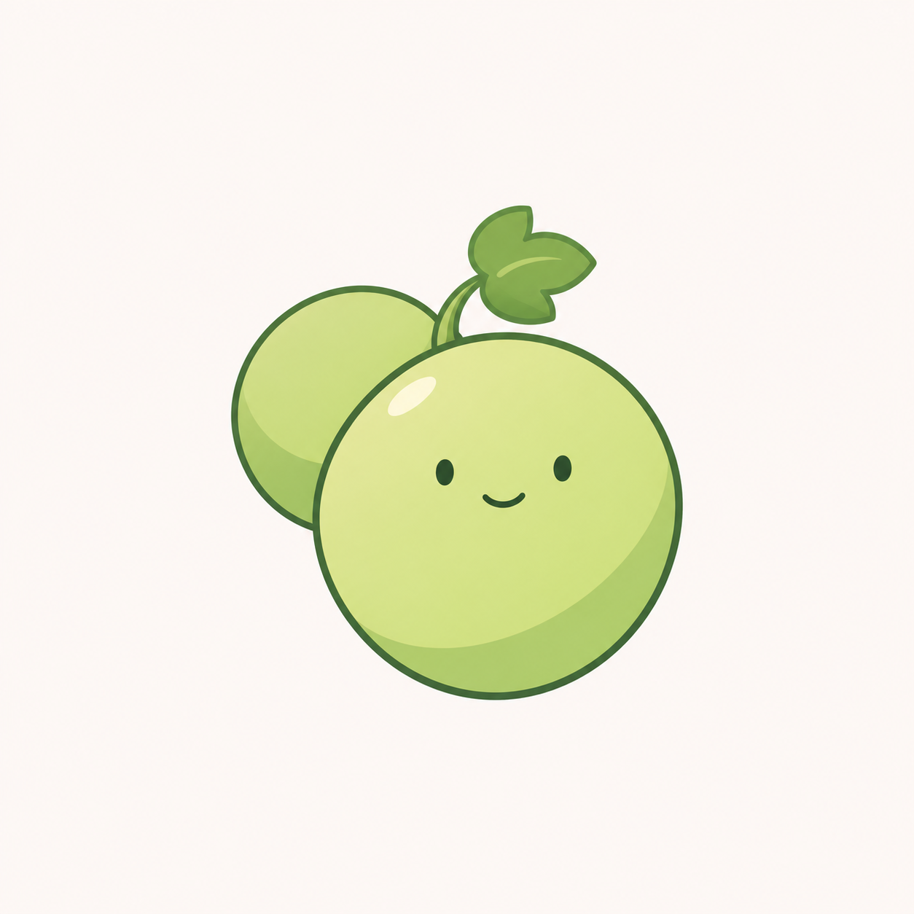
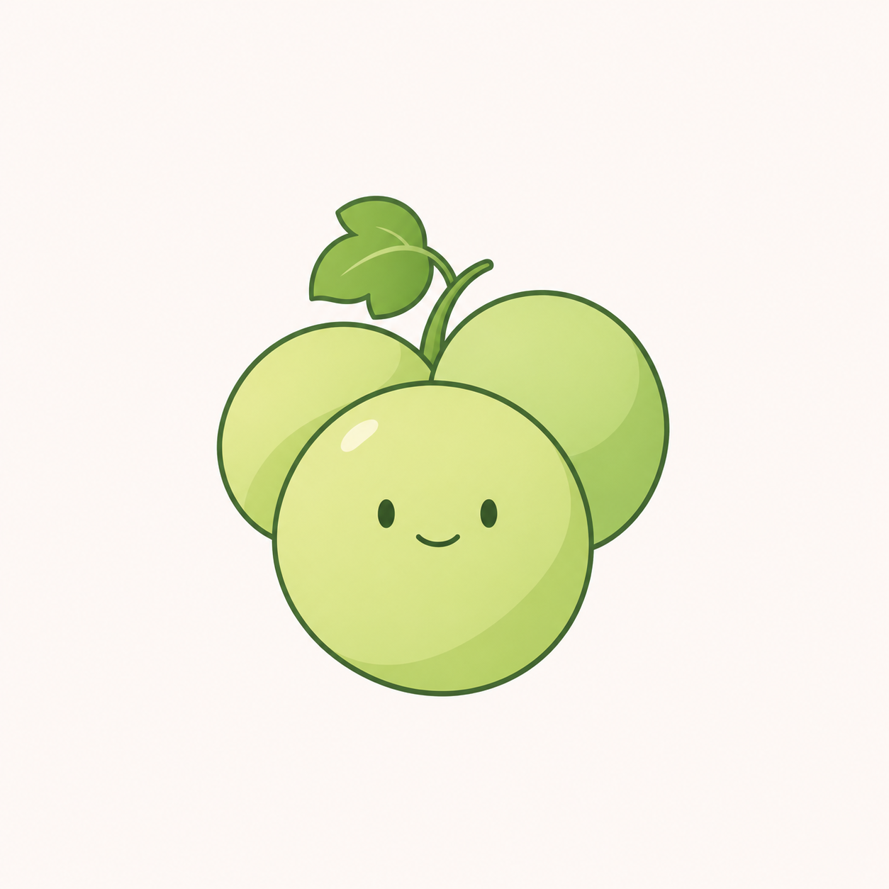

# 青提圆润果形重设计 v0.2

用户反馈[青提 v0.1](青提品牌与家族图标-v0.1.md)的样子不好，要求调整。本轮继续青提命名与清爽插画方向，重画果形，不将旧单颗版或家族示例当作已确认设计。

## 双果版



一大一小两颗圆润果实错落重叠，主果带面部，叶片和果梗缩小，去掉手脚、卷须和过长果身。

## 三果版



前方主果与后方两颗果实组成紧凑轮廓，仅主果带面部。用少量阴影区分重叠，整体配色更浅。

本轮先观察果形与角色比例，不继续铺开家族实例。生成结果三果版后果仍较对称，后续可根据用户偏好继续调整，不能据提示词宣称已解决所有轮廓识别问题。两张均为浅色背景位图候选，非透明生产图标；未进行 ICO、任务栏或 DPI 验收。程序名称、图标与用户数据不变。

## 生成方式与完整提示词

内置 imagegen，两个独立参考图生成请求。输入 `docs/images/qingti-single-v01.png` 仅用于题材参照，明确允许重做造型。

### pair

```text
Use case: logo-brand. Asset: redesigned 青提 mascot for a Chinese productivity software family.
Input image 1 is the rejected previous single-grape concept. Use it only to understand the green-grape theme; substantially redesign silhouette, proportions and styling. The user dislikes this appearance. Remove its long cucumber-like body, oversized leaf, thick stalk, hands, feet and large shiny patches.
New style: fresh calm tasteful 2D illustrated mascot, thin elegant dark-jade contours, smooth deliberate curves, simple softly shaded opaque color blocks. Fresh pale green grape flesh-color exterior with a restrained deeper leaf-green shade, tiny cream highlight on upper-left only. Soft greens with a hint of warm yellow, but not acid neon lime or dull olive. Keep enough contrast for a small software icon.
Grapes are round to subtly oval (height no more than 1.08 times width), plump with gentle asymmetric organic curvature. One SMALL three-lobed grape leaf tucked near a very short slender shared curved stem. Leaf is less than one-fifth of total fruit area; no giant leaf cap, curly tendril ornament, visible long trunk or sprout leaves.
Only ONE tiny friendly face in the entire composition: two small reserved dark oval eyes and a gentle subtle smile, no giant eyes, blush, eyebrows, noses or eyelashes. Give a composed friendly expression, not a loud baby cartoon. No limbs of any kind, no hands or feet, no humanoid posture.
Square near-white/off-white plain background. One compact complete composition, balanced and centered with about 18 percent clear margins. No words, title, tile, frame, props or other objects. No glass, frost, plastic shine, photorealism, noisy texture, 3D rendering or extravagant gradients. Elegant clean illustration rather than a toy.
Direction A: TWO round green grapes nestled together at a soft diagonal. Larger foreground grape is low-right, nearly circular, with the only small face positioned slightly above its center. One smaller un-faced grape peeks from behind upper-left, about 70 percent the foreground grape diameter. Shared short stem and a small leaf occupy the top gap, integrated as a simple compact accent. Avoid looking like a human head with ears, a pair of eyes, peas in a pod or breasts. A clear beautiful asymmetric double-fruit silhouette, quiet broad color planes, a little overlap depth, very few internal strokes.
```

### trio

```text
Use case: logo-brand. Asset: redesigned 青提 mascot for a Chinese productivity software family.
Input image 1 is the rejected previous single-grape concept. Use it only to understand the green-grape theme; substantially redesign silhouette, proportions and styling. The user dislikes this appearance. Remove its long cucumber-like body, oversized leaf, thick stalk, hands, feet and large shiny patches.
New style: fresh calm tasteful 2D illustrated mascot, thin elegant dark-jade contours, smooth deliberate curves, simple softly shaded opaque color blocks. Fresh pale green grape flesh-color exterior with a restrained deeper leaf-green shade, tiny cream highlight on upper-left only. Soft greens with a hint of warm yellow, but not acid neon lime or dull olive. Keep enough contrast for a small software icon.
Grapes are round to subtly oval (height no more than 1.08 times width), plump with gentle asymmetric organic curvature. One SMALL three-lobed grape leaf tucked near a very short slender shared curved stem. Leaf is less than one-fifth of total fruit area; no giant leaf cap, curly tendril ornament, visible long trunk or sprout leaves.
Only ONE tiny friendly face in the entire composition: two small reserved dark oval eyes and a gentle subtle smile, no giant eyes, blush, eyebrows, noses or eyelashes. Give a composed friendly expression, not a loud baby cartoon. No limbs of any kind, no hands or feet, no humanoid posture.
Square near-white/off-white plain background. One compact complete composition, balanced and centered with about 18 percent clear margins. No words, title, tile, frame, props or other objects. No glass, frost, plastic shine, photorealism, noisy texture, 3D rendering or extravagant gradients. Elegant clean illustration rather than a toy.
Direction B: THREE round green grapes in a compact softly triangular bunch, one foreground grape at lower center with the only tiny face, two partly overlapping un-faced smaller grapes peeking behind at upper left and upper right. Foreground grape gently overlaps both rear grapes, hidden intersections clean and deliberate. One small leaf sits near upper-left of a very short stem at the top gap. Asymmetrically adjust heights so the bunch feels natural rather than a perfectly symmetrical three-circle symbol. Only three grapes, no extra berries, no long hanging bunch. Soft restrained color variation differentiates foreground from rear. Grapes dominate, leaf is secondary, silhouette compact and instantly readable.
```
