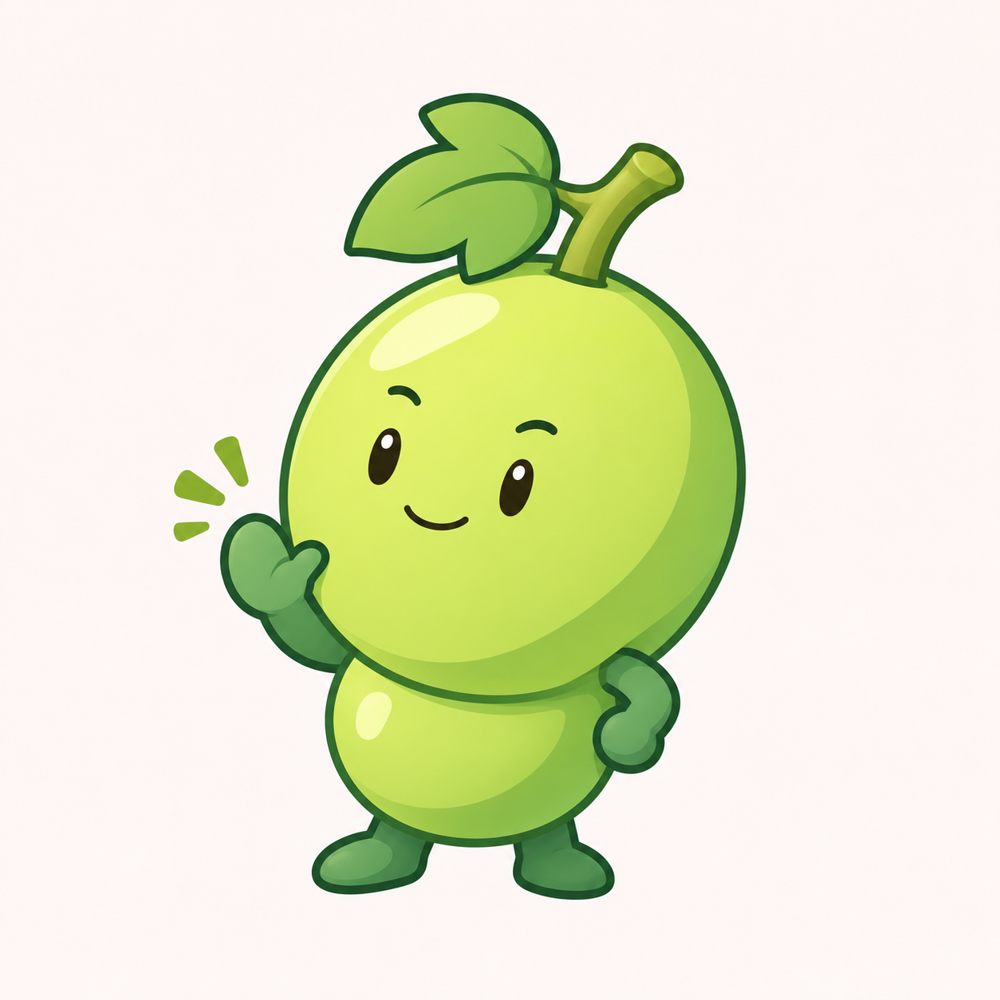
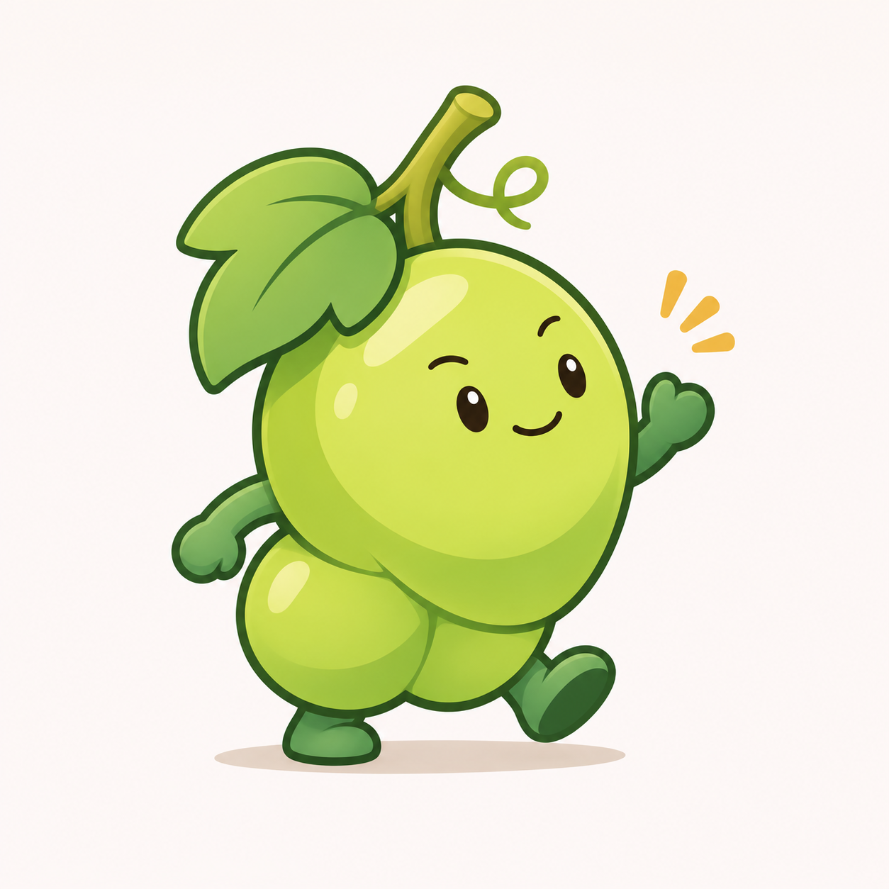

# 青提完整角色 v0.4

用户否定卷叶角色后，明确选择“完整小角色”：参考此前番茄软件图标中水果角色的手脚、表情与动作。本轮继续清爽插画，重新建立青提的头身关系与动态，不将旧版无手脚方案视为已接受方向。

## A：站立招呼



上方大主果带面部，下方小果构成身体，两只短手臂和两只小脚形成完整角色。侧倾头部，抬手招呼，姿态较稳定。

## B：轻快迈步



主果与下方较小果实组成不对称身体，短手脚呈迈步和挥手动作，角色更活泼。两版叶梗仍较显眼，后续可根据用户反馈进一步平衡比例。

本轮聚焦完整角色，不先展开应用家族。外侧动作强调线仅为展示效果，正式单图制作时应另行评估保留与否。两张均为浅色背景位图候选，未进行透明资产、ICO、实际任务栏或 DPI 验收。名称与设计方向不等于授权修改正式程序图标，用户数据未变更。

## 生成方式与完整提示词

内置 imagegen，两个独立生成请求。

- 输入一：`docs/images/qingti-cluster-v01.png`，仅作青提题材与旧方案参照，明确要求重做静态果实拼接造型。
- 输入二：用户曾提供的番茄软件图标参考截图 `codex-clipboard-5c6aacd9-00ea-4c08-8cb5-4fd071380821.png`，只借鉴完整水果角色与动作的表达方式，不复制品牌形象。

### steady

```text
Use case: stylized-concept. Asset: 青提 original full-character mascot for a Chinese productivity software family.
Input image 1 is the earlier REJECTED grape-bunch concept; do not repeat its static pile of fruit with dot eyes. Input image 2 is the user's tomato software-icon REFERENCE: borrow the idea of an expressive complete fruit character, compact clear silhouette, small hands and feet, and lively functional poses. Do not copy its tomato identity, exact face, logo, software marks or screenshot composition.
The user now explicitly chose "完整小角色" (a complete little character). Design an appealing memorable anthropomorphic GREEN GRAPE mascot, rather than a fruit arrangement or abstract logo. Give the character an intentional readable pose and distinctive friendly personality. Clearly articulated but VERY SHORT simple arms, mitten hands, little feet. Coherent anatomy: exactly two arms and two legs; limbs attach to the body's lower sides. No human face, separate human skin, hair, costume or clothing.
Fresh clean 2D illustration, fine dark-jade outlines, expressive small oval/almond dark eyes, tiny eyebrows and a subtle natural smile. Clean grape-green opaque cel colors, modest soft shadows and small pale highlights. A slightly warmer pear-green front plane and cooler fresh green shadows, not murky olive or acid neon. Rounded lightly elongated grape shapes, short stem and ONE small simplified three-lobed grape leaf, enough to read as grapes. Keep eyes restrained, not huge baby eyes; personality comes from pose and body language. Leaf and stalk should be tasteful small accents.
Professional adult-friendly app mascot, beautiful soft contours and clear silhouette at small size. No glass, frost, plastic toy render, material noise, excessive gradients, freckles, blush, jewelry, weapons, badges or unrelated objects.
One full isolated character, square near-white plain background, generous 15 percent margins, no words, title, frame, tile or extra mini characters.
Character A, friendly little organizer: create an intentionally designed two-part grape character with a large plump round-oval grape head/body (about 65 percent of full height) and a small lower grape forming its rounded belly/haunch, visually a natural short bunch rather than a snowman. Three-quarter view facing slightly LEFT. Short curved stem and small grape leaf tilt sideways as a distinctive jaunty top accent. Two short green arms emerge from the lower body; the near hand is raised beside the cheek in a small relaxed greeting with clear thumb, the other hand rests at the side. Two small dark-jade feet stand a little apart with one slightly forward. Head leans gently toward the raised hand, eyebrows and small warm smile communicate attentive competence. Silhouette full and stable, no tall stalk or hanging vine, no extra surrounding grape circles, no perfect symmetry. Friendly character ready to hold a notebook or folder in later family variants; no props in this drawing.
```

### lively

```text
Use case: stylized-concept. Asset: 青提 original full-character mascot for a Chinese productivity software family.
Input image 1 is the earlier REJECTED grape-bunch concept; do not repeat its static pile of fruit with dot eyes. Input image 2 is the user's tomato software-icon REFERENCE: borrow the idea of an expressive complete fruit character, compact clear silhouette, small hands and feet, and lively functional poses. Do not copy its tomato identity, exact face, logo, software marks or screenshot composition.
The user now explicitly chose "完整小角色" (a complete little character). Design an appealing memorable anthropomorphic GREEN GRAPE mascot, rather than a fruit arrangement or abstract logo. Give the character an intentional readable pose and distinctive friendly personality. Clearly articulated but VERY SHORT simple arms, mitten hands, little feet. Coherent anatomy: exactly two arms and two legs; limbs attach to the body's lower sides. No human face, separate human skin, hair, costume or clothing.
Fresh clean 2D illustration, fine dark-jade outlines, expressive small oval/almond dark eyes, tiny eyebrows and a subtle natural smile. Clean grape-green opaque cel colors, modest soft shadows and small pale highlights. A slightly warmer pear-green front plane and cooler fresh green shadows, not murky olive or acid neon. Rounded lightly elongated grape shapes, short stem and ONE small simplified three-lobed grape leaf, enough to read as grapes. Keep eyes restrained, not huge baby eyes; personality comes from pose and body language. Leaf and stalk should be tasteful small accents.
Professional adult-friendly app mascot, beautiful soft contours and clear silhouette at small size. No glass, frost, plastic toy render, material noise, excessive gradients, freckles, blush, jewelry, weapons, badges or unrelated objects.
One full isolated character, square near-white plain background, generous 15 percent margins, no words, title, frame, tile or extra mini characters.
Character B, nimble grape friend: create an asymmetrical compact miniature grape-BUNCH character with ONE larger upper/front oval grape carrying the only face and TWO smaller tucked lower/back grapes forming one unified short body/haunch, not a row of three separate heads. A short stem sweeps diagonally, one small leaf folds over to one side as a recognizable silhouette accent. Three-quarter view facing slightly RIGHT, with a lively short walking step: one rounded foot firmly planted and the other just forward, one small mitten hand lifted in a cheerful greeting, the other arm swings gently back. Give the face a small confident slightly asymmetric smile and subtle expressive eyebrows, head tilted a little. The character should feel like a helpful energetic assistant, not a humanoid in a grape suit. Exactly two short arms and two feet; no extra grapes disconnected from body, no large leaf cape, no unrelated props. Keep compact animated silhouette and natural connected grape anatomy.
```
