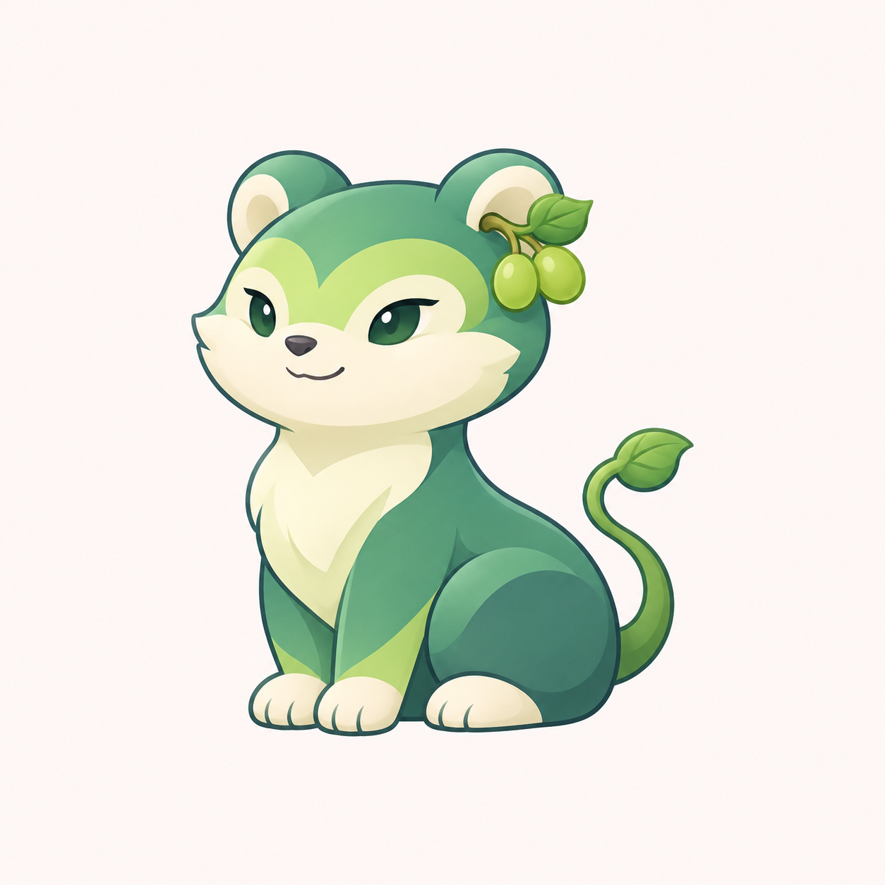

# 青提小兽方向 v0.12

用户在叶精灵 v0.11 后要求再换。本轮沿已授权的自主探索范围，保留青提名称，尝试动物感小兽，继续清爽插画与机灵、利落的角色气质。



采用圆耳、短吻、浅色面颊与胸腹、小爪和侧身坐姿。耳侧两颗青提与叶片连接名称意象，藤尾以小叶片收尾。用玉绿、浅青绿与米白区分形体，减少上一轮大叶冠的装饰占比。

这是新方向候选，用户尚未接受具体角色。眼形、头身比例和葡萄识别仍待评审；未制作功能家族、透明资源或 ICO，未进行实际任务栏尺寸、DPI 或品牌近似性验收，不改程序名称、图标、版本或用户数据。旧稿保留。

## 生成方式与完整提示词

内置 imagegen，以 `docs/images/mascot-cast-detail-v07.png` 仅作角色插画完成度参照，不复制其中具体角色。

```text
Use case: stylized-concept.
Asset: new 青提 original ANIMAL-LIKE mascot direction for a productivity-software family.
Input image 1 is only an illustration finish reference: fine blue-gray outline, clean tasteful cel shading, appealing little creature anatomy. Do not reproduce any specific character from the sheet. The previous large leaf-crowned humanoid sprite was rejected. This design must be visibly different.
Create ONE small original grape-inspired forest creature, closer to a compact clever little marten/otter than to a human elf:
- A rounded animal head with TWO SMALL rounded ears, a short cream-jade muzzle, tiny dark nose, distinct cheeks and little chin. No human face, human hair, pointed elf ears, huge leaf helmet, robe or humanoid torso.
- Small alert almond-shaped dark-jade eyes, modest highlights, a subtle cheerful corner-smile. Expression clever/playful and quietly composed, not a baby, not angry, smug or sleepy. Eye sizes restrained. Fine eyebrows implied by the jade forehead pattern, no makeup or eyelashes.
- Coat represented with smooth broad color shapes, NOT fur texture: deeper jade-green back/head cap and a pale warm ivory-green muzzle and chest. Face shape open and readable. Light grape green on upper forehead softly separates the features.
- Head roughly 45 percent of full body height, short neck naturally joined to a compact soft body, small rounded forepaws and sturdy short hind paws. Seated in a poised three-quarter stance facing slightly LEFT, two forepaws neatly placed in front, hind haunch tucked and one pale paw tip visible. Keep natural little-animal anatomy, not a huge head on a tiny belly.
- ONE small natural sprig of exactly TWO oval green grapes and one tiny folded grape leaf is tucked beside the left rounded ear. This replaces any crown, hair or jewelry and subtly connects to the name 青提; sprig under 12 percent of visual mass, not a giant bunch.
- A short supple green vine tail curls compactly behind its right haunch in one smooth C curve, ends with one small rounded folded leaf. Tail adds a clear lively silhouette without becoming larger than the body, no large squirrel tail or extra limbs.
The personality comes from the little animal's alert seated posture, short muzzle, ear placement and calm knowing expression. Fresh light grape green, cool deeper jade/teal-green, warm ivory-green face/chest; tiny slate accents at nose and eyes. Color balance should be soft and clear with one coherent light side and shadow side, minimal small marks. Fine confident outline, refined soft cel shading, slight illustrated depth, no glossy toy look or realistic materials.
One complete isolated character centered on warm nearly-white square canvas, generous 15 percent margins. No text, title, app tile, border, diagram, extra character, prop, scenery, flowers or external decorative marks. No human hands, clothes, leaf cape, armor, accessories, glass, frost, 3D rendering, material grain, fur detail, sparkles or imitating a specific existing game creature.
```
