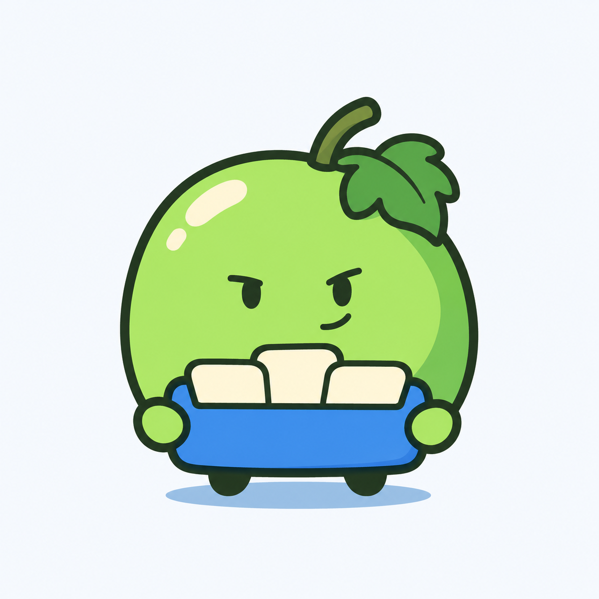

# 青提收纳图标重设计 v0.14

用户在小兽方案后要求再换，继而明确否定小雀方向。本轮回到软件图标用途，尝试更紧凑的青提小角色加收纳托盘，停止沿用动物或鸟类方向。



一颗青提构成主体，短手扶住蓝色托盘，三张浅色卡片表达图标与桌面物品收纳。五官缩小，去掉人形大眼，颜色以绿色、深色轮廓和蓝色道具为主，顶部保留小葡萄叶与果梗。

当前仍是待评审浅色背景概念，轮廓线和高光尚可继续修整；不宣称完成小尺寸可读性、透明图标、ICO、DPI 或品牌近似性验收。用户授权自主尝试方向不等于成图确认。未修改正式程序名称、图标、版本或用户数据。

## 生成方式与完整提示词

内置 imagegen。参考用户此前提供的番茄软件图标截图 `codex-clipboard-5c6aacd9-00ea-4c08-8cb5-4fd071380821.png`，仅取水果角色结合功能道具的表达方法，不复制具体品牌图形。

```text
Use case: logo-brand.
Asset: a polished Chinese desktop-organizer SOFTWARE ICON mascot for brand 青提, not a generic full-page cartoon illustration.
Input image 1 is the user's original tomato productivity-app reference. Study its economy: compact fruit silhouette, restrained little face, tiny appendages, and a clear functional prop. Do NOT copy tomato shape, leaf crown, exact face, app marks or text.
Create ONE original compact GREEN GRAPE character holding a small organizer tray.
Single grape is the entire body, full and squat, only a little taller than wide, subtly rounded-square with soft natural asymmetry, gently flattened base. Two tiny mitten hands attach directly near lower flanks, two tiny unobtrusive feet at base. No separate head/torso, animal, bird, elf, costume or human face.
Grape silhouette: one very short offset bent stalk, one SMALL folded lobed grape leaf tucked close to upper right, fruit remains dominant. Not an apple cleft, giant leaf cap, long stalk, vine tail or bunch of circles.
Facial design: a restrained, sharp little character face, two SMALL black-jade oval eyes with subtly angled short upper strokes, tiny one-corner smile. Face occupies less than one-quarter of fruit width. Expression lightly mischievous and composed, not babyish, angry, sneering or sleepy. Absolutely no white human eye sclera, huge eyes, eyelashes, blush, giant brows or elaborate facial shading.
The short hands hold a low simple BLUE ORGANIZER TRAY against the lower front of the grape. Tray contains THREE broad cream/ivory rectangular app cards with one slightly peeking up. It communicates "collect apps and desktop items" instantly. Prop about one-quarter of fruit area, face fully visible. Few clean shapes, one simple blue shadow, no tiny app logos, writing, buttons, glyphs or realistic objects.
Art direction: original compact hand-inked 2D illustrated app mascot, calm and clever. Crisp smooth charcoal-jade contour with deliberate slightly lively curvature, restrained flat fresh green and one cool jade-green shadow area, small warm ivory highlight. NO airbrushed gradients. Grape green should be crisp pear green with a hint of mint, not yellow lemon, olive mud or neon. Small dark feet, blue tray provides one clear contrasting color. Less than six visible color families. Sophisticated restrained graphic drawing; avoid generic Western stock vector clipart, oversized anthropomorphic eyes, swollen plastic gradients or detailed fantasy illustration.
Composition: single full unclipped character centered on very light cool-white square canvas, 20 percent margin, no title, letters, labels, logos, background scene, frame, app tile, extra miniature examples or decorative action marks. No glass, frost, 3D rendering, texture grain, furry creature, bird anatomy or leaf-elf head. A useful distinctive desktop-app icon concept with all lines and shapes designed for clarity.
```

## 已否定的小雀试验

本轮工作过程中曾生成 v0.13 小雀，用户即时否定，未选为最终交付。该方案停止推进。其生成方式为内置 imagegen，无参考图输入，提示词保留如下以记录已尝试方向：

```text
Use case: stylized-concept.
Asset: a NEW 青提 original small BIRD mascot for a Chinese productivity software family.
Design from scratch. Previous literal grape people, leaf elf and seated mammal were rejected. The user delegated creative direction and asks for another character. Keep only the brand name 青提 and clean illustration, playful intelligence with understated cool.
Create ONE delightful compact grape-inspired small songbird:
- A naturally rounded plump bird body with head flowing directly into body, short neck, not a separate human head, not a mammal with a fruit decoration. Grape-green upper plumage, pale warm ivory/very light jade belly, cooler jade wings.
- Tiny short warm yellow-orange beak, two very small amber/yellow bird feet with simple short toes. Warm accents bring balance, never large human boots.
- TWO small wings directly at sides; near wing slightly lifted in a relaxed helpful gesture, other tucked at flank. Wing tips consist of only three broad soft feather lobes; not humanoid fingers, arms, gloves or hands.
- A short fan-like tail peeks to the right, composed of THREE broad overlapping elongated green grape-shaped feather lobes, one lighter oval tip. Tail under one-third of body mass, no giant peacock or squirrel tail.
- A single small three-lobed grape-leaf crest angles sideways near the top-left of its head, integrated like a jaunty tuft, not a big foliage helmet. A VERY short curved stem tucked into the tuft subtly signals the grape theme. No bunch pendant or extra fruit accessories.
- Alert small almond eyes, a tiny white crescent/glint and deep jade pupils, gaze slightly left; restrained subtle eyebrow shape and a gentle raised corner at the beak. Smart lively poised expression, not smug, sleepy, angry or giant-eyed baby bird.
Standing three-quarter toward left, one foot firmly planted, the other just forward for a light confident stance. Characterful asymmetry, clean negative space, compact friendly silhouette. Tail, wings, beak, feet, leaf tuft should make it clearly a bird-inspired mascot, not a green egg with human limbs.
Style: refined fresh 2D mascot illustration, thin blue-gray/dark-jade contours, smooth deliberate curves, three broad restrained opaque cel-color planes and subtle illustrated volume. Fresh grape green, jade/teal-green, warm ivory belly, tiny warm amber accents. No huge white glare patch, dull yellow olive, neon green, grain or microfeather texture.
One full uncropped standalone character centered on warm near-white square canvas, 15 percent margins, no text, tile, frame, logos, other characters, props, scene or decorative rays. No fur, clothes, hats, jewelry, humanoid elf face, glass, frost, shiny toy rendering or photorealism. Do not imitate any existing game or cartoon bird.
```
