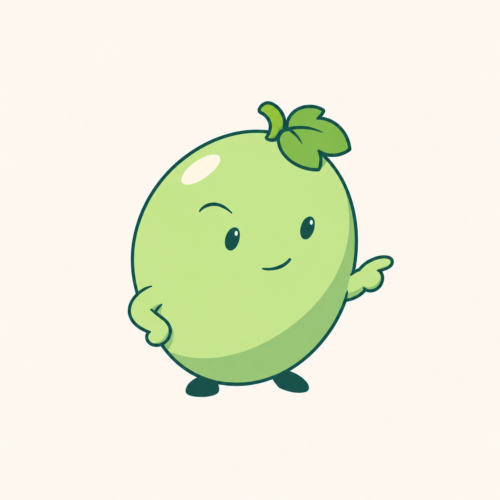

# 青提机灵简洁角色 v0.7

用户认为 v0.6 仍不理想后，明确选择融合“机灵俏皮”和“简洁酷一点”。本轮保留单果完整身体与短小手脚结构，重画神态、手势、线条与配色。



采用一手收于身侧、另一手向外轻指的姿态，配小幅挑眉与不对称微笑，减少卖萌与困倦感。轮廓线较上一版更细，配色偏清爽绿色，保留单颗青提、短果梗与小葡萄叶。首轮生成仍出现低眼睑，随后单独修改眼睛，使其更清醒。

最终稿仍是待评审浅色背景位图，尚未制作功能家族、透明资源或 ICO，也未进行真实任务栏、DPI 验收。色彩在第二次生成中有细微变化，不能把参考编辑称为除眼睛之外像素完全不变。用户确认气质与结构，不等于确认具体成图。程序名称、图标和用户数据未变更。

## 生成方式与完整提示词

内置 imagegen，共两次顺序生成；仅保存第二次结果作为本轮候选。

### 主角色重绘

输入一：`docs/images/qingti-compact-character-v06.png`，作为已确认结构和被否定外观的参照。输入二：用户此前提供的番茄软件图标截图 `codex-clipboard-5c6aacd9-00ea-4c08-8cb5-4fd071380821.png`，仅用于完整水果角色表达方式参照。

```text
Use case: stylized-concept.
Asset: original 青提 complete fruit mascot, personality = quick-witted/playful + understated cool.
Input image 1 is a REJECTED prior design, supplied only to preserve the user-approved single-grape anatomy and to show what must change. Do NOT repeat its sleepy half-lidded expression, thick outline, pale yellow cast or thinking-hand pose. Input image 2 provides only the structural idea of a compact expressive fruit app character, not its tomato identity or exact drawing.

Design a noticeably more poised and well-drawn 2D mascot:
ONE plump green grape is the ENTIRE continuous head/body, no separate head, neck, torso or other grape circles. Full slightly asymmetric oval, modest taper to the base, small forward lean. Two short arms directly on its sides and two tiny feet under its bottom. One very short bent stalk and one small three-lobed grape leaf tucked close along the top-right contour, a tidy jaunty botanical accent, no giant foliage.
Personality: an alert clever little helper with a restrained cheeky attitude. Small dark oval/almond eyes glance toward the viewer's right, both eyes alert and open, upper lids subtly angled but not drooping. One very small eyebrow raised a little, the other composed. Tiny asymmetric smile with just one corner lifted. Not sleepy, smug, angry, babyish or exuberant. No blush, teeth, lashes, huge pupils or excessive face features.
Pose: a casual confident lean, one small mitten hand resting on its lower flank, other short arm extending just slightly to the right with one simple rounded fingertip indicating forward, like a neat "this way" gesture. Anatomically readable tiny hands, no large gloves or long human arms. One foot supports weight, other foot angled outward, both directly connected to the single fruit body. Keep hands and feet secondary.
Graphic quality: sophisticated clean illustrated software mascot, refined slender dark blue-jade linework with deliberate smooth curves. Outer contour approximately half the thickness of the rejected input. Fresh grape green rather than yellow: light crisp green lit face (#B8DA7A family), controlled cooler green lower-right shadow (#78AE66 family), dark blue-jade outlines and features (#1D443D family). ONE broad restrained cel shadow and a small pale ivory highlight. Quiet large color planes, minimal very soft transitions, no cloudy gradient. Small darker-green leaf, compact dark-jade feet. Great negative space, compact unmistakable silhouette and lively attitude.
No glasses or sunglasses as shortcuts for "cool", no costumes, hats, shoes with laces, badges, tools, props, action marks or decorative twirls. No glass, frost, plastic toy gloss, material grain, realistic textures or 3D render.
Composition: one complete character centered in square warm nearly-white background, at least 15 percent empty margins. No words, frames, app tile, other characters, scene or background shadow. Keep single-grape body anatomy and communicate character through pose, eyes and linework.
```

### 眼神局部修正

输入：上述主角色生成结果。

```text
Use case: precise-object-edit.
Input image 1 is the exact edit target. Change ONLY the EYES to correct a sleepy expression, preserve every other element including silhouette, colors, pose, pointing hand, hip hand, feet, leaf, stem, highlight, smile, eyebrow and background.
Replace the drooping horizontal eyelid strokes that intersect the eye pupils. Draw TWO small OPEN attentive dark blue-jade oval-to-almond eyes glancing toward the right. Each eye is one clean tapered oval, subtly angled for a clever composed expression, with one tiny restrained pale catchlight. Neither eye may have a horizontal line across its upper half. Do not recreate half-lidded sleepy eyes. Keep the upper raised eyebrow separate from the eye, retain small asymmetric smile for a playful cool attitude. No big anime eyes, eyelashes, white sclera, extra brows, angry squint or large eye enlargement.
Maintain the delicate clean illustrated linework and same single-grape complete character body with short attached limbs. All areas outside the two eyes remain unchanged.
```
