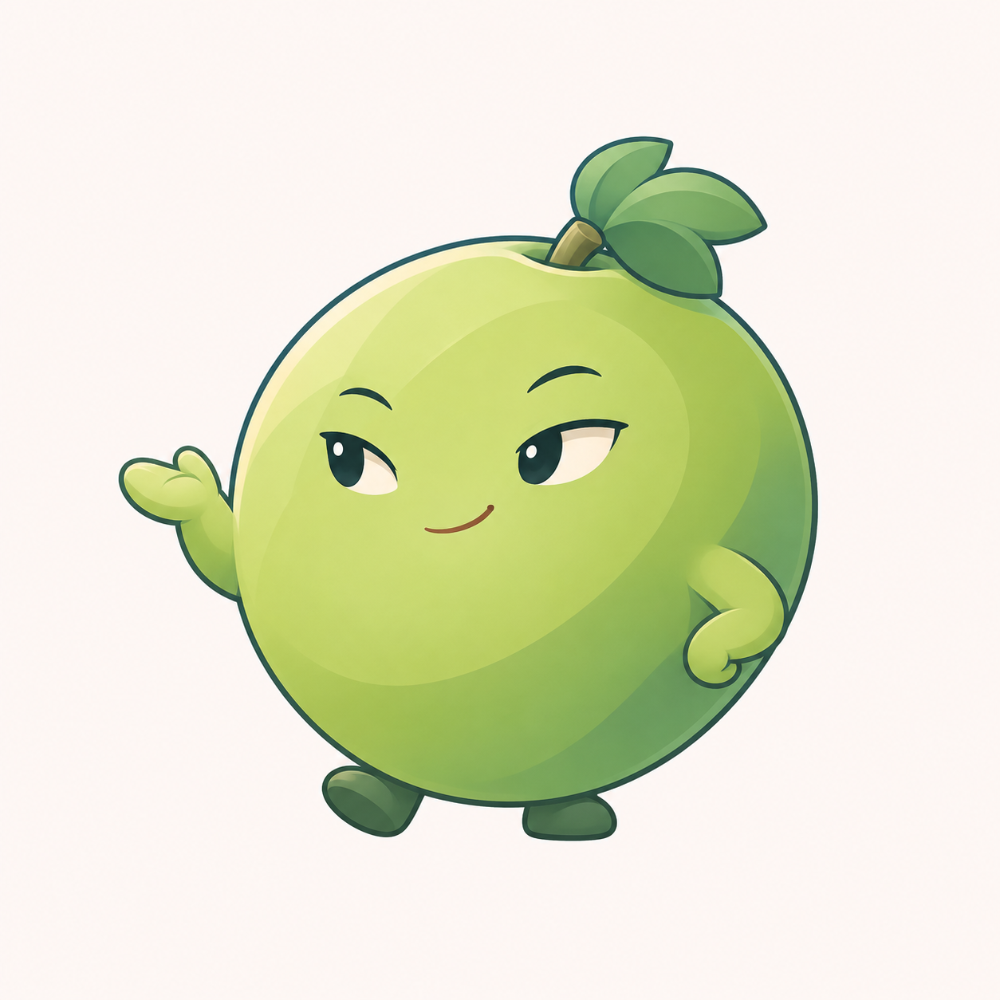

# 青提眼型与插画重绘 v0.8

用户否定 v0.7 后要求再改。本轮保留单果身体、短小手脚和“机灵俏皮＋简洁酷一点”气质，参考早期九角色稿的插画完成度重新绘制，而非继续微调旧稿的圆点眼。



调整饱满果身的局部轮廓，采用带少量眼白的眼型与侧向视线，配合抬手、收腰侧的手臂和前置小脚，增加角色表情与动作。明暗层次较上一版更丰富。

当前顶部叶形与果顶凹口仍可能影响葡萄识别；眼形气质、轮廓与色彩待用户评审，不宣称已经解决所有识别问题或获得确认。成图为浅色背景位图候选，未制作家族、透明图标或 ICO，未进行真实任务栏和 DPI 验收。程序名称、图标、用户数据不变。

## 生成方式与完整提示词

内置 imagegen，以 `docs/images/mascot-cast-detail-v07.png` 只作线条、眼型与插画风格参照，重新设计青提，不复制其中角色。

```text
Use case: stylized-concept.
Asset: a fresh high-quality 青提 (green grape) software mascot character, redesigned silhouette and drawing.
Input image 1 is ONLY a rendering/style reference: its delicate blue-gray contour, thoughtful character drawing, restrained cel-color planes and slight illustrated volume. Do not reproduce any characters, mythology, rocks, water, grid or lettering. Create a new green-grape character.
User-confirmed anatomy: ONE grape is the entire continuous head/body, with two very short arms and two tiny feet directly attached. No separate head, neck, torso, belly sphere, other grapes or clothing.
Character design: replace the generic egg silhouette with a plump softly shaped near-round grape, gently squared shoulders and a subtle oblique taper near its small flat base. No perfectly geometric circle and no long oval/pear. Fruit tilted slightly left, asymmetry deliberate and balanced. Short grape stem almost tucked into the top, one small neatly folded three-lobed grape leaf swept sideways like a jaunty botanical tuft. Keep leaf smaller than 15 percent of fruit mass. No long stalk, cape or vine decoration.
Give it a witty, quietly cool personality with well-drawn small ALMOND EYES with a little IVORY SCLERA and dark jade pupils glancing toward LEFT. Eyes small and expressive, NOT black oval dots, not droopy half-closed lids, no oversized anime eyes. One slightly lifted subtle brow, a tiny confident asymmetrical smile, no teeth, blush, lashes or angry expression. Similar care in the eye drawing as the reference's character faces, but clearly fruit and not a human face pasted onto fruit.
Pose: lightly leaning onto one foot, the other tiny foot relaxed forward. Near short arm bent with a small mitten hand resting against its lower flank; far hand slightly lifted with a relaxed open-palm gesture at shoulder level, not waving huge or pointing a human index finger. Clear attached anatomy, two hands and two feet only. Short stylized limbs, no long arms, cuffs, gloves, shoes or clothes.
Illustration: elegant clean drawn 2D character, warm fresh grape green lit plane, cooler jade-green shadow down one side, leaf in deeper jade, tiny dark desaturated green feet. Crisp coherent broad light/shadow masses with delicate transitions, subtle illustrated depth and one tiny warm ivory reflected edge, not shiny glossy blobs. Fine blue-gray/dark-jade contour, smooth confident curves, purposeful line hierarchy and careful hand construction, high drawing craftsmanship rather than clipart. Fruit has no pores, grain, texture or material effects. Avoid yellow-lemon color, gray washed-out green or neon.
One full uncropped isolated mascot on warm nearly-white square canvas, generous 15 percent whitespace, no text, icon tile, frame, props, action marks, layout panels or background scene. No glass, frost, 3D toy, plastic shine or photorealism.
```
