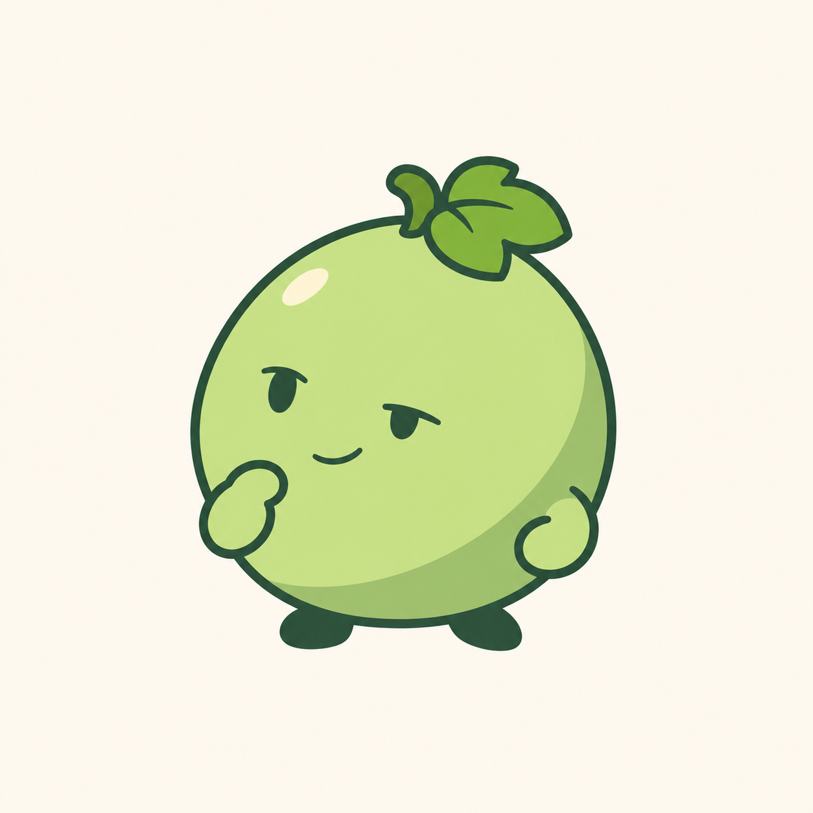

# 青提紧凑角色重绘 v0.6

用户认为[单果完整角色 v0.5](青提单果完整角色-v0.5.md)不好看。本轮保留已确认的单果完整身体结构，重新绘制比例、神态与配色；不推断用户认可旧版或新稿的具体外观。



缩短顶部果梗，收紧果身轮廓，采用更浅柔的绿色和简化阴影。眼形加入轻微半闭变化，一手靠近脸侧形成思考动作，另一手收于侧边，手脚直接接在同一果身。生成结果描边仍偏有分量，表情与线宽待用户评审；不宣称已完整达到提示词中的细线或无渐变要求。

仍为浅色背景候选图，未制作家族图标或透明生产资源，未进行实际任务栏尺寸、DPI 或 ICO 验收。程序名称、图标和用户数据不变，旧稿保留。

## 生成方式与完整提示词

内置 imagegen，参考用户提供的番茄软件图标截图 `codex-clipboard-5c6aacd9-00ea-4c08-8cb5-4fd071380821.png`，只取完整水果角色的结构与表达方式，重新绘制青提形象。

```text
Use case: stylized-concept.
Asset: a redesigned single-grape 青提 mascot, clean expressive 2D software character.
Input image 1 is ONLY a structural/style reference of small fruit software mascots. Borrow compact silhouette, expressive simple face and readable short appendages, without copying the tomato identity or its exact facial design. Do not reproduce screenshot, logos or text.
The user approved ONE grape as the entire head/body, with short hands and feet directly attached. Keep that anatomy. No separate head, neck, torso, belly sphere, other grapes or human body. The previous version was rejected for visual appeal; create a NEW refined drawing rather than repeating the long yellow oval and generic waving smile.
Art direction: a compact soft almost-round grape with a little organic asymmetry and slightly flattened stable base. Fruit width almost equal to height. No long cucumber shape or pear neck. Fresh light pistachio/pear green (#C6E389 family), quiet jade-green lower-side shadow (#92BB6C family), deep charcoal-jade outline and features (#294C3B family). Clean opaque flat color with ONE broad cel-shadow shape, no airbrush gradients or large glossy highlight patches. A tiny soft cream accent is sufficient. Polished subtle editorial mascot illustration, charming and composed, not a shiny toy or generic children's clipart.
Stem is VERY short, a gently bent green hook, less than 8 percent of fruit height. One small folded three-lobed grape leaf sweeps sideways close to the stem, about 12 percent of fruit area. Leaf and stem make one tidy top accent; no tall branch or extra twirls.
Face has character: small slightly half-lidded oval eyes, subtle asymmetry in eye openness, a delicate tiny smile lifted at one corner, warm and thoughtful rather than smug or sleepy. Avoid thick eyebrow arches, big baby eyes, catchlight-heavy eyes, blush, teeth, lashes or human skin. Face slightly below fruit center and turned a little toward left.
Pose is a calm thinking gesture: one VERY short arm brings a small mitten hand beside the lower cheek, the other hand rests against the lower flank. Two tiny dark-jade feet directly under the same fruit, one angled slightly outward. No long legs, boots, gloves with cuffs or clothing. Exactly two hands and two feet. Use slight body tilt and lively asymmetric posture; no action rays, speech balloons or props.
Consistent slender contour, smooth confident curves and uncluttered silhouette. Square warm ivory nearly-white plain canvas, single complete character centered with generous margins. No text, frame, icon tile, other drawings or environment. No glass, frost, texture, photographic materials, 3D render, stickers with thick white border, material grain or neon colors.
```
