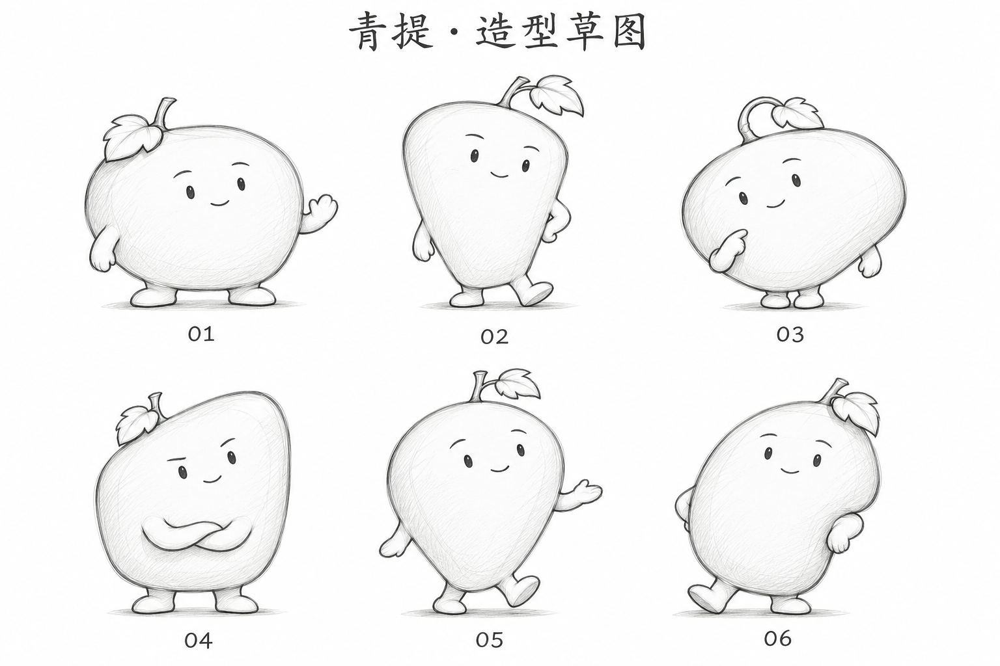

# 青提黑白造型草图 v0.10

用户明确否定 v0.9 的全部三种画法。本轮转为黑白造型草图，集中比较果身、叶梗、手脚与动作的比例，暂时去掉配色和材质表现的干扰。保留已确认的单果身体、短手脚，以及机灵、克制的角色气质。



六种候选分别尝试宽矮、倒梯形、斜向扁圆、圆角方形、圆角水滴、不规则侧凹的果身，搭配招呼、迈步、思考、抱臂等姿态。当前面部仍偏简化，尚未完成最终气质与画法，不将草图当作上色成稿。

草图是重建基础造型的阶段产物，六种轮廓均未获用户选择。未继续展开家族、透明资源、ICO、实际任务栏或 DPI 验收，不改动正式程序名称、图标或用户数据；旧稿保留作历史对照。

## 生成方式与完整提示词

内置 imagegen，全新生成一张六角色造型草图比较板，无参考图输入。

```text
Use case: stylized-concept.
Asset: professional early CHARACTER SHAPE EXPLORATION SHEET for 青提, a green-grape productivity-software mascot. Fresh concept work with no reference input.
User-confirmed design brief: a complete clever/playful and understated-cool fruit character. ONE grape is the ENTIRE continuous head/body. Short small arms and feet attach directly to that one fruit. NO separate head, neck, torso, belly sphere or bunch of grapes. A short stalk and ONE small simplified lobed grape leaf identify the fruit. No clothing, sunglasses, props or objects. Previous colored oval-fruit smiley designs were all rejected, so rethink actual character construction and pose.
Create a beautifully drawn BLACK-AND-WHITE character designer's exploration sheet with SIX meaningfully different silhouettes, not six expressions on the same stock ellipse. Soft natural grape shapes, deliberate curve rhythm, attractive proportion, compact leaf-to-body ratio, clear hand/body connections and appealing controlled gestures. All remain recognizable as one single grape body. Tiny expressive eyes, small subtle smile, reserved brows. No big human eyes, sneering faces, blush or baby expression. Personality from body language and shape.
Draw expressive clean fine graphite/ink sketch lines, occasional faint construction strokes and ONE restrained light gray shadow per character. White paper background with no visible grain. This is exploratory draft art, not polished clipart or 3D material. Gentle line-weight hierarchy, confident curves. NO color at all.
Six full characters in a spacious 2 rows by 3 columns landscape layout:
01: broad squat grape with softly flattened upper shoulders, a tiny folded leaf near upper-left, short relaxed arms and wide little grounded feet; near hand makes a restrained small greeting. Shape feels compact and capable, not spherical.
02: softly rounded trapezoid grape, narrower near bottom, slight lean left; small leaf swept right, two tiny arms at sides with one hand on flank, one foot lightly angled forward. Clever composed expression.
03: oblique soft pebble-shaped grape, slightly horizontal and asymmetrically full, small stem curled toward center, both feet tucked close, one hand near its cheek as if thinking. Warm attentive eyes, no sleepy half-lids. No separate abdomen.
04: full softly squared grape with high right shoulder and low left shoulder, one small close-set leaf; two short arms lightly folded against the SINGLE fruit's lower front, small feet steady. Quiet slightly cheeky confidence, not angry or smug.
05: rounded teardrop grape with a broad full top and softly tapered low base, short stalk and leaf secondary. Tiny walking step and understated open-palm gesture, limbs short. A fresh light energetic silhouette, not a long skinny body.
06: a rounded asymmetrical grape with a small flat base and modest side dimple, leaf folded along top corner. One foot relaxed out, one hand behind the fruit with its short arm edge visible and the other casually resting on side, head/body tilted slightly right. Playfully poised rather than generic waving smile.
Every fruit shape must differ visibly in silhouette and proportions while respecting the same anatomy. Leaf at most about one-fifth of fruit area, no giant foliage. Hands and feet small and intentionally drawn, never long gloves or oversized boots.
Top modest exact title "青提 · 造型草图". Below each drawing only its exact number "01", "02", "03", "04", "05", "06". No other wording, descriptions, graphic arrows, logos, frames, app tiles, background scene or additional characters. Generous whitespace separates the figures; full bodies uncropped.
```
