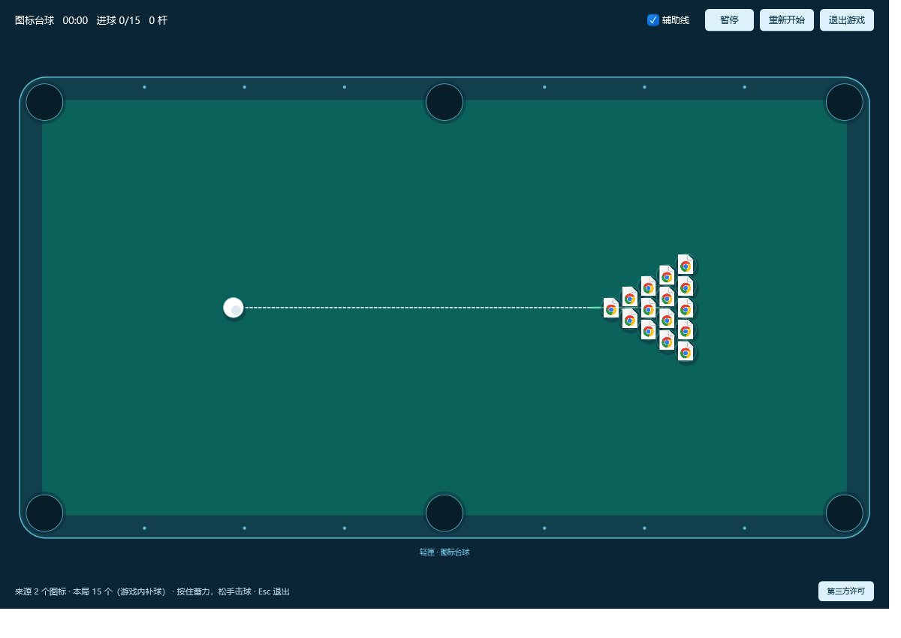

# 图标台球实现与验收（0.13.0）

2026-11-12 按确认的 C# 方案完成首版。入口「更多 → 桌面玩法 → 图标台球」，当前分类 / 全部收纳 / 桌面只读镜像，15～45 个图标，支持鼠标蓄力击球、碰撞、六袋、白球复位、辅助线、暂停、重开和清台成绩。操作见[使用说明](图标台球使用说明.md)。

截图为合成 URL 图标，只有本游戏画面，不含真实桌面。

## 实现边界

纯 C# 物理类库配合 WPF 自绘场景，同一单 EXE 按需创建临时游戏进程；日常不加载游戏图片、启动游戏进程或持续绘制。固定逻辑台面，动态细分步长，复用空间分桶；用合成帧时间限制 60 FPS。图标在游戏进程后台按 128 像素提取并复制成独立像素，最多 45 张，克隆球共享图像；原始像素上限约 2.81 MiB，WPF/GPU 副本另计。静止 / 暂停停止帧订阅，最小化及失焦暂停；DPI/尺寸变化先暂停并重投影。

管道限制当前用户，双方验证 PID、启动时间、EXE 及随机会话标识。游戏分支在普通单实例和可写 NookStore 初始化前处理。父进程在后台接收消息，验证并去重成绩后原子写入当前 `Data/Games/IconBilliards`；保留最近 100 局及单独历史最佳。未完成局不存成绩，没有设备标识、联网排名、游戏更新器、持续日志或磁盘会话快照。

更新、迁移或结束主程序前先关闭游戏并排空成绩；协议异常断管，父进程退出后游戏自行结束。关闭超时仅在核对身份后结束本会话子进程。正常游戏不置顶；测试模式为验证真实鼠标命中临时置顶，产品模式不启用内部测试命令。

首版是独立深青台球窗口。未运行上游 Python、未隐藏 Explorer、未移动或执行真实桌面内容，游戏坐标不写回分类顺序。参考 [desktop-icon-billiards](https://github.com/liuxiaogang-com/desktop-icon-billiards/tree/eb8818f378a3adf2cf5e753556e74dcd742af6d1) 的物理规则，保留 LXG 2025–2026 MIT 完整版权和许可，随单 EXE 嵌入，游戏内有第三方许可入口。

## 功能及兼容检查

全部在独立沙箱 / 隔离 TESTROOT 执行，未对真实用户数据做卸载、恢复、收纳或游戏测试。

| 检查 | 结果 |
| --- | --- |
| 收纳核心 | 53 通过，0 失败 |
| 纯游戏物理 | 14 通过，0 失败；边界 / 高速 / 同中心 / 速度传递 / 辅助线 / 暂停计时 / 白球 / 清台 / 重开 |
| 游戏集成 | 24 通过；真实鼠标蓄力击球、空来源禁用、历史最佳、成绩去重、30 次启停、维护前退出、异常父子 / 协议断连 |
| 收纳数据保护 | 游戏、重开、异常结束前后主索引、排序及托管正文校验一致 |
| 原生界面及真实拖动 | 70 + 12 项通过；原有动画、多选及排序保留 |
| 存储路由专项 | 9 项通过；目录搬迁、维护和更新不回写旧备份 |
| 旧版更新 | 0.12.13 → 0.13.0 成功；三个分类顺序、偏好、正文、就绪确认保持 |
| 隔离安装 / 覆盖 / 卸载恢复 | 全部通过，11 个测试文件恢复；真实用户数据未参与 |

证据见[验证结果](验证结果/说明.md)。物理/输入及生命周期检查针对首版实际行为，不代表完整覆盖所有 Shell 扩展或显示器组合。

## 内存与帧率

私有工作集使用 Windows `PROCESS_MEMORY_COUNTERS_EX2`，与总工作集、专用提交分别记录；1 MiB = 1,048,576 字节。没有强制 GC 或裁剪工作集。结果是本机样本，不是所有电脑的固定上限。

未开游戏对照：旧版 0.12.13 与候选 0.13.0 各一个全新隔离进程，58 个合成 URL、7 分类、开启动画、10 次开合。

| 阶段：主进程私有工作集 | 旧版 | 新版 |
| --- | ---: | ---: |
| 启动最小化 | 34.9 MiB | 34.5 MiB |
| 10 次开合后展开 | 92.2 MiB | 94.0 MiB |
| 最小化闲置 15 秒 | 82.7 MiB | 76.9 MiB |

这是一轮对照，用于确认无明显游戏常驻增量，不能据此宣称主进程新增了固定的内存下降比例。

游戏进程：15 球、2 个来源的静止场景约 59.9 MiB；45 个独立合成来源、1920×1040 逻辑像素窗口的持续运动约 79 MiB，专用提交约 145～147 MiB。最终持续采样时主进程约 58.3 MiB，两进程私有工作集合计约 137.5 MiB。游戏运行内存是额外开销，不能只报主进程一项。

两轮三局暖机采样平均约 59～60 FPS，帧间隔 P95 分别 31.6 / 34.2 ms。原定 ≤33 ms 目标未在所有轮次稳定达到，保留为后续改善项；不宣称全程锁定 60 FPS。最小化检查无帧订阅，2 秒累计 CPU 62.5～93.75 ms（含探针及 WPF 内部工作），不能称为绝对零 CPU。

完整游戏检查含 30 次启停后，父进程私有工作集：测试前 82.3 MiB，游戏退出后 15 / 60 秒约 70.7 / 70.9 MiB。正常维护及异常父进程退出时，父子进程均在 3 秒内结束；没有残留游戏进程。图像、绘制及其图形资源随游戏进程结束释放。

候选单 EXE 约 981 KiB，保留共享 .NET 10 Windows Desktop Runtime x64 依赖；正式资产尺寸与哈希以发行核验为准。

## 仍需覆盖

混合 DPI 多屏的完整组合、极小工作区、各种第三方 Shell 扩展和真实无运行时电脑的端到端安装仍需更多设备验证。独立窗口的透明 Explorer 图层、音效、全球排名、皮肤和入袋后实际收纳不在首版范围。正式发布和本机应用状态以[项目交接](项目交接.md)为准。
