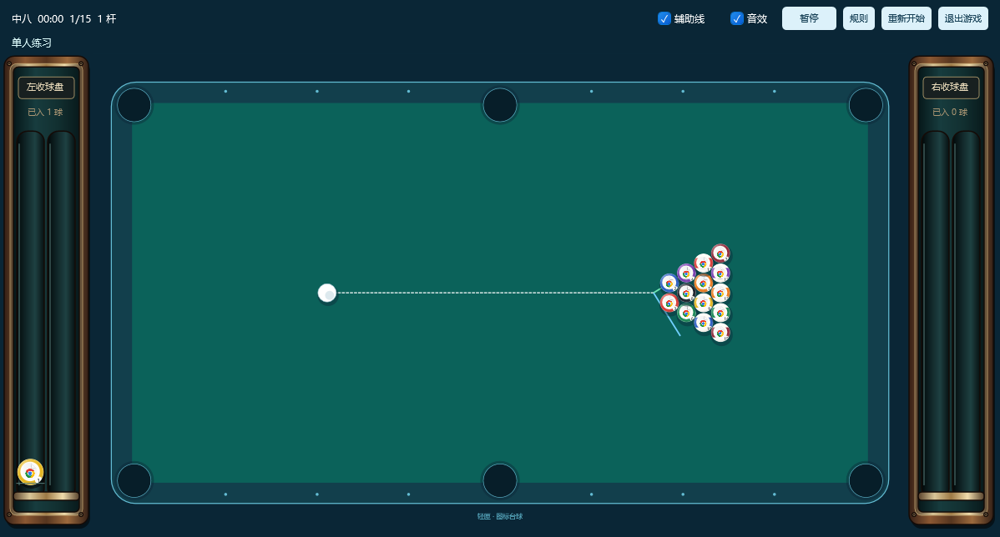
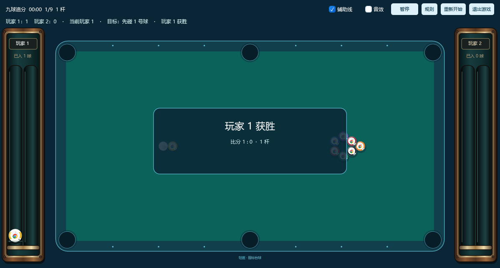

# 左右收球槽、实录音效及图标放大（0.14.1）

按用户三项要求调整：左右各一个球盘并增加实物质感、改用真实击球录音、放大游戏内的软件图案。

## 收球槽与图标

球台左右各一个竖向双轨收球槽，以木纹、暗色衬底、内凹槽、金属压边及螺钉表现层次。球从下方向上堆放，保留球面反光与接触阴影。框体按尺寸生成冻结 DrawingGroup 并复用，不加载大尺寸木纹位图。

双人左侧属于玩家 1、右侧属于玩家 2，按实际击球方收球；单人按进球顺序先填左侧、再填右侧。白球不进盘，复位球从盘中移除，重开清空。收球记录不代表犯规球也计分，计分仍由对战规则处理。

软件图案的半径占球体由 0.48 改为 0.70，图案直径约放大 46%；号码移至更靠边的位置。球仍是规则颜色的圆形，碰撞半径、球数和摆法不变。这里放大的是游戏里的软件图案，主程序 A2 品牌及任务栏兼容标识保持。

## 真实录音

采用作者明确以 CC0 发布的两份台球现场录音：

- [Za-Games：billiard ball clack](https://freesound.org/people/Za-Games/sounds/539854/)，作者说明为实体台球相互撞击声。
- [csaszi：BILLIARD pool shots - CsG](https://freesound.org/people/csaszi/sounds/350918/)，台球击球与滚动录音。

使用公开 HQ 预览，开发阶段切取独立瞬态、去直流、去掉多余前导静音、重采样为 44.1 kHz 单声道 PCM16，仅在切口做短淡入淡出并匹配响度。轻 / 重击、两种碰撞片段保留录音本身；碰库和入袋反馈使用实录片段的低通版本，不将它们冒充单独录制的球库 / 球袋现场音。运行时仅缩放振幅及选择片段，不拉伸时长、变调或混入合成正弦音。

六段 PCM 随 Core 程序集嵌入。原始来源、切片时间、处理参数、输入与输出 SHA-256 位于 Audio/manifest.json 和 ThirdPartyNotices/BilliardsAudio-CC0.txt；Importer 脚本仅供开发复现，运行及普通构建不需要 Python、FFmpeg 或联网下载。

音频由游戏进程内的独立按需工作线程输出；闲置阻塞等待，单设备、最多六个叠加声部、两个 20 ms 输出缓冲，避免长录音逐段排队。静音 / 暂停丢弃旧代次声音，退出停止设备并释放缓冲。没有麦克风采集、系统音量修改或主进程音频循环。

## 验证与边界

验证录音资源加载、强弱响度、相同片段波形时间不变、圆形图标裁切、左右槽位关系、白球排除和复位移除；另验证真实设备播放、叠加声音停止、缓冲释放及游戏退出。性能与实机结果在验收后补录。

录音替代上一版的合成敲击声；不同球杆、球台、房间及扬声器听感仍会不同，不将一组录音表述为与所有实物场景完全一致。原有玩法、开局说明和 40% 窗口保持。

## 隔离验收结果

37 项物理 / 对战 / 录音资源检查、47 项游戏集成检查通过。实录设备提交 8 个 20 ms 缓冲成功，设备回退为 false，声音自然播放和叠加后停止均释放到 0 待处理；同片段强弱波形相关系数大于 0.9999，强击 RMS 超过弱击两倍，未通过变调冒充力度。六段原始像素无关的 PCM 总计 100,720 字节，资源与来源哈希均可复核。

21 个合成图标、40% 窗口暖机三局样本约 59.8 FPS，P95 33.7 ms，游戏私有工作集约 84.5 MiB，主进程约 58.7 MiB，合计约 143.2 MiB；无强制 GC 或裁剪工作集，不承诺所有电脑和图标均锁定 60 FPS。最小化暂停且无帧订阅，退出后无游戏进程。0.14.0 → 0.14.1 旧版更新保持三个分类排序、偏好及正文。

