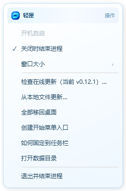
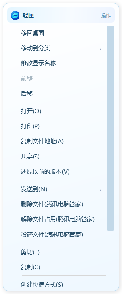

# 任务栏图标与菜单修复

用户反馈更新后任务栏图标未变，所有右键弹窗仍像旧版。核对日常程序已运行 0.12.0，55 项内容和分类保留；旧任务栏快捷方式继续引用同路径 EXE 的图标，安装登记显示名/版本也未随 EXE 更新同步。

新版在启动后的空闲阶段刷新已属于本程序的入口：复制版本化 ICO，更新图标路径及应用显示资源，通知 Shell 刷新；保持原目标、参数、工作目录、快捷方式文件名和固定顺序。仅在安装登记路径匹配当前 EXE 时同步显示名、图标和版本。旧数据文件不参与迁移。

所有应用内上下文菜单增加蓝青品牌标题区和渐变面板，保持尺寸限制与原生 DPI 清晰度。Windows 任务栏原生跳转列表保持系统绘制，同步应用图标和标识，不接管 Explorer 的系统菜单。

验证：37 项隔离原生检查通过，涵盖菜单在 80%、100%、150% 及自由尺寸下的边界、文字排版与滚动。新增固定入口测试保护目标、参数、原路径和无关快捷方式。真实固定入口已先行改为版本化 ICO，收纳配置与偏好哈希未变化；元数据与旧固定入口已在同盘加密目录备份。
