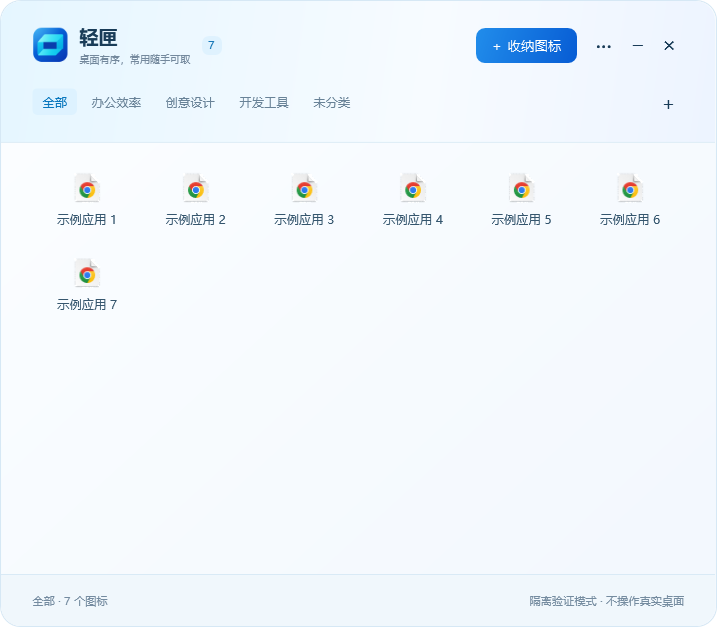
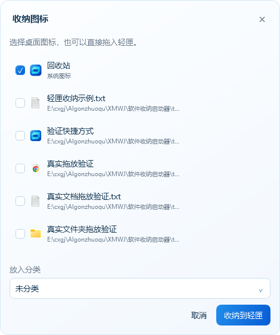
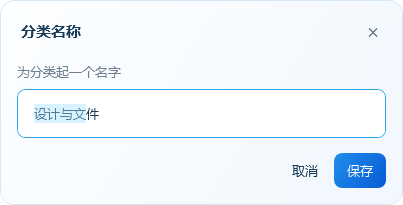
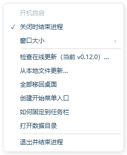

# 轻匣品牌与界面落地

用户已确认显示名称为轻匣，并要求替换正式图标、统一内部 UI。此次将 A2 折角方向实现为可维护矢量资源，而非使用带白色预览背景的生成图片。

主面板采用浅蓝青背景、深蓝文字和蓝色渐变主按钮，保持现有窗口尺寸、分类标签及六列布局。图标由矢量独立生成 16、20、24、32、40、48、64、96、128、256 像素 ICO，并生成面板 PNG。

编辑、勾选项、分类下拉、右键菜单和更新弹窗统一颜色、圆角与焦点状态。去掉编辑和收纳弹窗的整体缩放，让文字按屏幕像素排版。截图使用隔离演示数据，并非用户实际分类。

兼容策略：显示名、快捷方式、界面文案改为轻匣；保留 DesktopNook 的程序集、AUMID、数据目录、注册表键和下载资产名。安装器 ProductName 与内部卸载文件名沿用旧标识，保证 0.11.x 更新器仍可验证新包。安装显示名和文件说明为轻匣。开始菜单只迁移目标为当前 EXE 的旧快捷方式。

验证通过：核心 42 项、原生 37 项（包括新图标尺寸、旧更新标识、快捷方式迁移、分类可见名称与新控件交互）、自启与关闭行为、隔离安装/覆盖升级/卸载恢复。覆盖升级保留分类与偏好文件哈希，卸载恢复 11 个隔离测试文件。

未直接覆盖日常运行的安装版；正式包按源码先推送、产物后构建并发布的既定流程交付，用户可在软件内确认更新。
